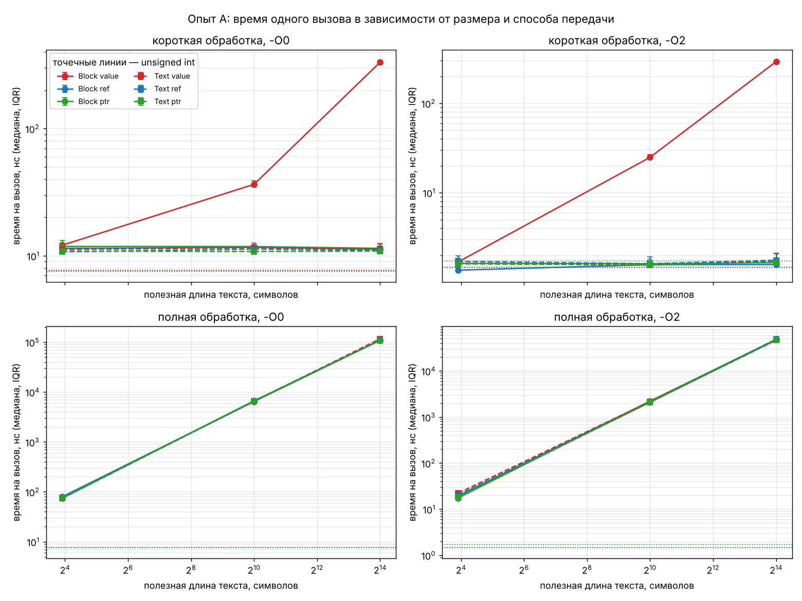
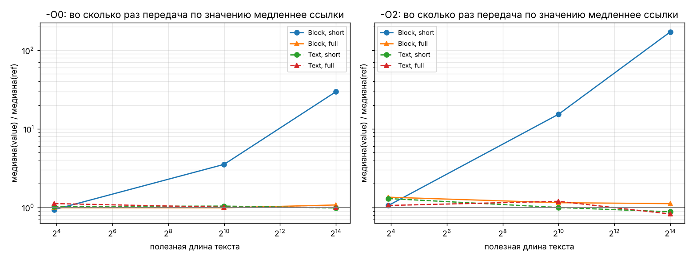
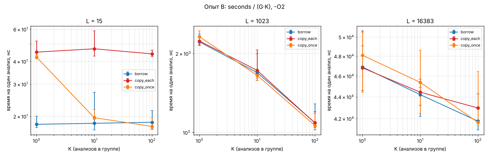
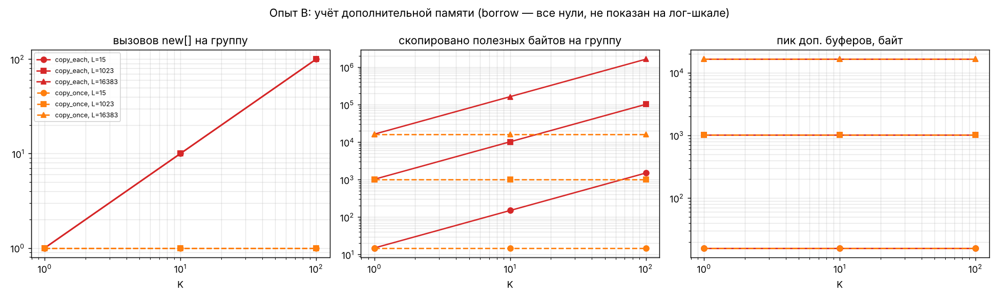

# Отчёт. Лабораторная 3: строки — цена передачи и копирования

Платформа, сборка и параметры запуска — в [README.md](README.md). Все числа ниже получены на одной машине
(виртуальная машина, Intel Xeon 2.8 ГГц, 2 vCPU, g++ 13.3, Linux) и описывают только её.
Исходные времена — `data/A_*.csv` и `data/B_O2.csv`; медианы и квартили — `data/summary_*.csv`.
Каждое объяснение причин проверено отдельным опытом или по ассемблеру; где именно — указано рядом (раздел «Контрольные опыты»).

## Что реализовано

* `Block { char data[N]; }` — символы внутри объекта, последний байт `\0`, полезная длина N − 1.
* `Text { const char* data; size_t size; }` — описатель чужого текста. Владельцы: `std::vector<std::string>` или
  `std::vector<Block>` в опыте A, `std::unique_ptr<char[]>` в опыте B; `Text` ничего не освобождает.
* Для каждого способа хранения — короткий обработчик (код первого байта) и полный (за один проход: число слов
  и сумма кодов как `unsigned long long`), каждый в трёх вариантах: `T`, `const T&`, `const T*`.
  Все девять вариантов вызывают одно и то же ядро `full_pass`/`first_byte`, так что работа одинаковая.
* `clone_text(Text)` — `new char[size+1]`, `memcpy`, `\0`; владелец копии — вызывающий код, `delete[]` один раз.
* Корректность (`tests.cpp`, 161 проверка для каждого BLOCK_SIZE, плюс прогон под ASan/UBSan): пустой текст,
  один символ, только разделители, табуляции, пунктуация, "one two" → 2 слова и сумма 700, строка 100 000 символов,
  совпадение всех способов передачи и копии, неизменность входа, независимость копии (источник меняется — описатель
  видит изменение, копия нет), чтение LF/CRLF.


## Методика (общая для A и B)

* Таймер `std::chrono::steady_clock` вокруг серии из G вызовов; G подбирается удвоением, пока серия не займёт
  ≥ 100 мс, и затем фиксируется для всех вариантов условия (столбец `repeats`).
* 8 разных входов каждой длины (генератор, seed 20261023), вызовы чередуют их по кругу индексом `g & 7`
  (без деления в цикле: в первой версии `g % M` компилировался в `div`, который сам стоил ~20 тактов
  и маскировал разницу между вариантами).
* Внутренний цикл серии инстанцирован шаблоном для каждой лямбды, поэтому косвенный вызов `std::function`
  происходит один раз на серию, а не на каждый исследуемый вызов.
* Прогрев, затем 15 замеров каждого условия; порядок вариантов перемешивается в каждом замере.
  Сравниваем медианы, разброс — межквартильный размах (IQR), в таблицах в % от медианы.
* Сумма результатов серии сохраняется после таймера и сверяется между вариантами (иначе программа
  останавливается); каждый результат отдельно проверяется до замеров.
* Объявления в `text.h`, определения в `text.cpp`, вызовы в `main.cpp`, без `-flto`: компилятор не видит тела
  обработчиков в месте вызова и не может встроить их или выбросить передачу.
* **Сборка с `-Wa,-mbranches-within-32B-boundaries`.** Процессор машины (Intel, модель 85 — Skylake-SP /
  Cascade Lake) подвержен ошибке JCC: цикл, у которого условный переход касается 32-байтной границы,
  исполняется заметно медленнее. Без флага скорость одинакового машинного кода зависела от того, куда он
  случайно лёг в памяти, — в контрольном опыте до 2.4 раза (раздел «Контрольные опыты», п. 1). Флаг заставляет
  ассемблер отодвигать переходы от границ; семантику программы он не меняет. Все таблицы и графики ниже — из
  сборки с этим флагом. Первые прогоны без флага давали IQR 20–70 % и «случайные» 10–20 % между
  ссылкой и указателем; с флагом IQR в основном 5–15 %.

## Опыт A: размер объекта и способ передачи

### Гипотезы (до измерений)

1. `unsigned int` — 4 байта, передаётся в регистре; ссылка и указатель — 8-байтный адрес в регистре плюс
   одно чтение из памяти. Разница между тремя способами — доли наносекунды, на фоне вызова не видна.
2. `Block` по значению семантически копирует весь массив, поэтому цена вызова растёт ~ линейно с N:
   для 16 байт незаметна, для 16 КБ — сотни наносекунд. `const Block&` и `const Block*` передают 8-байтный
   адрес и от N не зависят.
3. `Text` по значению копирует 16-байтный описатель (адрес + длина) — от длины текста не зависит.
   Все три способа передачи `Text` примерно равны.
4. Для полного прохода цена передачи остаётся той же в абсолютных единицах, но её доля мала:
   проход по N байтам сам стоит O(N), и копирование N байт (быстрый `memcpy`) — небольшая добавка.
5. Ссылка и указатель компилируются в одинаковый машинный код (в ABI ссылка — это адрес),
   воспроизводимой разницы между ними нет.
6. С `-O2` всё быстрее, но копирование Block по значению не исчезнет: тело функции в другой единице трансляции,
   и вызывающий код обязан подготовить копию по ABI.

### Что хранится в параметре и создаются ли динамические массивы

| Параметр | Что лежит в параметре | Размер (байт, x86-64) |
|---|---|---:|
| `unsigned int` | само число (регистр) | 4 |
| `const unsigned int&`, `const unsigned int*` | адрес числа | 8 |
| `Block` по значению | **копия всего массива** (N байт) | 16 / 1024 / 16384 |
| `const Block&`, `const Block*` | адрес исходного Block | 8 |
| `Text` по значению | копия описателя: адрес символов + длина | 16 при любой длине |
| `const Text&`, `const Text*` | адрес описателя | 8 |

`sizeof(Text)` = 16 во всех сборках при длинах 15, 1023, 16383 (`data/sizes_*.csv`), `sizeof(Block)` = N.
В опыте A программа не создаёт ни одного динамического массива: все `Block` и строки подготовлены до замеров,
а копия `Block` при передаче по значению создаётся в стеке вызывающей функции. Передача `Text` по значению
копирует только описатель, символы остаются у владельца — поэтому она не делает строку независимой
(если владелец исчезнет, копия описателя будет висячей, как и оригинал).

### Результаты

Время на один вызов, медиана 15 замеров; в скобках IQR в % от медианы; `value/ref` — отношение медиан.





**Короткая обработка (первый байт):**

| объект | длина | сборка | value | ref | ptr | value/ref |
|---|---:|---|---:|---:|---:|---:|
| scalar | 0 | -O0 | 7.70 нс (11%) | 7.56 нс (4%) | 7.58 нс (8%) | 1.02 |
| scalar | 0 | -O2 | 1.45 нс (45%) | 1.47 нс (37%) | 1.73 нс (23%) | 0.99 |
| Block | 15 | -O0 | 12.11 нс (8%) | 11.44 нс (8%) | 11.86 нс (17%) | 1.06 |
| Block | 15 | -O2 | 1.68 нс (15%) | 1.36 нс (9%) | 1.62 нс (13%) | 1.23 |
| Block | 1023 | -O0 | 36.47 нс (11%) | 11.65 нс (11%) | 11.84 нс (8%) | 3.13 |
| Block | 1023 | -O2 | 24.84 нс (9%) | 1.57 нс (24%) | 1.60 нс (9%) | 15.84 |
| Block | 16383 | -O0 | 332.90 нс (7%) | 11.23 нс (6%) | 11.46 нс (10%) | 29.64 |
| Block | 16383 | -O2 | 291.60 нс (6%) | 1.57 нс (16%) | 1.65 нс (35%) | 185.73 |
| Text | 15 | -O0 | 11.22 нс (14%) | 10.75 нс (9%) | 10.88 нс (3%) | 1.04 |
| Text | 15 | -O2 | 1.61 нс (9%) | 1.71 нс (24%) | 1.60 нс (12%) | 0.94 |
| Text | 1023 | -O0 | 11.59 нс (12%) | 11.31 нс (11%) | 10.82 нс (12%) | 1.02 |
| Text | 1023 | -O2 | 1.55 нс (9%) | 1.61 нс (8%) | 1.56 нс (16%) | 0.96 |
| Text | 16383 | -O0 | 11.31 нс (14%) | 11.00 нс (13%) | 10.89 нс (11%) | 1.03 |
| Text | 16383 | -O2 | 1.73 нс (27%) | 1.76 нс (22%) | 1.66 нс (14%) | 0.98 |

**Полная обработка (слова + сумма):**

| объект | длина | сборка | value | ref | ptr | value/ref |
|---|---:|---|---:|---:|---:|---:|
| Block | 15 | -O0 | 78.99 нс (8%) | 79.12 нс (15%) | 74.29 нс (16%) | 1.00 |
| Block | 15 | -O2 | 19.04 нс (16%) | 19.48 нс (9%) | 17.37 нс (11%) | 0.98 |
| Block | 1023 | -O0 | 6.47 мкс (4%) | 6.50 мкс (8%) | 6.68 мкс (10%) | 0.99 |
| Block | 1023 | -O2 | 2.09 мкс (12%) | 2.19 мкс (5%) | 2.21 мкс (5%) | 0.95 |
| Block | 16383 | -O0 | 109.50 мкс (15%) | 108.70 мкс (4%) | 109.40 мкс (6%) | 1.01 |
| Block | 16383 | -O2 | 47.24 мкс (7%) | 47.85 мкс (7%) | 47.61 мкс (5%) | 0.99 |
| Text | 15 | -O0 | 74.80 нс (6%) | 73.87 нс (6%) | 76.27 нс (13%) | 1.01 |
| Text | 15 | -O2 | 22.17 нс (9%) | 20.19 нс (10%) | 18.27 нс (5%) | 1.10 |
| Text | 1023 | -O0 | 6.53 мкс (10%) | 6.58 мкс (12%) | 6.56 мкс (13%) | 0.99 |
| Text | 1023 | -O2 | 2.16 мкс (7%) | 2.08 мкс (11%) | 2.08 мкс (8%) | 1.04 |
| Text | 16383 | -O0 | 116.60 мкс (7%) | 110.20 мкс (16%) | 108.70 мкс (2%) | 1.06 |
| Text | 16383 | -O2 | 46.91 мкс (20%) | 48.79 мкс (11%) | 46.07 мкс (14%) | 0.96 |

### Наблюдения (измерено)

* **Скаляр**: ~7.6 нс на вызов в `-O0` и ~1.5 нс в `-O2`, три способа совпадают в пределах разброса.
* **Block, короткая работа**: при 16 байтах способы неразличимы. При 1 КБ по значению в 3.1 раза медленнее
  ссылки в `-O0` (36 против 12 нс) и в 16 раз в `-O2` (25 против 1.6 нс). При 16 КБ — в 30 раз (`-O0`, 333 нс)
  и в 186 раз (`-O2`, 292 нс против 1.6 нс). Ссылка и указатель от размера не зависят.
* **Text, короткая работа**: все три способа и все три длины — 10.8–11.6 нс (`-O0`) и 1.5–1.8 нс (`-O2`), то есть
  на уровне скаляра. Длина текста не влияет, потому что в функцию попадают 16 байт описателя.
* **Полная работа**: время растёт линейно с длиной — около 2.0 нс на байт при L = 1023 и 2.9 нс при L = 16383
  в `-O2`, 6.3–7.1 нс в `-O0`. Все три способа передачи — и для Block, и для Text — совпадают в пределах ±10 %
  при IQR 5–15 %. Исключение — Text из 15 символов в `-O2` (весь вызов 18–22 нс): по значению на 4 нс медленнее,
  чем по указателю. Здесь различается сам код функции (описатель приходит в двух регистрах, а не по адресу),
  и при такой короткой работе это заметно. Для Block 16 КБ в `-O2`: value 47.2 мкс, ref 47.9 мкс — разницы нет.
* **Ссылка против указателя**: `ptr/ref` во всех 26 условиях от 0.89 до 1.19, в 22 из них — в пределах ±6 %;
  отклонения больше есть только там, где весь вызов занимает 1.5–20 нс и IQR сам 9–45 %.
  Воспроизводимой разницы нет.
* **-O0 против -O2**: `-O2` ускоряет всё в 2.3–7.4 раза, кроме передачи Block 16 КБ по значению (333 → 292 нс):
  копирование 16 КБ оптимизатор ускорить почти не может, и в `-O2` оно никуда не исчезло.

### Объяснение

* **Что именно копируется (проверено по ассемблеру, `./asm_check.sh`, файлы `asm/`).** При `-O2` вызывающий код
  перед `block_*_val` копирует массив: для 1 КБ — `rep movsq` (128 восьмибайтовых слов), для 16 КБ — вызов
  `memcpy`, а Block из 16 байт передаётся прямо в двух регистрах (`rdi`, `rsi`) по правилам System V ABI. Сами
  `block_full_ref` и `block_full_ptr` скомпилированы в идентичный код; `block_full_val` отличается только
  тем, что читает данные со стека (`rsp + 8`), а не по адресу из `rdi`. Вся разница — копирование до вызова.
* **Цена передачи и её доля.** Разность value − ref в короткой работе и есть цена копии: ≈ 23 нс за 1 КБ
  и ≈ 290 нс за 16 КБ в `-O2`, то есть 45–55 ГБ/с, ≈ 0.02 нс на байт (копирование внутри кэша). Полный проход
  стоит 2–3 нс на байт, в 100–150 раз дороже копирования: 290 нс — это 0.6 % от 47 мкс.
  Такую долю серия из 15 замеров с IQR 7 % обнаружить не может, и таблица действительно разницы не показывает.
  Цена передачи заметна, только когда полезная работа мала по сравнению с размером объекта.
* **Почему полный проход такой медленный — 2–3 нс на байт (проверено, контрольный опыт 2).** На тексте без
  разделителей тот же код стоит 0.93 нс/байт, а вариант без условных переходов — 1.3–1.4 нс/байт на любом
  тексте. Значит, на случайном тексте 1–2 нс на каждый байт уходят на неверно предсказанные переходы:
  пробелы стоят случайно (~18 % символов), и предсказатель часто ошибается.
* **Тенденции Block и Text разные** потому, что в параметре Text всегда 16 байт, а в параметре Block — N байт.
* **Ссылка и указатель — один и тот же машинный код (проверено).** `asm_check.sh` сравнивает тела функций без
  адресов: во всех трёх сборках `-O2` пары `*_ref`/`*_ptr` совпадают инструкция в инструкцию; в месте вызова
  в обоих случаях в `rdi` кладётся адрес. Поэтому разница могла бы появиться только от расположения кода
  в памяти, и именно её мы нашли в первых прогонах (контрольный опыт 1).
* Оговорка: семантическая копия не обязана быть физической. Здесь она сохранилась (видно в ассемблере),
  потому что тела функций в другой единице трансляции; с LTO или встраиванием компилятор мог бы передать адрес
  и не копировать.

## Опыт B: независимая копия и повторное использование

### Гипотезы

1. Цена одной копии ≈ `new[]` + `memcpy(L)` + `delete[]`. Для L = 15 это порядка 20 нс — сравнимо с анализом
   (~25 нс), поэтому `copy_each` будет примерно в 2 раза медленнее `borrow`.
2. Для больших L анализ (≈ 2.5 нс/байт) намного дороже копирования (`memcpy` ≪ 1 нс/байт), и разница между
   режимами исчезнет в шуме.
3. `copy_once` амортизирует копию на K анализов: накладные на один анализ ≈ цена копии / K, при K = 100
   неотличимы от `borrow`. При K = 1 `copy_once` и `copy_each` совпадают по определению.
4. Счётчики (выводим до прогона):
   * `borrow`: 0, 0, 0;
   * `copy_each`: allocations = G·K, copied_bytes = G·K·L, peak = L + 1;
   * `copy_once`: allocations = G, copied_bytes = G·L, peak = L + 1.
   Пик не зависит ни от G, ни от K: в каждый момент жива не больше чем одна копия.

### Результаты

Время на один анализ = seconds / (G·K), медиана 15 замеров (IQR в %):



| L | K | borrow | copy_each | copy_once | copy_each/borrow | copy_once/borrow | (copy_each−borrow), нс |
|---:|---:|---:|---:|---:|---:|---:|---:|
| 15 | 1 | 18.06 нс (15%) | 44.92 нс (18%) | 42.21 нс (7%) | 2.49 | 2.34 | 26.9 |
| 15 | 10 | 18.30 нс (56%) | 46.85 нс (34%) | 19.65 нс (13%) | 2.56 | 1.07 | 28.6 |
| 15 | 100 | 18.54 нс (25%) | 43.94 нс (8%) | 17.59 нс (14%) | 2.37 | 0.95 | 25.4 |
| 1023 | 1 | 2.21 мкс (10%) | 2.23 мкс (7%) | 2.31 мкс (10%) | 1.01 | 1.05 | 16.0 |
| 1023 | 10 | 1.69 мкс (25%) | 1.72 мкс (26%) | 1.65 мкс (9%) | 1.02 | 0.98 | 33.0 |
| 1023 | 100 | 1.09 мкс (24%) | 1.08 мкс (15%) | 1.06 мкс (15%) | 1.00 | 0.98 | -3.0 |
| 16383 | 1 | 46.89 мкс (10%) | 46.81 мкс (13%) | 48.09 мкс (13%) | 1.00 | 1.03 | -80.0 |
| 16383 | 10 | 44.20 мкс (8%) | 44.43 мкс (4%) | 45.37 мкс (14%) | 1.01 | 1.03 | 230.0 |
| 16383 | 100 | 41.76 мкс (4%) | 42.96 мкс (6%) | 41.65 мкс (12%) | 1.03 | 1.00 | 1200.0 |

Счётчики памяти (`data/B_counters.csv`; рядом с предсказанием — `data/B_counters_check.csv`, совпали все 27 строк):

| L | G | K | режим | new[] | скопировано байт | пик, байт |
|---:|---:|---:|---|---:|---:|---:|
| 15 | 4194304 | 1 | borrow | 0 | 0 | 0 |
| 15 | 4194304 | 1 | copy_each | 4 194 304 | 62 914 560 | 16 |
| 15 | 4194304 | 1 | copy_once | 4 194 304 | 62 914 560 | 16 |
| 15 | 262144 | 10 | borrow | 0 | 0 | 0 |
| 15 | 262144 | 10 | copy_each | 2 621 440 | 39 321 600 | 16 |
| 15 | 262144 | 10 | copy_once | 262 144 | 3 932 160 | 16 |
| 15 | 32768 | 100 | borrow | 0 | 0 | 0 |
| 15 | 32768 | 100 | copy_each | 3 276 800 | 49 152 000 | 16 |
| 15 | 32768 | 100 | copy_once | 32 768 | 491 520 | 16 |
| 1023 | 65536 | 1 | borrow | 0 | 0 | 0 |
| 1023 | 65536 | 1 | copy_each | 65 536 | 67 043 328 | 1 024 |
| 1023 | 65536 | 1 | copy_once | 65 536 | 67 043 328 | 1 024 |
| 1023 | 8192 | 10 | borrow | 0 | 0 | 0 |
| 1023 | 8192 | 10 | copy_each | 81 920 | 83 804 160 | 1 024 |
| 1023 | 8192 | 10 | copy_once | 8 192 | 8 380 416 | 1 024 |
| 1023 | 1024 | 100 | borrow | 0 | 0 | 0 |
| 1023 | 1024 | 100 | copy_each | 102 400 | 104 755 200 | 1 024 |
| 1023 | 1024 | 100 | copy_once | 1 024 | 1 047 552 | 1 024 |
| 16383 | 4096 | 1 | borrow | 0 | 0 | 0 |
| 16383 | 4096 | 1 | copy_each | 4 096 | 67 104 768 | 16 384 |
| 16383 | 4096 | 1 | copy_once | 4 096 | 67 104 768 | 16 384 |
| 16383 | 256 | 10 | borrow | 0 | 0 | 0 |
| 16383 | 256 | 10 | copy_each | 2 560 | 41 940 480 | 16 384 |
| 16383 | 256 | 10 | copy_once | 256 | 4 194 048 | 16 384 |
| 16383 | 32 | 100 | borrow | 0 | 0 | 0 |
| 16383 | 32 | 100 | copy_each | 3 200 | 52 425 600 | 16 384 |
| 16383 | 32 | 100 | copy_once | 32 | 524 256 | 16 384 |



### Наблюдения (измерено)

* **L = 15**: `copy_each` стабильно в 2.4–2.6 раза медленнее `borrow` при любом K: копия добавляет ≈ 25–29 нс
  к ≈ 18 нс анализа. `copy_once` при K = 1 совпадает с `copy_each` (≈ 42–45 нс), при K = 10 — уже +7 % к `borrow`,
  при K = 100 неотличим от `borrow`.
* **L = 1023 и 16383**: все три режима совпадают в пределах 0–5 % при IQR 4–26 %. **Различие неразличимо на фоне
  разброса.** Ожидаемая добавка копии — ~25 нс на `new`/`delete` плюс ~0.02 нс на байт (по опыту A):
  ≈ 45 нс для 1 КБ (2 % от анализа) и ≈ 0.3 мкс для 16 КБ (0.7 %).
* Время на анализ падает с ростом K **во всех трёх режимах**, включая `borrow`: при L = 1023 с 2.2 до 1.1 мкс
  (вдвое), при L = 16383 с 46.9 до 41.8 мкс (на 11 %), при L = 15 не меняется.
* Счётчики совпали с формулами во всех строках. Например, для L = 1023, K = 100, G = 1024: у `copy_each`
  102 400 выделений и 104 755 200 перенесённых байтов, у `copy_once` — 1 024 и 1 047 552,
  а пик у обоих одинаковый — 1024 байта.

### Объяснение

* **Цена копии** почти не зависит от L, пока L мала: её определяют `new`/`delete` (~25 нс), а `memcpy` 1 КБ
  добавляет ещё ~20 нс. Её **доля** определяется отношением «цена копии / цена анализа»: для 15 символов
  это больше 1:1, для 1 КБ уже ~1:50, для 16 КБ ~1:150 — наш анализ (2–3 нс на байт) на два порядка медленнее
  `memcpy` (~0.02 нс на байт).
* `copy_once` заметно выгоднее `copy_each`, когда копия сравнима с анализом (малые L) и K ≥ 10: накладные
  делятся на K. При больших L выигрыш есть в абсолютных наносекундах, но не виден на фоне шума.
* **Падение времени с ростом K — это предсказатель переходов (проверено, контрольный опыт 2).** При K = 100 одна
  и та же строка анализируется 100 раз подряд, при K = 1 строки меняются на каждом анализе. В контрольном опыте
  повторный анализ одной строки длины 1023 стоит 1.09 нс/байт против 1.92 нс/байт для восьми строк по кругу —
  почти как текст без разделителей (0.93). Это ровно значения опыта B: 1.09 мкс при K = 100 и 2.2 мкс при K = 1.
  Для 16383 символов последовательность переходов слишком длинная, чтобы её запомнить: 2.42 против 2.71 нс/байт,
  отсюда и всего 11 % в опыте B. У варианта без условных переходов разницы нет (1.39 против 1.39 нс/байт),
  что исключает объяснения через кэш данных.
* **Объём копирования и пик памяти — разные вещи.** `copied_bytes` суммирует все копии за опыт и растёт как
  G·K·L, а пик — максимум одновременно живых буферов. В `copy_each` копия освобождается сразу после анализа,
  поэтому в каждый момент жива одна копия: пик = L + 1 байт, хотя перенесены десятки мегабайт. Пик вырос бы,
  только если бы копии накапливались (например, сохранялись в контейнер).
* Сравнение показывает цену **получения независимости** данных. `borrow` быстрее, но только пока жив источник;
  после уничтожения источника заимствованный `Text` использовать нельзя, и никакая скорость этого не компенсирует.

## Контрольные опыты

### 1. Ссылка, указатель и ошибка JCC (`control_ref_ptr.cpp`, `./run_control_ref_ptr.sh`)

`text_full_ref` и `text_full_ptr` имеют идентичный машинный код. Их замеряли поочерёдно по 15 раз на тексте
без разделителей (чтобы убрать шум неверных предсказаний) в обычной сборке `-O2` и в сборке с
`-Wa,-mbranches-within-32B-boundaries`, для каждого из трёх `BLOCK_SIZE` (он меняет расположение функций в `text.o`):

```
== BLOCK_SIZE=16, сборка: plain 
text_full_ref: медиана 0.958 нс/байт (адрес mod 64 = 16)
text_full_ptr: медиана 1.663 нс/байт (адрес mod 64 =  0)
ptr / ref = 1.736
== BLOCK_SIZE=16, сборка: jcc -Wa,-mbranches-within-32B-boundaries
text_full_ref: медиана 0.976 нс/байт (адрес mod 64 =  0)
text_full_ptr: медиана 0.985 нс/байт (адрес mod 64 = 48)
ptr / ref = 1.010
== BLOCK_SIZE=1024, сборка: plain 
text_full_ref: медиана 1.591 нс/байт (адрес mod 64 =  0)
text_full_ptr: медиана 0.652 нс/байт (адрес mod 64 = 48)
ptr / ref = 0.410
== BLOCK_SIZE=1024, сборка: jcc -Wa,-mbranches-within-32B-boundaries
text_full_ref: медиана 0.980 нс/байт (адрес mod 64 = 48)
text_full_ptr: медиана 1.001 нс/байт (адрес mod 64 = 48)
ptr / ref = 1.021
== BLOCK_SIZE=16384, сборка: plain 
text_full_ref: медиана 1.728 нс/байт (адрес mod 64 =  0)
text_full_ptr: медиана 0.722 нс/байт (адрес mod 64 = 48)
ptr / ref = 0.418
== BLOCK_SIZE=16384, сборка: jcc -Wa,-mbranches-within-32B-boundaries
text_full_ref: медиана 0.948 нс/байт (адрес mod 64 = 48)
text_full_ptr: медиана 0.957 нс/байт (адрес mod 64 = 48)
ptr / ref = 1.009
```

В обычной сборке одна из двух одинаковых функций в 1.7–2.4 раза медленнее другой, причём какая именно — зависит
от сборки. С флагом обе функции равны с точностью 1–2 %. Это и есть ошибка JCC: на процессорах Intel от Skylake
до Cascade Lake микрокод не кэширует в DSB (кэш декодированных инструкций) переход, касающийся 32-байтной
границы, и цикл с таким переходом исполняется через медленный декодер. Поэтому все замеры в отчёте сделаны
со включённым флагом.

### 2. Цена неверно предсказанных переходов (`control_branches.cpp`)

Нс на байт, минимум из 9 серий; сборка `-O2` с тем же флагом. «8 строк» — входы по кругу, как в опытах;
«одна строка» — одна и та же строка подряд, как при большом K в опыте B; «без ветвлений» — тот же подсчёт без
условных переходов внутри цикла (результаты совпадают с `text_full_ref`).

```
нс на байт (минимум из 9 серий)
      L | текст             | с ветвлениями | без ветвлений
     15 | случайный, 8 строк     |         1.317 |         1.362
     15 | случайный, одна строка |         1.337 |         1.389
     15 | без разделителей       |         1.256 |           —
   1023 | случайный, 8 строк     |         1.923 |         1.393
   1023 | случайный, одна строка |         1.086 |         1.389
   1023 | без разделителей       |         0.931 |           —
  16383 | случайный, 8 строк     |         2.706 |         1.302
  16383 | случайный, одна строка |         2.416 |         1.400
  16383 | без разделителей       |         0.918 |           —
```

Выводы: (1) на предсказуемом тексте проход в 2–3 раза быстрее, чем на случайном, — цена неверных предсказаний
1–1.8 нс на байт; (2) без ветвлений проход стоит 1.3–1.4 нс/байт на любом тексте и не зависит от повторов;
(3) повтор одной строки ускоряет проход только при ветвлениях и только пока строка короткая (1023 — почти до
предсказуемого уровня, 16383 — на 11 %). Для L = 15 время на байт определяется накладными вызова, а не циклом.

## Итоговые выводы

1. Цена передачи заметна, когда объект большой **и** передаётся по значению **и** полезная работа мала:
   Block 1 КБ — в 3–16 раз дороже ссылки, Block 16 КБ — в 30–186 раз. Для скаляра, `Text` любой длины
   и маленького Block способ передачи не влияет.
2. При полном проходе доля цены передачи падает до долей процента (копия 16 КБ — 0.3 мкс при работе 47 мкс)
   и не обнаруживается: работа на порядки дороже копирования.
3. Тенденции для Block и Text разные: у Block цена передачи по значению растёт с размером, у Text — нет,
   потому что `sizeof(Text)` = 16 при любой длине.
4. Воспроизводимой разницы между `const T&` и `const T*` нет: машинный код одинаков. Видимая разница в первых
   прогонах объяснялась ошибкой JCC процессора, то есть расположением кода, а не способом передачи.
5. Независимая копия стоит ~`new` + `memcpy` + `delete`. Если копировать перед каждым анализом, она более чем
   удваивает время для коротких строк; копирование один раз на K анализов делает её незаметной уже при K ≥ 10.
   Для строк от 1 КБ разница неразличима.
6. Суммарный объём копирований (G·K·L) и пик дополнительной памяти (L + 1) — независимые величины.
7. Методический вывод: на этой машине сравнение «одинакового» кода требует учитывать расположение циклов
   (ошибка JCC) и характер данных (предсказуемость переходов) — оба эффекта по величине превосходят изучаемые.

### Когда достаточно заимствования, а когда нужна копия

Заимствования (`const T&`, `const T*`, `Text`) достаточно, когда источник гарантированно живёт дольше
использования и не меняется во время него — например, функция только читает аргумент и ничего не
сохраняет. Собственная копия нужна, когда данные должны пережить источник (сохраняются в объекте,
передаются в другой поток, используются после возврата из функции) или когда источник может измениться,
а нужен снимок. В этом случае выгоднее копировать один раз и переиспользовать копию.
