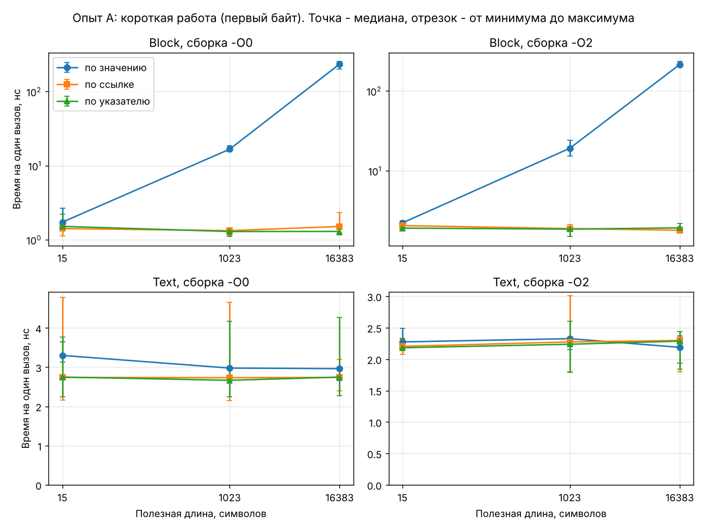
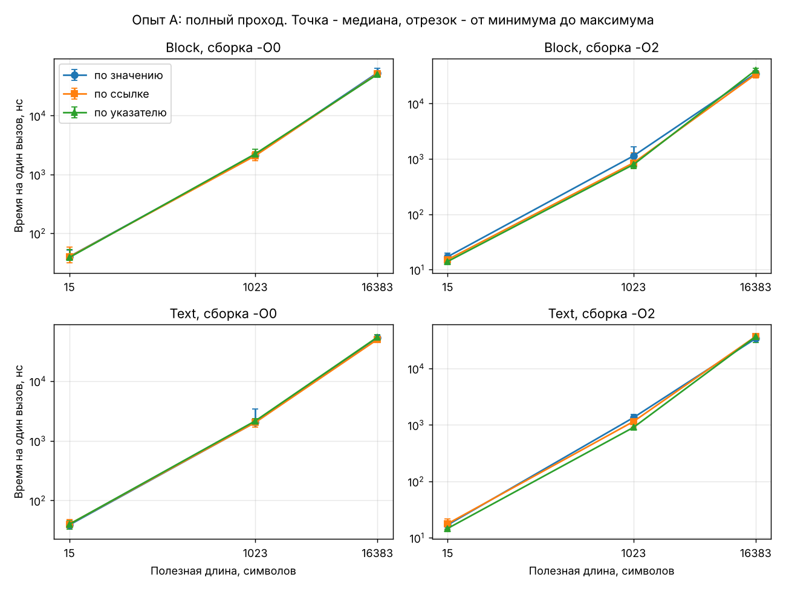
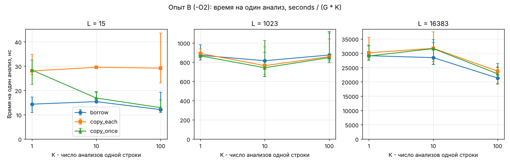

# Отчёт. Лабораторная 3: цена передачи и копирования строк

Вопрос работы: как размер и устройство данных, способ передачи в функцию и повторное использование текста
влияют на время и на дополнительную память.

Платформа, команды сборки и формат данных описаны в [README.md](README.md). Во всех таблицах время дано
в наносекундах на один вызов: сначала медиана семи измерений, в скобках минимум и максимум.

## 0. Что реализовано

- `Block` хранит символы внутри объекта, `Text` хранит только адрес и длину чужого текста.
- Короткий обработчик возвращает код первого байта, полный за один проход считает слова и сумму кодов.
- Каждый обработчик написан в трёх вариантах: параметр `T`, `const T&`, `const T*`.
- `clone_text` делает независимую копию через `new char[size + 1]`.

Проверки (`tests.cpp`, 33 штуки, все проходят для размеров блока 16, 1024 и 16384): пустой текст, один символ,
только разделители, несколько слов, табуляции, `"one two"` даёт 2 слова и сумму 700, строка из 100 000 символов
сверена с независимым подсчётом, обработчики не меняют исходные данные, все способы передачи дают одинаковый
результат, копия независима от источника.

## 1. Опыт A: размер объекта и способ передачи

### Гипотезы (до измерений)

1. Для `unsigned int` способ передачи не важен: копируется 4 байта либо адрес, это одинаково дёшево.
2. Для `Block` передача по значению стоит тем дороже, чем больше блок, потому что копируется весь массив.
   По ссылке и по указателю передаётся только адрес, время от размера блока не зависит.
3. Для `Text` способ передачи не важен при любой длине текста: `sizeof(Text)` всегда 16 байт.
4. При полном проходе цена копирования блока станет малой долей общего времени.
5. Ссылка и указатель не различаются: в обоих случаях в функцию приходит адрес.

### Короткая работа: вернуть первый байт

| Объект | Длина | Сборка | value | ref | ptr | value / ref |
|---|---|---|---|---|---|---|
| unsigned int | – | -O0 | 1.50 (1.18–2.28) | 1.54 (1.36–2.40) | 1.50 (1.47–2.20) | 0.97 |
| unsigned int | – | -O2 | 1.87 (1.71–1.96) | 1.92 (1.65–1.95) | 1.86 (1.64–2.09) | 0.98 |
| Block | 15 | -O0 | 1.73 (1.58–2.67) | 1.42 (1.13–1.62) | 1.52 (1.38–2.21) | 1.22 |
| Block | 15 | -O2 | 2.23 (2.18–2.38) | 2.06 (1.87–2.30) | 1.92 (1.83–1.96) | 1.08 |
| Block | 1023 | -O0 | 16.69 (15.48–18.74) | 1.33 (1.14–1.38) | 1.29 (1.10–1.41) | 12.57 |
| Block | 1023 | -O2 | 19.13 (15.23–24.16) | 1.89 (1.50–2.12) | 1.86 (1.50–1.97) | 10.13 |
| Block | 16383 | -O0 | 235 (202–255) | 1.51 (1.17–2.33) | 1.29 (1.17–1.55) | 155.56 |
| Block | 16383 | -O2 | 214 (209–234) | 1.80 (1.70–2.01) | 1.93 (1.78–2.20) | 118.91 |
| Text | 15 | -O0 | 3.30 (3.14–3.65) | 2.74 (2.17–4.78) | 2.75 (2.24–3.76) | 1.20 |
| Text | 15 | -O2 | 2.27 (2.21–2.49) | 2.20 (2.08–2.33) | 2.18 (2.15–2.33) | 1.03 |
| Text | 1023 | -O0 | 2.98 (2.80–3.01) | 2.73 (2.15–4.65) | 2.66 (2.24–4.17) | 1.09 |
| Text | 1023 | -O2 | 2.33 (2.15–2.35) | 2.27 (1.80–3.01) | 2.24 (1.79–2.61) | 1.02 |
| Text | 16383 | -O0 | 2.96 (2.66–3.01) | 2.74 (2.40–3.20) | 2.75 (2.27–4.27) | 1.08 |
| Text | 16383 | -O2 | 2.19 (1.93–2.37) | 2.30 (1.80–2.44) | 2.29 (1.84–2.44) | 0.95 |

Наблюдения (измеренные факты):

- **Скаляр.** Три способа дают 1.5 нс в сборке -O0 и 1.9 нс в -O2, различия меньше разброса. Гипотеза 1 подтверждена.
- **Block по значению.** Время растёт вместе с размером блока: 1.7 нс, 17 нс, 235 нс в -O0 и 2.2 нс, 19 нс, 214 нс в -O2.
  По ссылке и по указателю время остаётся 1.3–2 нс при любом размере. Блок из 1024 байт по значению
  передаётся в 10–13 раз дольше, чем по ссылке, блок из 16384 байт - в 120–155 раз дольше. Гипотеза 2 подтверждена.
- **Block из 16 байт.** По значению медиана выше на 0.2–0.3 нс (8–22 %). Это сравнимо с разбросом
  измерений, надёжным такое различие считать нельзя.
- **Text.** Время 2.2–3.3 нс и не зависит от длины текста: при 15 и при 16383 символах оно одинаковое.
  В -O2 три способа совпадают в пределах разброса. В -O0 передача по значению на 0.2–0.6 нс медленнее по медиане,
  но диапазоны перекрываются. Гипотеза 3 подтверждена.
- **Оптимизация.** Копирование большого блока при -O2 не исчезло: 214 нс против 235 нс. Короткие вызовы в -O2
  оказались не быстрее, а немного медленнее, чем в -O0 (1.9 нс против 1.5 нс у скаляра).

Объяснение:

- Параметр типа `Block` - это отдельный объект. Функция лежит в другом файле (`text.cpp`), компилятор при
  сборке `main.cpp` не видит её тела и обязан подготовить копию всех байтов блока. 235 нс на 16384 байта - это
  около 0.014 нс на байт, то есть порядка 70 ГБ/с. Это правдоподобная скорость копирования данных, которые
  лежат в кэше процессора.
- Параметр `const Block&` или `const Block*` хранит только адрес (8 байт). Сколько байтов лежит по этому адресу,
  для цены вызова не важно.
- Параметр типа `Text` - это копия описателя: адрес и длина, 16 байт. Символы не копируются, поэтому длина
  текста на время не влияет.
- Почему короткие вызовы в -O2 чуть медленнее, чем в -O0, я не выяснял. Предположение: влияет расположение
  машинного кода цикла в памяти. На выводы это не влияет, потому что варианты сравниваются внутри одной сборки.

### Полный проход: слова и сумма кодов

| Объект | Длина | Сборка | value | ref | ptr | value / ref |
|---|---|---|---|---|---|---|
| Block | 15 | -O0 | 39.94 (36.44–51.12) | 39.58 (31.01–57.43) | 38.56 (36.48–52.32) | 1.01 |
| Block | 15 | -O2 | 17.10 (16.28–19.99) | 15.17 (14.18–18.42) | 14.02 (13.12–16.71) | 1.13 |
| Block | 1023 | -O0 | 2132 (1910–2227) | 2073 (1719–2468) | 2235 (1911–2705) | 1.03 |
| Block | 1023 | -O2 | 1133 (939–1636) | 849 (672–1293) | 790 (660–1026) | 1.34 |
| Block | 16383 | -O0 | 53.4 тыс. (49.7 тыс.–63.7 тыс.) | 51.5 тыс. (47.8 тыс.–56.3 тыс.) | 50.2 тыс. (47.4 тыс.–54.8 тыс.) | 1.04 |
| Block | 16383 | -O2 | 34.9 тыс. (33.0 тыс.–39.0 тыс.) | 33.6 тыс. (28.9 тыс.–38.5 тыс.) | 40.0 тыс. (31.6 тыс.–43.1 тыс.) | 1.04 |
| Text | 15 | -O0 | 38.87 (37.46–45.04) | 40.09 (34.29–48.12) | 40.02 (33.19–45.44) | 0.97 |
| Text | 15 | -O2 | 16.82 (15.93–17.99) | 17.67 (16.94–21.67) | 14.56 (14.19–17.65) | 0.95 |
| Text | 1023 | -O0 | 2030 (1887–3384) | 2026 (1685–2321) | 2147 (1956–2322) | 1.00 |
| Text | 1023 | -O2 | 1346 (1117–1539) | 1146 (922–1176) | 902 (848–1300) | 1.17 |
| Text | 16383 | -O0 | 53.2 тыс. (47.9 тыс.–55.8 тыс.) | 49.6 тыс. (45.3 тыс.–60.4 тыс.) | 54.2 тыс. (50.6 тыс.–60.0 тыс.) | 1.07 |
| Text | 16383 | -O2 | 33.9 тыс. (32.1 тыс.–37.2 тыс.) | 36.9 тыс. (34.1 тыс.–40.1 тыс.) | 36.6 тыс. (29.1 тыс.–37.1 тыс.) | 0.92 |

Наблюдения:

- Время растёт вместе с длиной: около 2–3.3 нс на символ в -O0 и 0.8–2.4 нс на символ в -O2.
- Способ передачи на фоне разброса не различим ни для `Block`, ни для `Text`. Диапазоны трёх вариантов
  перекрываются во всех двенадцати условиях.
- У `Block` из 1024 байт в -O2 медиана по значению выше (1133 нс против 849 нс). Но у `Text` той же длины
  разница такая же (1346 нс против 1146 нс), хотя там символы не копируются вообще. Значит, это разброс
  измерений, а не цена копирования.
- Оптимизация ускоряет полный проход в 1.3–2.8 раза.

Объяснение: копирование блока стоит 17–19 нс для 1024 байт и 214–235 нс для 16384 байт (это измерено
в короткой работе). Полный проход по тем же блокам занимает 0.8–2 мкс и 34–53 мкс. Доля копирования
получается около 1–2 % и 0.5 %, что меньше разброса измерений в 10–20 %. Гипотеза 4 подтверждена.

### Ответы на вопросы опыта A

- **Когда заметна цена передачи?** Когда объект большой, передаётся по значению, а сама функция делает мало.
  Для блока из 16384 байт вызов «вернуть первый байт» стал дороже в 120–155 раз.
- **Как меняется её доля при полном проходе?** Падает до 0.5–2 % и перестаёт быть различимой: работа над
  каждым символом стоит на два порядка больше, чем его копирование.
- **Одинаковы ли тенденции для Block и Text?** Нет. У `Block` цена передачи по значению растёт с размером
  данных, у `Text` не меняется, потому что `sizeof(Text)` равен 16 при любой длине текста.
- **Есть ли воспроизводимая разница между ссылкой и указателем?** Не обнаружена. Знак разницы меняется от
  условия к условию, диапазоны перекрываются. Гипотеза 5 подтверждена.

### Что хранится в параметре (опыт A и память)

| Параметр | Что лежит в параметре | Новые динамические массивы |
|---|---|---|
| `unsigned int` | копия числа, 4 байта | нет |
| `Block` | копия всего массива, `sizeof(Block)` байт (16, 1024, 16384) | нет, копия временная и живёт до конца вызова |
| `const Block&`, `const Block*` | адрес исходного блока, 8 байт | нет |
| `Text` | копия адреса и длины, 16 байт | нет |
| `const Text&`, `const Text*` | адрес описателя, 8 байт | нет |

Ни один вариант опыта A не вызывает `new`. `sizeof` описывает размер объекта, но не говорит, сколько байтов
программа на самом деле переслала: в оптимизированной сборке компилятор вправе убрать часть копирований.
В этом опыте копирование большого блока по времени видно в обеих сборках.

## 2. Опыт B: независимая копия и повторное использование

Три режима для группы из K анализов одной строки длины L:

- `borrow`: K раз анализировать исходный текст;
- `copy_each`: перед каждым анализом сделать копию и сразу после анализа освободить её;
- `copy_once`: сделать одну копию, проанализировать её K раз, освободить.

Групп G, всего анализов G·K, это число одинаково у трёх режимов. Сборка -O2, полный обработчик.
В замер входят создание, заполнение и освобождение копий.

### Гипотезы (до измерений)

1. `copy_each` платит за копию при каждом анализе, поэтому его накладные расходы на один анализ от K не зависят.
2. `copy_once` платит за одну копию на K анализов: расходы на один анализ падают как 1/K, и при большом K
   режим сравняется с `borrow`.
3. При K = 1 режимы `copy_each` и `copy_once` делают одно и то же и должны совпасть.
4. Для длинных строк цена копии мала рядом с ценой анализа: копировать символ дешевле, чем разбирать его.

### Результаты

| L | K | borrow | copy_each | copy_once | copy_each / borrow | copy_once / borrow |
|---|---|---|---|---|---|---|
| 15 | 1 | 14.37 (10.93–17.24) | 28.03 (26.53–34.91) | 28.41 (22.45–32.51) | 1.95 | 1.98 |
| 15 | 10 | 15.40 (15.28–19.22) | 29.54 (29.46–29.86) | 16.89 (16.78–19.52) | 1.92 | 1.10 |
| 15 | 100 | 12.12 (10.82–19.32) | 29.20 (23.14–43.59) | 12.93 (11.47–16.03) | 2.41 | 1.07 |
| 1023 | 1 | 872 (823–980) | 891 (845–936) | 865 (852–903) | 1.02 | 0.99 |
| 1023 | 10 | 815 (648–903) | 765 (676–958) | 742 (654–1024) | 0.94 | 0.91 |
| 1023 | 100 | 875 (811–1120) | 857 (838–1042) | 847 (795–1105) | 0.98 | 0.97 |
| 16383 | 1 | 29.1 тыс. (27.9 тыс.–32.5 тыс.) | 30.1 тыс. (27.5 тыс.–35.6 тыс.) | 29.0 тыс. (27.5 тыс.–32.9 тыс.) | 1.03 | 1.00 |
| 16383 | 10 | 28.5 тыс. (26.0 тыс.–33.7 тыс.) | 31.7 тыс. (27.0 тыс.–37.5 тыс.) | 31.6 тыс. (26.1 тыс.–34.7 тыс.) | 1.11 | 1.11 |
| 16383 | 100 | 21.3 тыс. (19.2 тыс.–25.2 тыс.) | 23.7 тыс. (19.5 тыс.–25.0 тыс.) | 22.8 тыс. (19.2 тыс.–26.4 тыс.) | 1.11 | 1.07 |

Наблюдения:

- **L = 15.** Анализ исходной строки стоит 12–15 нс. `copy_each` стоит 28–30 нс при любом K, то есть копия
  добавляет около 14–15 нс и удваивает время. `copy_once` при K = 1 совпадает с `copy_each` (28 нс), при K = 10
  стоит 16.9 нс, при K = 100 стоит 12.9 нс и почти не отличается от `borrow`. Гипотезы 1, 2 и 3 подтверждены.
- **L = 1023 и L = 16383.** Три режима не различаются на фоне разброса: отношения к `borrow` лежат от 0.91
  до 1.11, диапазоны перекрываются. Гипотеза 4 подтверждена.
- При L = 16383 и K = 100 время на анализ у всех трёх режимов ниже (21–24 мкс против 28–32 мкс при K = 1 и 10).
  Это касается и `borrow`, поэтому с копированием не связано.

Объяснение:

- Накладная стоимость копии на один анализ равна C(L) в режиме `copy_each` и C(L) / K в режиме `copy_once`,
  где C(L) - цена одного вызова `new[]`, переноса L символов и `delete[]`. Для L = 15 измерено C ≈ 14 нс.
  Проверка формулы: при K = 10 ожидается 15.4 + 14 / 10 ≈ 16.8 нс, измерено 16.9 нс.
- Для короткой строки C почти целиком состоит из цены выделения и освобождения памяти, а не переноса 15 байт.
  Поэтому относительная цена копии для коротких строк самая большая.
- Для длинной строки перенос символа стоит около 0.014 нс (измерено в опыте A), а его анализ 1–2 нс.
  Копия добавляет порядка 1 % и теряется в разбросе.
- Почему при L = 16383 и K = 100 анализ идёт быстрее, я не проверял. Предположение: одна и та же строка
  анализируется 100 раз подряд, и процессор лучше предсказывает переходы в цикле на уже знакомых данных.

### Ответы на вопросы опыта B

- **Как накладная стоимость зависит от длины и K?** В абсолютных числах она растёт с длиной, но относительно
  анализа падает: для 15 символов копия удваивает время, для 1023 и 16383 символов она неразличима.
  От K зависит только `copy_once`: его накладные расходы на анализ убывают как 1/K.
- **Когда копирование один раз заметно выгоднее копирования перед каждым вызовом?** Когда строка короткая
  и используется много раз. При L = 15 и K = 100 `copy_once` в 2.3 раза быстрее `copy_each`. При K = 1 разницы
  нет. Для длинных строк разница по времени не обнаружена, но по числу выделений и перенесённых байтов
  `copy_once` выгоднее в K раз (см. следующий раздел).
- **Какова цена независимой копии относительно обработки исходного текста?** Для 15 символов около 100 %
  времени анализа, для 1023 и 16383 символов меньше разброса измерений (не больше нескольких процентов).

## 3. Память

Отдельным проходом той же последовательности действий программа считает: вызовы `new[]` для копий,
скопированные полезные байты (без терминаторов) и максимум одновременно выделенных под копии элементов `char`
(с терминаторами). Счётчики меняются в момент настоящего выделения и освобождения (`counted_clone`,
`counted_release` в `main.cpp`). Во временном прогоне счётчиков нет. Исходные строки, служебные данные
распределителя памяти и стек не учитываются, так что это не полная память процесса.

### Прогноз (до подсчёта)

| Режим | Вызовов `new[]` | Скопировано байтов | Пик дополнительной памяти |
|---|---|---|---|
| `borrow` | 0 | 0 | 0 |
| `copy_each` | G·K | G·K·L | L + 1 |
| `copy_once` | G | G·L | L + 1 |

### Факт

Для `borrow` все счётчики равны нулю. Остальное:

| L | K | G | режим | new[] | скопировано байтов | пик, char |
|---|---|---|---|---|---|---|
| 15 | 1 | 4000000 | copy_each | 4000000 | 60000000 | 16 |
| 15 | 1 | 4000000 | copy_once | 4000000 | 60000000 | 16 |
| 15 | 10 | 400000 | copy_each | 4000000 | 60000000 | 16 |
| 15 | 10 | 400000 | copy_once | 400000 | 6000000 | 16 |
| 15 | 100 | 40000 | copy_each | 4000000 | 60000000 | 16 |
| 15 | 100 | 40000 | copy_once | 40000 | 600000 | 16 |
| 1023 | 1 | 200000 | copy_each | 200000 | 204600000 | 1024 |
| 1023 | 1 | 200000 | copy_once | 200000 | 204600000 | 1024 |
| 1023 | 10 | 20000 | copy_each | 200000 | 204600000 | 1024 |
| 1023 | 10 | 20000 | copy_once | 20000 | 20460000 | 1024 |
| 1023 | 100 | 2000 | copy_each | 200000 | 204600000 | 1024 |
| 1023 | 100 | 2000 | copy_once | 2000 | 2046000 | 1024 |
| 16383 | 1 | 10000 | copy_each | 10000 | 163830000 | 16384 |
| 16383 | 1 | 10000 | copy_once | 10000 | 163830000 | 16384 |
| 16383 | 10 | 1000 | copy_each | 10000 | 163830000 | 16384 |
| 16383 | 10 | 1000 | copy_once | 1000 | 16383000 | 16384 |
| 16383 | 100 | 100 | copy_each | 10000 | 163830000 | 16384 |
| 16383 | 100 | 100 | copy_once | 100 | 1638300 | 16384 |

Все 27 строк `data/B_memory.csv` совпали с прогнозом; программа сама сравнивает счётчики с формулами и
сообщает о расхождении. График тех же чисел: [plots/B_memory.png](plots/B_memory.png).

**Почему большое число перенесённых байтов не означает большой пик памяти.** Пример: L = 1023, `copy_each`.
Всего перенесено 204.6 МБ, а пик равен 1024 байтам. Каждая копия освобождается до того, как создаётся следующая,
поэтому одновременно существует только один буфер. Сумма копирований показывает, сколько работы сделано
за всё время, а пик показывает, сколько памяти было занято в один момент.

## 4. Выводы

1. Передача по значению копирует объект целиком. Для маленьких объектов (`unsigned int`, 16-байтовый `Text`)
   это не дороже передачи адреса. Для большого `Block` цена растёт с размером и при короткой работе
   функции увеличивает время вызова в 10–155 раз.
2. `Text` по значению не создаёт независимую строку: копируются адрес и длина, символы остаются общими.
   Проверка в `tests.cpp`: после изменения источника оба описателя видят новое значение, а копия из
   `clone_text` хранит старое.
3. Чем больше полезной работы делает функция, тем меньше доля передачи. При полном проходе способ передачи
   в этих измерениях не различим.
4. Разница между ссылкой и указателем не обнаружена.
5. Независимая копия заметно стоит только для коротких строк, где главная цена - выделение памяти.
   Если копия нужна и текст используется много раз, её стоит сделать один раз.
6. Заимствования (`Text`) достаточно, пока источник жив и не меняется на протяжении работы. Собственная
   копия нужна, когда источник может измениться или исчезнуть раньше, чем закончится работа с текстом:
   например, строка читается в один и тот же буфер, а прошлое значение ещё понадобится.

Все числа получены на одной машине и в одной версии компилятора. На другой платформе величины изменятся.
