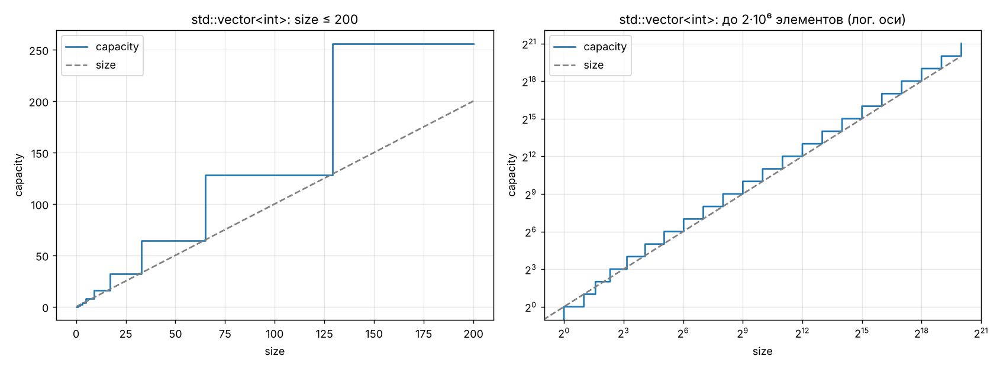
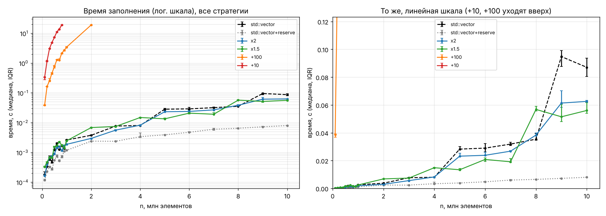
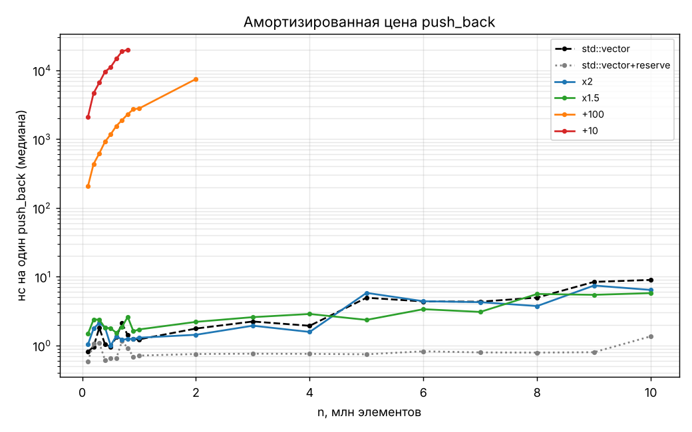
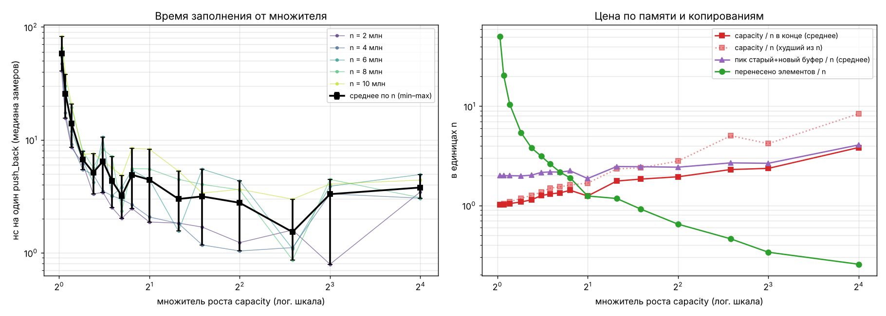
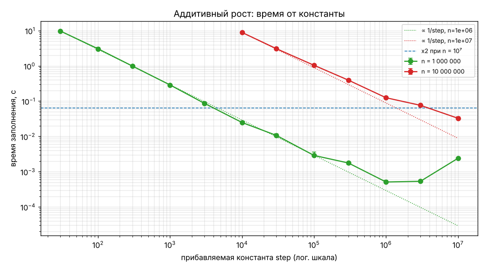

# Отчёт. subvector: динамический массив и стратегии роста

Все числа получены на одной машине: виртуальная машина, Intel Xeon 2.8 ГГц, 2 vCPU, 8 ГБ, Linux, g++ 13.3 с -O2,
libstdc++ (подробнее — [README.md](README.md)). На другой машине абсолютные значения будут другими, а качественная
картина, по нашим ожиданиям, сохранится. Исходные данные — `data/*.csv`, сводки — `data/summary_*.csv`.

## 0. Реализация

`subvector<T>` (файл `subvector.h`) хранит ровно три поля из задания — `T* data`, `unsigned int size`,
`unsigned int capacity` — плюс объект стратегии роста и счётчики для экспериментов.

* `push_back` при `size == capacity` вычисляет новую ёмкость по стратегии и вызывает `resize`; если память не
  выделилась (`new (std::nothrow)`) или ёмкость не помещается в `unsigned int`, возвращает `false`, вектор не меняется.
* `resize(new_capacity)` выделяет новый буфер, переносит `min(size, new_capacity)` элементов, освобождает старый.
  В момент переноса живы **оба** буфера — это и есть пик памяти при росте.
* `pop_back` на пустом векторе возвращает `T{}` (для `int` — 0); `clear` обнуляет только `size`;
  `shrink_to_fit` = `resize(size)`.
* Стратегии: `Growth::add(c)` — capacity + c, `Growth::mul(k)` — ⌈capacity·k⌉, но не меньше capacity + 1
  (иначе при k близком к 1 и малой ёмкости рост бы остановился: ⌈1·1.02⌉ = 2, а вот ⌊…⌋ дал бы 1).
* Правило трёх/пяти: деструктор освобождает память, копия независима и получает `capacity == size`, перемещение
  забирает буфер. Проверки — `tests.cpp`, включая сверку с `std::vector` на 200 000 случайных операций
  и прогон под AddressSanitizer/UBSan.

## 1. Как растёт capacity у std::vector

**Гипотеза.** libstdc++ увеличивает ёмкость геометрически, вероятно в 2 раза: так `push_back` стоит O(1)
амортизированно.

**Наблюдение** (`data/std_capacity.csv`, `data/std_capacity_changes.csv`, график `plots/std_capacity.png`):

Ёмкость меняется только когда `size` превышает текущую `capacity`, и принимает значения
0 → 1 → 2 → 4 → 8 → 16 → … → 2 097 152. Отношение соседних значений всегда ровно 2 (22 перевыделения до 2·10⁶
элементов, первое — 0 → 1). Между перевыделениями capacity постоянна — график ступенчатый, а в логарифмических осях ступени
идут через равные промежутки. Вывод: **libstdc++ (g++ 13) использует удвоение**, начиная с 1.
(У MSVC, по документации и известным реализациям, множитель 1.5 — это зависит от библиотеки, а не от стандарта:
стандарт требует только амортизированно постоянного `push_back`.)

**Конструкторы и операции** (`data/std_constructors.csv`):

| Операция | size | capacity |
|---|---:|---:|
| `vector<int> a;` | 0 | 0 — пустой вектор память не выделяет |
| `vector<int> b(10);`, `c(10, 7)` | 10 | 10 — ровно столько, сколько элементов |
| `vector<int> d{1,2,3};`, из диапазона 5 эл. | 3 / 5 | 3 / 5 |
| 17 `push_back` | 17 | 32 |
| копия `cp(big)` и `as = big` | 17 | 17 — копия не наследует запас, capacity = size |
| `mv(std::move(cp))` | 17 | 17; у `cp` после перемещения 0 / 0 — буфер «украден» |
| `pop_back()`, `clear()` | 17 / 0 | 32 / 32 — память не освобождается |
| `shrink_to_fit()` после `clear` | 0 | 0 |
| `reserve(100)`; `push_back`; `reserve(10)` | 0 / 1 / 1 | 100 / 100 / 100 — reserve только увеличивает |
| `resize(150)`, затем `resize(5)` | 150 / 5 | 150 / 150 — resize меняет size, не уменьшает capacity |
| `vector<int> s(5); s.push_back(1)` | 6 | 10 — удвоение от текущей ёмкости, не от степени двойки |
| `vector<int> t(7); t.push_back(1)` | 8 | 14 |
| `insert` 5, потом 3, потом 20 элементов в пустой | 5 / 8 / 28 | 5 / 10 / 28 — новая ёмкость = size + max(size, добавляемое) |

Все наблюдения согласуются с правилом libstdc++ «новая ёмкость = size + max(size, сколько добавляем)»;
для `push_back` это ровно удвоение. Отсюда правила для subvector: пустой конструктор ничего не выделяет; копия получает `capacity == size`;
`clear` не трогает ёмкость; рост — от текущей ёмкости.

## 2. Сравнение стратегий и std::vector

**Гипотезы.**
1. При росте на константу c каждое перевыделение копирует весь массив, перевыделений n/c, всего копируется
   c + 2c + … ≈ n²/(2c) элементов. Время должно расти **квадратично** по n и быть обратно пропорционально c.
2. При умножении на k копируется n·(1/(k−1)) элементов в сумме (геометрическая прогрессия), то есть
   O(1) на элемент. Время **линейно** по n; ×2 копирует меньше, чем ×1.5 (≈1·n против ≈2·n).
3. `std::vector` в libstdc++ ведёт себя как ×2.

**Результаты** (`data/strategies.csv`, медианы 7 замеров; для долгих точек 3 или 1 замер; стратегии
измерялись вперемешку, см. README):

| n | std::vector | std::vector+reserve | x2 | x1.5 | +100 | +10 |
|---:|---:|---:|---:|---:|---:|---:|
| 100 000 | 0.18 мс | 0.12 мс | 0.16 мс | 0.33 мс | 38.79 мс | 334.10 мс |
| 500 000 | 1.22 мс | 0.55 мс | 0.90 мс | 1.54 мс | 763.90 мс | 7.35 с |
| 1 000 000 | 2.60 мс | 1.18 мс | 1.87 мс | 2.46 мс | 3.45 с | пропущено |
| 2 000 000 | 3.76 мс | 2.39 мс | 2.95 мс | 6.83 мс | 19.04 с | пропущено |
| 5 000 000 | 28.27 мс | 3.91 мс | 23.19 мс | 13.41 мс | пропущено | пропущено |
| 10 000 000 | 87.07 мс | 8.00 мс | 62.56 мс | 56.04 мс | пропущено | пропущено |

| стратегия | перевыделений при n=10⁶ | перенесено / n при n=10⁶ | capacity / n при n=10⁶ |
|---|---:|---:|---:|
| std::vector | 21 | 1.05 | 1.05 |
| std::vector+reserve | 1 | 0 | 1 |
| x2 | 21 | 1.05 | 1.05 |
| x1.5 | 34 | 2.1 | 1.05 |
| +100 | 10000 | 5e+03 | 1 |

**Наблюдения.**

* +10 и +100 действительно квадратичные. Перенесено элементов (`moved_elements`) ровно c·(0+1+…+(n/c−1)) =
  n(n−c)/(2c): для +100 при n = 10⁶ это 4.9995·10⁹, для +10 при n = 7·10⁵ — 2.45·10¹⁰. При удвоении n с 10⁶ до 2·10⁶
  время +100 выросло в 5.5 раза (3.45 → 19.0 с) — даже быстрее, чем n² (предположительно потому, что копируемый
  массив перестал помещаться в кэш последнего уровня).
  До 10 млн элементов эти стратегии не доведены: по прогнозу из квадратичного закона +100 заняла бы ≈ 460 с, а +10 —
  около часа на один замер. Это отмечено в CSV (`status = skipped_predicted_…`), а не выброшено молча.
* ×2 и ×1.5 линейны: 1.5–7 нс на элемент на всём диапазоне до 10⁷ — в тысячи раз быстрее аддитивных
  (+100 при n = 10⁶: 3 450 нс на элемент). Число перевыделений логарифмическое: 25 для ×2 и 40 для ×1.5 при n = 10⁷.
* **Скачки нс/элемент совпадают с page fault'ами** (столбец `page_faults`). Пока последний буфер меньше ~32 МБ,
  page fault'ов при заполнении нет (память переиспользуется из кучи), и ×2 стоит 1.5–2 нс/элемент. Как только
  ёмкость переходит 32 МБ, появляются page fault'ы — по одному на каждую 4-килобайтную страницу нового буфера,
  и время растёт до 5–9 нс/элемент:

  | n | ×2: ёмкость, МБ | ×2: page faults | ×2: нс/эл. | ×1.5: ёмкость, МБ | ×1.5: page faults | ×1.5: нс/эл. |
  |---:|---:|---:|---:|---:|---:|---:|
  | 4 млн | 16.8 | 0 | 2.1 | 21.3 | 0 | 3.7 |
  | 5 млн | 33.6 | 4 883 | 4.6 | 21.3 | 0 | 2.7 |
  | 8 млн | 33.6 | 7 813 | 4.8 | 47.8 | 7 813 | 7.1 |
  | 10 млн | 67.1 | 17 959 | 6.3 | 47.8 | 9 766 | 5.6 |

  Поэтому при n = 5 млн ×1.5 оказалась быстрее ×2: её буфер ещё «помещается» под порог. Порог 32 МБ совпадает с
  максимальным порогом `mmap` в glibc на 64-битных системах: блоки больше него выделяются через `mmap`
  и при освобождении возвращаются ядру, так что новый буфер приходит «свежим», и первое касание каждой страницы
  стоит page fault с обнулением. Связь «буфер > 32 МБ → page faults» измерена; механизм glibc — наше объяснение.
* **std::vector использует удвоение.** Последовательность capacity и число перевыделений у `std::vector`
  и у subvector ×2 совпадают поэлементно (25 перевыделений и 16 777 215 перенесённых элементов при n = 10⁷).

**std::vector против subvector ×2.** После выравнивания условий (см. ниже) при n ≤ 4 млн они идут вровень:
1.8–2.6 и 1.5–2.1 нс/элемент. При n ≥ 5 млн оба платят одинаковое число page fault'ов (17 959 при n = 10⁷),
но `std::vector` медленнее на 20–50 % (n = 9 млн: 95 против 62 мс, n = 10 млн: 87 против 63 мс, IQR 3–10 %).
Ёмкости, число перевыделений и переносов у них одинаковые, так что дело не в стратегии роста. Причину этого
остатка мы не установили; кандидаты для проверки — разные пути копирования (`memmove` в libstdc++ против
поэлементного цикла в subvector) и порядок освобождения старого буфера на больших блоках.

Важная находка про методику. В первой версии замеров стратегии шли по очереди (сначала все n для `std::vector`,
потом для ×2 и т. д.), и `std::vector` выглядел в 3–4 раза медленнее subvector ×2, хотя ёмкости у них одинаковые.
Мы проверили две причины:

1. **Встраивание.** В ассемблере g++ не встроил `std::vector::push_back` в замеряемый цикл (оставался вызов
   `emplace_back` на каждый элемент), а `subvector::push_back` встроил. Замеряемые функции помечены
   `__attribute__((flatten))` — после этого оба цикла стали одинаково плотными (запись, инкремент, сравнение).
   Этого оказалось мало.
2. **Состояние распределителя памяти.** Счётчик page fault'ов показал: в одном и том же процессе стратегия,
   которая измеряется **первой**, платит page fault на каждой странице (194 на 100 000 элементов), а следующие —
   ноль. Контрольный опыт `control_order.cpp` (`data/control_order.txt`): без прогрева кучи и `std::vector`,
   и subvector стоят ≈ 4 нс/элемент с 194 page fault'ами; после выделения и освобождения 30 МБ — оба
   1.5–2.5 нс/элемент без page fault'ов.

Поэтому окончательные замеры перемешивают порядок стратегий на каждом n и начинаются с прогрева кучи.
Вывод: основная (3–4-кратная) разница была в способе измерения, а не в контейнерах; стратегия роста у них одна и та же.

## 3. Определение наилучшей стратегии

### 3.1. Время заполнения от множителя

Взяты 16 множителей от 1.02 до 16 и для каждого 5 значений n (2, 4, 6, 8, 10 млн), по 7 замеров на точку.
Несколько n нужны потому, что время одного заполнения сильно зависит от положения n относительно ближайшего
перевыделения; поэтому сравниваем средние нс/элемент по пяти n и показываем разброс (`data/summary_factor_mean.csv`).

| k | нс/элемент, среднее по 5 n (min–max) | перенесено / n | 1/(k−1) | capacity / n (среднее / худшее) | перевыделений при n=10⁷ |
|---:|---:|---:|---:|---:|---:|
| 1.02 | 57.97 (40.71–82.56) | 50.62 | 50.00 | 1.01 / 1.01 | 645 |
| 1.05 | 25.66 (15.60–38.16) | 20.45 | 20.00 | 1.02 / 1.04 | 280 |
| 1.1 | 13.97 (8.55–20.84) | 10.45 | 10.00 | 1.04 / 1.09 | 150 |
| 1.2 | 6.69 (5.46–7.92) | 5.42 | 5.00 | 1.08 / 1.17 | 83 |
| 1.3 | 5.13 (3.31–7.55) | 3.80 | 3.33 | 1.14 / 1.27 | 59 |
| 1.4 | 6.45 (3.43–10.57) | 3.14 | 2.50 | 1.25 / 1.36 | 47 |
| 1.5 | 4.34 (2.52–7.13) | 2.61 | 2.00 | 1.31 / 1.50 | 40 |
| 1.618 | 3.19 (2.01–4.82) | 2.17 | 1.62 | 1.34 / 1.54 | 34 |
| 1.75 | 4.90 (2.47–8.42) | 1.89 | 1.33 | 1.42 / 1.61 | 30 |
| 2 | 4.44 (1.87–8.27) | 1.24 | 1.00 | 1.24 / 1.68 | 25 |
| 2.5 | 2.99 (1.55–5.29) | 1.17 | 0.67 | 1.76 / 2.33 | 19 |
| 3 | 3.15 (1.17–5.50) | 0.92 | 0.50 | 1.84 / 2.39 | 16 |
| 4 | 2.77 (1.04–4.33) | 0.65 | 0.33 | 1.94 / 2.80 | 13 |
| 6 | 1.52 (0.86–2.98) | 0.46 | 0.20 | 2.30 / 5.04 | 10 |
| 8 | 3.30 (0.79–4.46) | 0.34 | 0.14 | 2.36 / 4.19 | 9 |
| 16 | 3.78 (3.04–4.93) | 0.26 | 0.07 | 3.83 / 8.39 | 7 |

**Наблюдения.**

* При k → 1 время резко растёт: перенесено ≈ n/(k−1) элементов (50·n при k = 1.02), перевыделений ≈ ln n / ln k
  (645 при k = 1.02). Измеренное «перенесено / n» совпадает с 1/(k−1) с точностью до округления ёмкостей.
* От k ≈ 1.5 и выше время перестаёт заметно уменьшаться: копирование стоит уже ≲ 1–2·n, и на первый план выходят
  запись самих элементов и page fault'ы на буферах больше 32 МБ. Разброс между разными n (столбики на графике)
  здесь сравним с разницей между соседними k, то есть **для k ∈ [1.5; 4] различие на нашей машине в пределах шума**.
* Если смотреть только на n = 2 и 4 млн, где page fault'ов нет ни у одного k ≤ 6, картина чище: 41–48 нс/элемент
  при k = 1.02, 5.5–6.1 при k = 1.2, 2.5–3.2 при k = 1.5, 1.9–2.1 при k = 2, 1.0–1.2 при k = 4. Выигрыш от k > 2 есть,
  но это доли наносекунды на элемент, а цена — в 2 раза больше памяти.
* Память растёт с k монотонно: в худшем случае из пяти n после заполнения выделено ≈ k·n ячеек
  (1.5·n при k = 1.5, 1.7·n при k = 2, 2.8·n при k = 4, 8.4·n при k = 16), а в момент перевыделения одновременно живут
  старый и новый буферы — до (1 + k)/k · capacity.

### 3.2. Время заполнения от прибавляемой константы

Константы от 10 до 10⁷ при n = 10⁶ и n = 10⁷ (`data/step.csv`); точки, которые по прогнозу дольше 20 с, пропущены.

| step | n = 10⁶ | n = 10⁷ |
|---:|---:|---:|
| 30 | 9.87 с (33330 перевыд.) | пропущено (> 20 с) |
| 100 | 3.09 с (10000 перевыд.) | пропущено (> 20 с) |
| 300 | 1.12 с (3334 перевыд.) | пропущено (> 20 с) |
| 1 000 | 279.80 мс (1000 перевыд.) | пропущено (> 20 с) |
| 3 000 | 102.20 мс (334 перевыд.) | пропущено (> 20 с) |
| 10 000 | 26.25 мс (100 перевыд.) | 8.68 с (1000 перевыд.) |
| 30 000 | 9.59 мс (34 перевыд.) | 3.25 с (334 перевыд.) |
| 100 000 | 2.89 мс (10 перевыд.) | 1.03 с (100 перевыд.) |
| 300 000 | 1.86 мс (4 перевыд.) | 423.70 мс (34 перевыд.) |
| 1 000 000 | 0.48 мс (1 перевыд.) | 135.60 мс (10 перевыд.) |
| 3 000 000 | 0.51 мс (1 перевыд.) | 84.19 мс (4 перевыд.) |
| 10 000 000 | 2.50 мс (1 перевыд.) | 43.25 мс (1 перевыд.) |

**Наблюдения.**

* Пока step ≪ n, время обратно пропорционально step (пунктир ∝ 1/step проходит по точкам): это та же квадратичная
  формула n²/(2·step).
* Когда step ≥ n, выделение одно, и аддитивная стратегия превращается в `reserve`: n = 10⁶ заполняется за ≈ 0.5 мс,
  быстрее, чем при ×2. Но это работает **только если заранее знать n**: при step = 10⁷ и n = 10⁶ выделено
  в 10 раз больше нужного, а при n = 10⁸ та же константа снова дала бы квадратичное поведение.
* Аддитивный рост с любой фиксированной константой асимптотически проигрывает умножению: для n = 10⁷
  даже step = 10⁴ (40 КБ на шаг) даёт 8.7 с против 0.063 с у ×2.

### 3.3. Вывод: какая стратегия лучшая

Для сценария «последовательно добавляем элементы, итоговый размер заранее неизвестен» лучшая — **мультипликативная
с множителем примерно от 1.5 до 2**.

* Аддитивная стратегия даёт O(n²) копирований при любой константе; она приемлема, только если константа
  сопоставима с итоговым размером, — но тогда это просто `reserve`, и нужно знать n.
* Мультипликативная даёт амортизированно O(1) на `push_back`: суммарно перенесено n/(k−1) элементов.
* Множитель ниже ~1.3 заметно медленнее (много копирований и перевыделений).
* Множитель выше 2 почти не ускоряет заполнение (на нашей машине — в пределах разброса), но расходует больше памяти:
  до k·n ячеек после заполнения.
* Между 1.5 и 2 выбор — компромисс. 2 — меньше копирований (1·n против 2·n) и это выбор libstdc++. 1.5 — меньше
  лишней памяти (до 1.5·n против 2·n) и есть теоретический плюс: при k < φ ≈ 1.618 сумма ранее освобождённых блоков
  со временем становится больше следующего запроса, и распределитель в принципе может переиспользовать эту память
  (так обосновывают ×1.5 в MSVC и folly::fbvector). При k = 2 сумма всех прежних блоков 1 + 2 + … + 2^(m−1) = 2^m − 1
  всегда меньше нового 2^m.
* Если n известен заранее, лучше всего `reserve(n)` / `resize(n)`: одно выделение, ноль копирований.
  В наших данных `std::vector+reserve` — 0.8–1.2 нс/элемент на всём диапазоне, без page fault'ов,
  а subvector с одним выделением (step ≥ n) при n = 10⁶ — 0.5 нс/элемент.

Ограничения: замеры на виртуальной машине с 2 vCPU и одном компиляторе; не исследовались другие типы элементов
(для тяжёлых при копировании типов вклад переносов вырос бы, и выигрыш больших k стал бы заметнее) и другие сценарии
(чередование добавления и удаления, много векторов одновременно, фрагментация).
