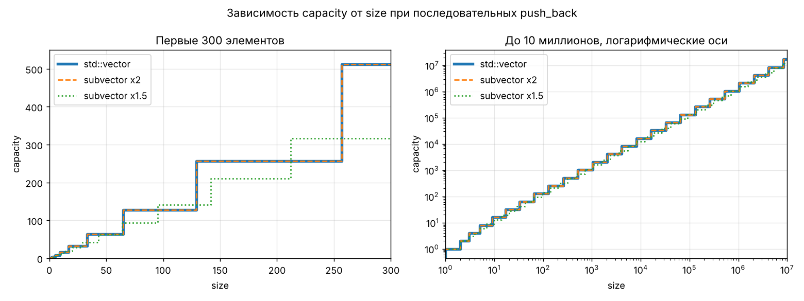
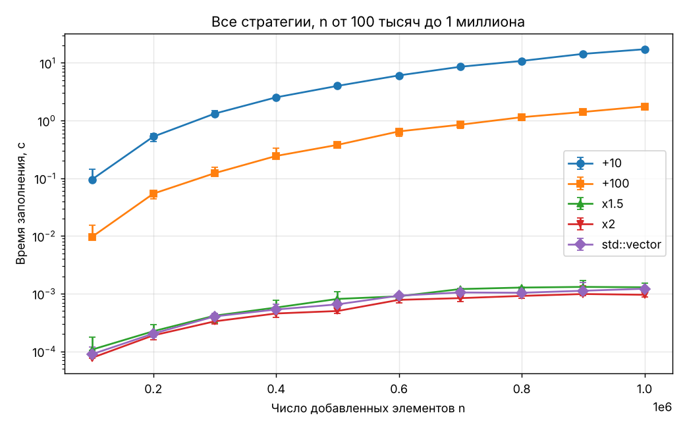
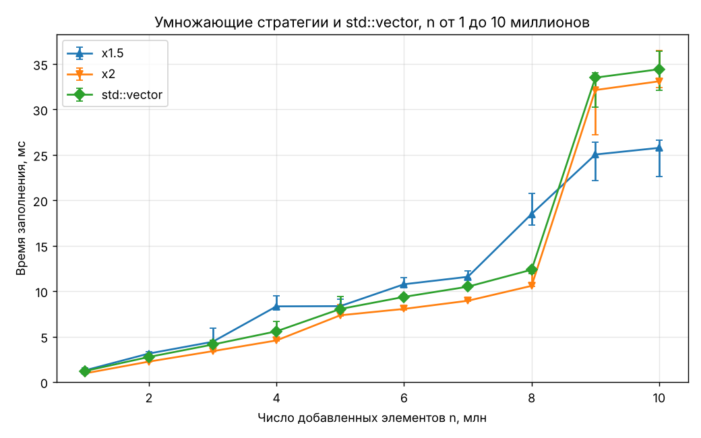

# Отчёт. Лабораторная 4: subvector и стратегии роста

Цель: разобраться, как устроен динамический массив, как он расширяется и как стратегия роста ёмкости
влияет на скорость. Платформа, команды и формат данных описаны в [README.md](README.md).

## 0. Реализация subvector

Класс хранит три поля: `data` (адрес массива), `size` (сколько элементов лежит) и `capacity` (сколько
помещается без перевыделения).

Главное действие - `resize(new_capacity)`: выделить новый массив, перенести в него элементы, освободить
старый массив, запомнить новый адрес. Все остальные методы короткие:

- `push_back`: если `size == capacity`, сначала увеличить ёмкость по выбранной стратегии, потом записать элемент;
- `pop_back`: уменьшить `size` и вернуть последний элемент, для пустого вектора вернуть 0;
- `shrink_to_fit`: `resize(size)`;
- `clear`: `size = 0`, память остаётся.

Проверки (`tests.cpp`, 26 штук, все проходят): пустой вектор, сохранность элементов после перевыделений,
обрезка при `resize`, `shrink_to_fit`, `clear`, последовательности ёмкостей для четырёх стратегий
и сверка со `std::vector` на 200 000 случайных операций.

## 1. Как растёт std::vector

### capacity от size

При последовательных `push_back` ёмкость `std::vector` менялась так: 0, 1, 2, 4, 8, 16, 32, 64, ...,
8 388 608, 16 777 216. За 10 миллионов добавлений ёмкость изменилась 25 раз, каждый раз ровно вдвое.

Программа сравнила эту последовательность с двумя вариантами subvector:

| Сравнение | Изменений ёмкости | Результат |
|---|---|---|
| `std::vector` и subvector ×2 | 25 и 25 | последовательности совпали полностью |
| `std::vector` и subvector ×1.5 | 25 и 41 | не совпали |

**Вывод: `std::vector` в этой библиотеке (libstdc++ из g++ 13.3) использует удвоение.** Стандарт языка
множитель не задаёт, в другой библиотеке он может быть другим.

### Конструкторы и методы

| Действие | size | capacity |
|---|---|---|
| `vector<int> a;` | 0 | 0 |
| `vector<int> b(10);` | 10 | 10 |
| `vector<int> c(10, 7);` | 10 | 10 |
| `vector<int> d = {1, 2, 3};` | 3 | 3 |
| `b.push_back(1)` при size = capacity = 10 | 11 | 20 |
| `vector<int> e(b);` (копия `b`) | 11 | 11 |
| `a.reserve(100);` | 0 | 100 |
| `a.resize(5);` | 5 | 100 |
| `b.pop_back();` | 10 | 20 |
| `b.clear();` | 0 | 20 |
| `b.shrink_to_fit();` после `clear` | 0 | 0 |

Что из этого следует:

- пустой вектор память не выделяет;
- конструкторы выделяют ровно столько, сколько нужно, без запаса;
- запас появляется только при переполнении, и ёмкость при этом удваивается (10 → 20);
- копия получает ёмкость по числу элементов, запас оригинала не копируется;
- `pop_back` и `clear` память не возвращают, для этого есть `shrink_to_fit`.

subvector ведёт себя так же: пустой конструктор ничего не выделяет, `pop_back` и `clear` не меняют ёмкость.

## 2. Сравнение стратегий

Тест: добавить n элементов в пустой контейнер через `push_back`. Время - медиана пяти измерений;
звёздочка означает одно измерение, потому что замер длился больше 2 секунд.

### Гипотеза (до измерений)

При стратегии «+c» перевыделение происходит каждые c элементов, и каждый раз переносятся все уже
накопленные элементы. Всего переносится примерно n² / (2c) элементов, то есть время растёт как n².
При стратегии «×k» перевыделений мало (порядка log n), а всего переносится порядка n элементов,
то есть время растёт как n. Значит, «+10» и «+100» должны быть намного медленнее, причём «+10» примерно
в 10 раз медленнее, чем «+100».

### Результаты

| n | +10 | +100 | x1.5 | x2 | std::vector |
|---|---|---|---|---|---|
| 100 000 | 95.1 мс | 9.6 мс | 107 мкс | 77 мкс | 89 мкс |
| 200 000 | 527.0 мс | 54.1 мс | 223 мкс | 189 мкс | 203 мкс |
| 300 000 | 1.32 с | 122.6 мс | 415 мкс | 331 мкс | 403 мкс |
| 400 000 | 2.53 с * | 243.5 мс | 574 мкс | 453 мкс | 531 мкс |
| 500 000 | 3.99 с * | 379.1 мс | 810 мкс | 500 мкс | 652 мкс |
| 600 000 | 6.06 с * | 649.1 мс | 899 мкс | 780 мкс | 923 мкс |
| 700 000 | 8.57 с * | 847.5 мс | 1.2 мс | 836 мкс | 1.0 мс |
| 800 000 | 10.82 с * | 1.14 с | 1.3 мс | 913 мкс | 1.0 мс |
| 900 000 | 14.32 с * | 1.41 с | 1.3 мс | 985 мкс | 1.1 мс |
| 1 000 000 | 17.24 с * | 1.76 с | 1.3 мс | 956 мкс | 1.2 мс |
| 2 000 000 | – | 6.92 с * | 3.1 мс | 2.2 мс | 2.8 мс |
| 3 000 000 | – | 16.05 с * | 4.4 мс | 3.4 мс | 4.1 мс |
| 4 000 000 | – | – | 8.3 мс | 4.6 мс | 5.6 мс |
| 5 000 000 | – | – | 8.4 мс | 7.3 мс | 8.0 мс |
| 6 000 000 | – | – | 10.8 мс | 8.0 мс | 9.4 мс |
| 7 000 000 | – | – | 11.6 мс | 8.9 мс | 10.5 мс |
| 8 000 000 | – | – | 18.5 мс | 10.6 мс | 12.4 мс |
| 9 000 000 | – | – | 25.0 мс | 32.1 мс | 33.5 мс |
| 10 000 000 | – | – | 25.8 мс | 33.1 мс | 34.4 мс |

**Почему «+10» и «+100» не доведены до 10 миллионов.** Время этих стратегий растёт как n². Отношение
время / n² (в секундах на миллион в квадрате) выходит на постоянное значение: около 17 для «+10» при n от
600 тысяч и около 1.75 для «+100». Прогноз для «+100» на 2 и 3 миллиона: 1.75 · 4 = 7.0 с и 1.75 · 9 = 15.8 с.
Измерено 6.92 с и 16.05 с, прогноз подтвердился. По той же формуле 10 миллионов элементов заняли бы около
3 минут для «+100» и около 29 минут для «+10» на одно измерение. Это прогноз, а не измерение.

### Наблюдения

- **Прибавляющие стратегии квадратичны.** При росте n в 10 раз (со 100 тысяч до миллиона) время «+10»
  выросло в 181 раз, «+100» в 183 раза. Умножающие стратегии и `std::vector` выросли в 12–14 раз.
- **«+10» медленнее «+100» в 9.3–10.8 раза** при всех n, как и предсказывала формула n² / (2c).
- **Разрыв с умножающими стратегиями растёт вместе с n.** При миллионе элементов «+100» медленнее
  удвоения примерно в 1800 раз, «+10» примерно в 18 000 раз.
- **×1.5 и ×2.** До 8 миллионов ×1.5 медленнее удвоения на 14–82 %. При 9 и 10 миллионах, наоборот,
  быстрее на 22 %.
- **std::vector и subvector ×2.** Последовательности ёмкостей у них одинаковые. По времени `std::vector`
  по медиане медленнее на 4–30 %; диапазоны измерений не перекрываются в 7 точках из 19.
- **Скачки на графике.** У ×2 и `std::vector` время резко растёт между 8 и 9 миллионами, у ×1.5 между
  7 и 8 миллионами.

### Объяснение

- Число перенесённых элементов посчитано программой (раздел 3): при n = 1 млн стратегия «+10» перенесла
  50 миллиардов элементов, «+100» перенесла 5 миллиардов, а удвоение чуть больше миллиона.
  Время следует за этим числом.
- Скачки совпадают с моментами перевыделения. Удвоение переходит с ёмкости 8 388 608 на 16 777 216, когда
  n превышает 8.39 млн: в этот момент переносятся 8.4 млн элементов и выделяется массив на 64 МБ.
  У ×1.5 переход с 7 972 438 на 11 958 657 происходит при n около 7.97 млн. Поэтому при n = 9 и 10 млн
  стратегия ×1.5 оказалась быстрее: её последний перенос был меньше.
- Почему такой перенос стоит около 20 мс, я не проверял. Предположение: большой новый массив система
  выдаёт программе по частям при первом обращении, и это дольше самого копирования.
- Почему `std::vector` немного медленнее subvector ×2 при одинаковой стратегии, я не выяснял.
  Предположение: по-разному устроен перенос элементов в новый массив. Стратегия роста у них одна.

## 3. Наилучшая стратегия

Сценарий один: последовательное добавление элементов.

### Время от множителя

Множители k от 1.1 до 4, три значения n. Время дано в наносекундах на один добавленный элемент (медиана).

| k | 5 млн, нс | 7 млн, нс | 10 млн, нс | перевыделений (10 млн) | перенесено / n (5, 7, 10 млн) | capacity / n (5, 7, 10 млн) |
|---|---|---|---|---|---|---|
| 1.1 | 5.2 | 6.4 | 6.2 | 160 | 10.28, 10.75, 10.02 | 1.03, 1.08, 1.00 |
| 1.2 | 3.0 | 3.2 | 3.3 | 87 | 5.84, 5.01, 5.05 | 1.17, 1.00, 1.01 |
| 1.3 | 2.5 | 2.6 | 2.5 | 62 | 4.18, 3.88, 3.53 | 1.25, 1.16, 1.06 |
| 1.4 | 1.8 | 2.0 | 2.3 | 49 | 2.66, 2.66, 2.61 | 1.06, 1.06, 1.04 |
| 1.5 | 1.7 | 1.8 | 2.1 | 41 | 2.13, 2.28, 2.39 | 1.06, 1.14, 1.20 |
| 1.6 | 2.0 | 1.6 | 2.0 | 36 | 2.33, 1.67, 1.87 | 1.40, 1.00, 1.12 |
| 1.7 | 1.8 | 1.5 | 2.1 | 32 | 2.06, 1.47, 1.75 | 1.44, 1.03, 1.23 |
| 1.8 | 1.5 | 1.9 | 1.9 | 29 | 1.59, 2.04, 1.43 | 1.27, 1.63, 1.14 |
| 1.9 | 1.4 | 1.7 | 1.8 | 27 | 1.38, 1.88, 1.31 | 1.24, 1.69, 1.18 |
| 2 | 1.5 | 1.3 | 3.2 | 25 | 1.68, 1.20, 1.68 | 1.68, 1.20, 1.68 |
| 2.2 | 1.1 | 1.4 | 1.6 | 22 | 0.84, 1.32, 0.92 | 1.00, 1.58, 1.11 |
| 2.4 | 1.5 | 1.2 | 1.4 | 20 | 1.50, 1.07, 0.75 | 2.10, 1.50, 1.05 |
| 2.6 | 1.2 | 0.9 | 3.0 | 19 | 1.01, 0.72, 1.32 | 1.62, 1.16, 2.11 |
| 2.8 | 1.2 | 1.0 | 3.1 | 18 | 1.00, 0.72, 1.40 | 1.81, 1.29, 2.53 |
| 3 | 1.5 | 1.2 | 1.5 | 16 | 1.43, 1.02, 0.72 | 2.87, 2.05, 1.43 |
| 3.5 | 1.1 | 0.9 | 3.0 | 15 | 0.77, 0.55, 1.35 | 1.92, 1.37, 3.36 |
| 4 | 2.6 | 1.1 | 1.3 | 13 | 1.12, 0.80, 0.56 | 3.36, 2.40, 1.68 |

Наблюдения:

- От k = 1.1 до k = 1.5 время падает быстро: с 5–6 нс до примерно 2 нс на элемент.
- От k = 1.5 до k = 4 общий уровень снижается медленно, примерно с 2 нс до 1–1.5 нс, и линия становится
  пилообразной. Выбросы вверх до 3 нс стоят в разных местах для разных n: при 10 млн это k = 2, 2.6, 2.8
  и 3.5, при 5 млн это k = 4.
- Выбросы совпадают с большими значениями capacity / n. Например, при n = 10 млн и k = 3.5 итоговая ёмкость
  равна 3.36 n, а время 3.0 нс; при k = 3 ёмкость 1.43 n, а время 1.5 нс.
- Число перенесённых элементов на один добавленный лежит между 1 / (k − 1) и k / (k − 1) (пунктир на
  среднем графике). Запас памяти в конце лежит между 1 и k (пунктир на правом графике).

Объяснение:

- Перенос. Перед последним перевыделением в массиве лежало c элементов, до этого c / k, c / k² и так далее.
  Сумма этой геометрической прогрессии равна c · k / (k − 1). Она не зависит от числа перевыделений, поэтому
  в среднем на каждый добавленный элемент приходится постоянное число переносов. При k = 1.1 это около 10,
  при k = 2 от 1 до 2, при k = 4 меньше 1.5. Вот почему время сначала падает быстро, а потом почти не меняется.
- Пила. Результат при фиксированном n зависит от того, где последняя ёмкость оказалась относительно n.
  Если последнее перевыделение случилось незадолго до конца, программа только что перенесла почти все
  элементы и выделила массив в k раз больше, из которого использует малую часть. Это худший случай и по
  времени, и по памяти. При другом n тот же множитель попадает в хороший случай. Поэтому по одному значению n
  нельзя говорить, что, например, k = 2.4 лучше, чем k = 2.
- Почему время выброса больше, чем следует из числа переносов, я не проверял. Предположение то же, что в
  разделе 2: обращение к новой, ещё не использованной памяти большого массива стоит дорого.

### Время от слагаемого

Слагаемые c от 10 до 1 000 000, n = 1 млн.

| c | время | измерений | перевыделений | перенесено элементов | время × c, с |
|---|---|---|---|---|---|
| 10 | 17.63 с | 1 | 100000 | 49 999 500 000 | 176 |
| 20 | 8.58 с | 1 | 50000 | 24 999 500 000 | 172 |
| 50 | 3.38 с | 1 | 20000 | 9 999 500 000 | 169 |
| 100 | 1.74 с | 5 | 10000 | 4 999 500 000 | 174 |
| 200 | 850.0 мс | 5 | 5000 | 2 499 500 000 | 170 |
| 500 | 315.8 мс | 5 | 2000 | 999 500 000 | 158 |
| 1 000 | 172.0 мс | 5 | 1000 | 499 500 000 | 172 |
| 2 000 | 92.1 мс | 5 | 500 | 249 500 000 | 184 |
| 5 000 | 37.2 мс | 5 | 200 | 99 500 000 | 186 |
| 10 000 | 18.7 мс | 5 | 100 | 49 500 000 | 187 |
| 20 000 | 9.6 мс | 5 | 50 | 24 500 000 | 193 |
| 50 000 | 4.2 мс | 5 | 20 | 9 500 000 | 210 |
| 100 000 | 2.4 мс | 5 | 10 | 4 500 000 | 236 |
| 200 000 | 1.4 мс | 5 | 5 | 2 000 000 | 287 |
| 500 000 | 927 мкс | 5 | 2 | 500 000 | 464 |
| 1 000 000 | 747 мкс | 5 | 1 | 0 | 747 |

Наблюдения и объяснение:

- Время обратно пропорционально слагаемому: произведение время × c остаётся в пределах 158–193 при c от 10
  до 20 000. Это следует из формулы: переносится n² / (2c) элементов, столбец «перенесено элементов»
  совпадает с ней точно (n (n − c) / (2c)).
- При c больше 50 000 время падает медленнее, чем 1 / c. Переносов уже мало, и остаётся время самих
  n записей элементов: около 0.75 мс на миллион, это видно в последней строке, где переносов нет вообще.
- Слагаемое, которое хорошо при одном n, плохо при другом. c = 100 000 при n = 1 млн работает за 2.4 мс,
  но при n = 100 млн это была бы та же ситуация, что c = 1000 при n = 1 млн: в сто раз больше переносов
  на элемент. Прибавляющая стратегия быстра, только если слагаемое сравнимо с итоговым размером,
  то есть если размер известен заранее. Но тогда проще один раз вызвать `resize` с нужной ёмкостью.

### Какая стратегия наилучшая

**Умножение с множителем от 1.5 до 2.** Доводы:

1. Прибавление константы даёт квадратичное время при любом c. Увеличение c уменьшает время только в
   постоянное число раз и стоит памяти: при малом числе элементов вектор сразу занимает c ячеек.
2. Умножение даёт постоянное среднее число переносов на элемент при любом n. Контейнеру не нужно знать
   заранее, сколько элементов в него положат.
3. Множитель меньше 1.5 заметно медленнее: при k = 1.1 каждый элемент переносится в среднем 10 раз,
   время в 3 раза больше, чем при k = 1.5.
4. Множитель больше 2 почти не ускоряет заполнение (выигрыш не больше 1 нс на элемент, и то не при всяком n),
   но увеличивает запас памяти: в худшем случае вектор занимает в k раз больше, чем нужно. При k = 3.5
   в измерениях встретился запас 3.36 n.
5. Между 1.5 и 2 измерения не дают однозначного победителя: разница в пределах пилы, которая зависит от n.
   Удвоение делает меньше переносов (в среднем около 1.5 на элемент против 2–2.4 у ×1.5), множитель 1.5
   оставляет меньше неиспользованной памяти (не больше 50 % против 100 %).

`std::vector` из libstdc++ использует удвоение, то есть выбирает скорость.

## 4. Выводы

1. Динамический массив - это адрес, число элементов и ёмкость. Расширение всегда означает новый массив,
   перенос всех элементов и освобождение старого массива.
2. `std::vector` в libstdc++ удваивает ёмкость: последовательность ёмкостей совпала с subvector ×2.
3. Стратегия «+c» квадратична: при миллионе элементов «+10» медленнее удвоения примерно в 18 000 раз.
4. Стратегия «×k» линейна; среднее число переносов на элемент зависит только от k.
5. Лучший компромисс между временем и памятью - множитель от 1.5 до 2.

Все числа получены на одной машине и в одной версии компилятора. На другой платформе величины изменятся.
