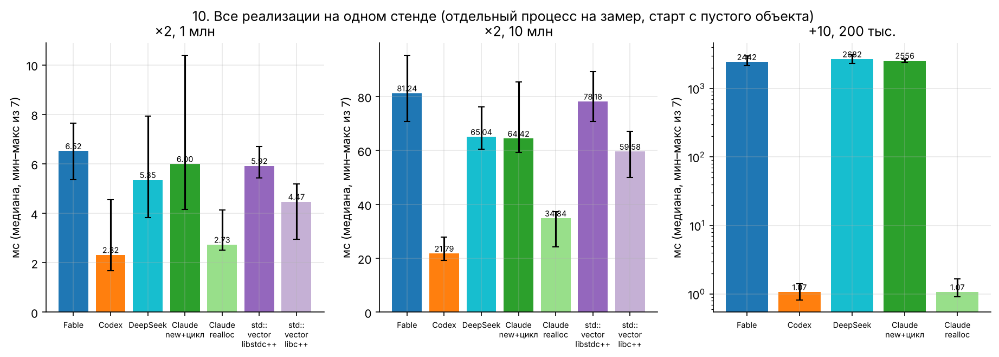
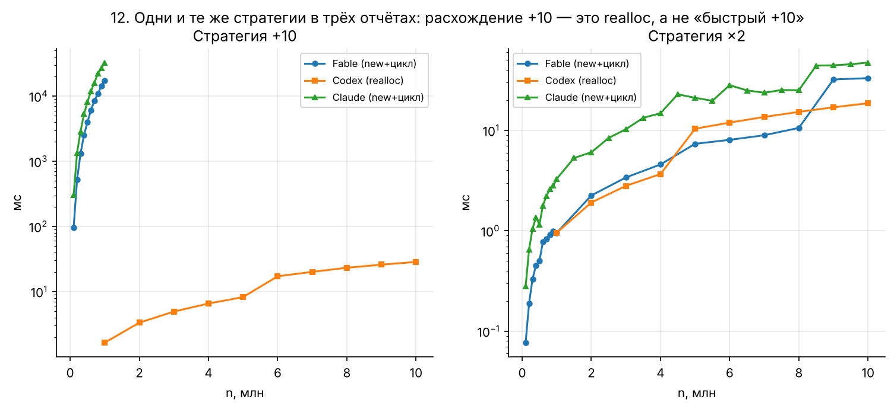
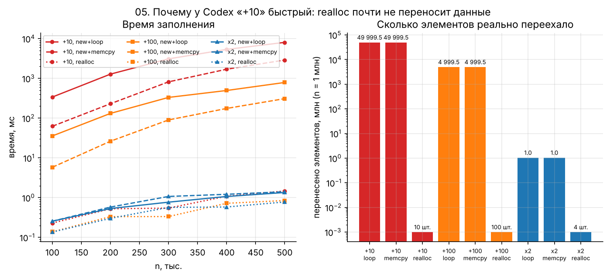
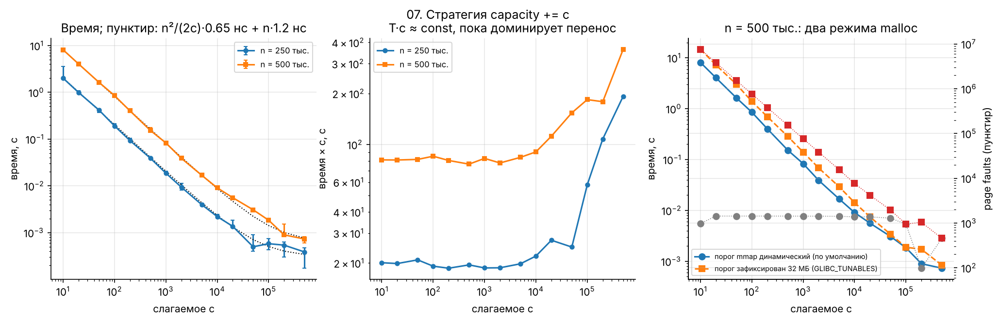

# Коротко о главном

Лабораторную о `subvector` решали четыре ИИ:

| Решение | Где лежит | Что в нём |
|---|---|---|
| Fable 5.2 | `Lab4/` (корень) | основное решение: класс для `int`, тесты, опыты, `REPORT.md` |
| Codex | `Lab4/ai_research/codex/` | класс на `realloc`, тесты, замеры, `REPORT.md` и рецензия `REVIEW.md` |
| DeepSeek | `Lab4/ai_research/deepseek/` | только класс (прислан без замеров и отчёта) |
| Claude | `Lab4/ai_research/claude/` | шаблон класса, расширенный стенд замеров, этот документ и отчёт по лабе |

Теория, устройство `std::vector` и все замеры по существу лабы — в отдельном документе `Lab4/Lab4_subvector.pdf` («отчёт по лабе»). Здесь — только сравнение решений.

**Главные выводы.**

1. **Почему в выводах Codex «криво».** Его `subvector` перевыделяет память через `realloc`. Для больших блоков glibc переносит не данные, а страницы памяти (`mremap`), и при +10 на миллион вставок адрес меняется всего 1 раз из 100 000. Квадратичная стоимость копирования в его замерах исчезла: +10 выглядит в 1,5 раза медленнее ×2, хотя при честном копировании разница около $10^4$ раз. Это замер аллокатора glibc, а не стратегии роста (разделы 3 и 4.1).
2. **Fable** решил лабораторную верно. Его гипотеза о скачке между 8 и 9 млн подтверждена. Абсолютные секунды в его отчёте зависят от порядка опытов через состояние `malloc` (раздел 4.2): 17 с на миллион у него против 33 с в прогоне Claude при одинаковом коде.
3. **DeepSeek** прислал корректный класс, по скорости он вровень с Fable и Claude. Но в нём нет доступа к элементам, `subvector v(10)` не компилируется, а огромный множитель даёт неопределённое поведение (раздел 7).
4. На общем стенде все копирующие решения (Fable, DeepSeek, Claude) совпадают в пределах разброса, а два решения с `realloc` (Codex и вариант Claude) быстрее их на +10 примерно в 2300 раз.
5. Точных счётчиков токенов нет ни у кого. Известно: Fable — 28 мин 42 с и 40 % пятичасового лимита; Codex — 14 мин 50 с; DeepSeek — неизвестно; Claude — оценка в разделе 9.

# 1. Что и как сравнивается

Все решения выполняют одно задание (текст — в отчёте по лабе, раздел 1). Первая версия решения Claude (17.11) опиралась на восстановленную по памяти формулировку («недовектор» со структурой `mas / top` и функциями `init`/`destructor`), и она оказалась **неверной**. После того как пришёл настоящий текст (18.11), решение Claude переписано в шаблон класса, а претензии к другим решениям «не по заданию» сняты: Fable, Codex и DeepSeek сделали класс для `int`, который задание разрешает.

Сравнение идёт по трём линиям:

* **код** — соответствие заданию, корректность (тесты с санитайзерами);
* **скорость** — один драйвер для всех реализаций, отдельный процесс на замер (раздел 3);
* **выводы** — насколько верно каждый объяснил свои числа (разделы 4–7).

# 2. Решение Claude

## 2.1 Решения в коде

* **Шаблон класса, как в задании**: `template <class T = int> class subvector` с закрытыми полями `data`, `size`, `capacity` и методами `push_back`, `pop_back`, `resize` (меняет **ёмкость**), `shrink_to_fit`, `clear`, конструктором пустого вектора и деструктором. Чтение — `get_size()`, `get_capacity()`, `operator[]`, `get_data()`.
* **Работает для любого `T`, а не только для `int`.** Память выделяется «сырой» (`malloc`), элементы создаются на месте (placement new) и уничтожаются явно. Это то, чего требует шаблон: `new T[n]` создал бы $n$ объектов заранее и требовал бы конструктора по умолчанию. При переносе используется `std::move_if_noexcept`, как в `std::vector` (отчёт по лабе, раздел 3.4). Если копия элемента бросит исключение, уже перенесённые уничтожаются, а вектор остаётся прежним.
* **Копирование и перемещение.** Копия глубокая, её ёмкость равна `size`, как у `std::vector`. Перемещение забирает блок, присваивание сделано через copy-and-swap. `push_back(v[0])` безопасен: значение копируется до перевыделения.
* **Две настройки для экспериментов.** `Growth` — прибавлять $c$ или умножать на $k$. `Realloc` — новый блок с переносом по одному (по умолчанию), новый блок с `memcpy` или `realloc` (как у Codex). Побайтовые способы включаются только для тривиально копируемых `T` (`if constexpr`). Для `std::string` и других «настоящих» классов они невозможны, и вектор молча использует перенос по одному. Это и есть причина, по которой `std::vector` не пользуется `realloc` (отчёт по лабе, раздел 3.3).
* **Безопасный рост.** `next_capacity` считает в `double`, округляет вверх, ограничивает `UINT_MAX` (заодно отсекает `NaN`) и гарантирует рост хотя бы на 1. Без этого $1\cdot1.5=1$ и $0\cdot2=0$ зациклили бы рост. Недопустимые $k\le1$ и $c=0$ заменяются значениями по умолчанию.
* **Строгая гарантия.** При неудаче выделения `resize` и `push_back` возвращают `false`, объект не меняется.
* **Быстрый путь `push_back`** — одно сравнение и запись, он встраивается в цикл. Редкий путь `grow_and_push` вынесен отдельно, по той же схеме, что `_M_realloc_insert` в libstdc++.

```cpp
template <class T = int>
class subvector {
public:
    subvector() = default;                       // пустой: data = nullptr, size = capacity = 0
    ~subvector() { release(); }
    bool push_back(const T& d) {
        if (size == capacity) return grow_and_push(d);
        ::new (static_cast<void*>(data + size)) T(d);
        ++size;
        return true;
    }
    T    pop_back();                             // пустой -> T() (для int это 0)
    bool resize(unsigned int new_capacity);      // меньше size -> лишние уничтожаются
    void shrink_to_fit() { resize(size); }
    void clear() { destroy(0, size); size = 0; } // память остаётся
private:
    T* data = nullptr;  unsigned int size = 0;  unsigned int capacity = 0;
    Growth growth;      Realloc how = Realloc::NewLoop;
};
```

**Первая версия** (17.11) была структурой с `mas / top` и свободными функциями по неверно восстановленному заданию. Все замеры отчёта по лабе и общий стенд раздела 3 сделаны на ней. После перехода на шаблон класса обе версии прогнаны вперемешку на общем стенде (`data/equivalence.csv`): ×2 на 10 млн — 62,1 и 62,2 мс (медианы 20 раундов), +10 на 200 тыс. — 2,43 и 2,31 с, вариант с `realloc` — 1,06 и 0,85 мс. Диапазоны перекрываются. Алгоритм тот же, время совпадает, поэтому данные 17.11 остаются в силе.

## 2.2 Проверки

`tests.cpp` собирается с AddressSanitizer и UndefinedBehaviorSanitizer (включая `float-cast-overflow`). Что проверяется:

* для каждого из трёх способов перевыделения: граничные случаи (пустой объект, `pop_back` пустого, `resize(0)`, обрезка) и 4 стратегии × 20 000 случайных операций против `std::vector` **по всему содержимому после каждой операции**;
* то же для `subvector<std::string>`;
* тип-счётчик: каждый созданный объект уничтожен ровно один раз после `pop_back`, `resize`, `clear` и деструктора;
* глубокая копия, перемещение, присваивание, `push_back` собственного элемента во время перевыделения;
* последовательности ёмкостей, переполнение и недопустимые параметры.

Итог: **3079 проверок, 0 ошибок**, санитайзеры молчат.

# 3. Все реализации на одном стенде



| мс, медиана [мин–макс] | ×2, 1 млн | ×2, 10 млн | +10, 200 тыс. |
|---|---|---|---|
| Fable (new[] + цикл) | 6,52 [5,37–7,65] | 81,2 [70,8–95,2] | 2 442 [2 144–2 995] |
| Codex (realloc) | 2,32 [1,67–4,56] | 21,8 [19,3–27,8] | 1,07 [0,82–1,42] |
| DeepSeek (new[] + цикл) | 5,35 [3,84–7,92] | 65,0 [60,5–76,1] | 2 682 [2 315–3 079] |
| Claude, new[] + цикл | 6,00 [4,15–10,37] | 64,4 [59,3–85,4] | 2 556 [2 421–2 704] |
| Claude, realloc | 2,73 [2,51–4,13] | 34,8 [24,3–37,3] | 1,07 [0,91–1,66] |
| std::vector, libstdc++ | 5,92 [5,43–6,71] | 78,2 [70,7–89,2] | — |
| std::vector, libc++ | 4,47 [2,96–5,20] | 59,6 [50,0–67,2] | — |

Стенд перезапущен 18.11 в новом контейнере (тот же тип машины, Xeon 2,1 ГГц), когда добавилось решение DeepSeek. Все семь реализаций измерены в одной сессии. Машина в этот день была примерно в 1,3 раза медленнее, чем 17.11, поэтому абсолютные числа выше, чем в отчёте по лабе, а соотношения те же.

* **Fable, DeepSeek и Claude с `new[]` на +10 совпадают** в пределах разброса (2442, 2682 и 2556 мс, диапазоны перекрываются): алгоритм и машинный цикл копирования одни и те же. Расхождение их отчётов (17 с против 33 с на миллион) объясняется состоянием `malloc`, а не кодом (раздел 4.2).
* **Codex и Claude с `realloc` тоже совпадают**: 1,07 и 1,07 мс, то есть в 2300 раз быстрее копирующих вариантов. Моя реализация с `realloc` воспроизводит результат Codex, значит, дело именно в способе перевыделения.
* На ×2 разница между реализациями в пределах 2–4 раз, и её почти целиком определяет способ получения памяти. `realloc`/`mremap` не копирует и не трогает заново старые страницы, поэтому быстрее всех. Три копирующих subvector (Fable, DeepSeek, Claude) и `std::vector` из libstdc++ идут вровень. libc++ быстрее libstdc++ примерно на четверть, причину я не исследовал.



# 4. Почему выводы авторов разошлись

## 4.1 Способ переноса: новый блок, memcpy, realloc



| n = 500 000 | new[] + цикл | new[] + memcpy | realloc | смен адреса (n = 1 млн): цикл / realloc |
|---|---|---|---|---|
| +10 | 8 055 мс | 2 896 мс | **1,47 мс** | 99 999 / **1** |
| +100 | 789 мс | 310 мс | **0,85 мс** | 9 999 / **1** |
| ×2 | 1,35 мс | 1,41 мс | 0,78 мс | 20 / 1 |

* `memcpy` быстрее простого цикла в 2,8 раза. При `-O2` g++ 13 не векторизует цикл с неизвестным числом итераций и копирует по одному `int`, а `memcpy` из glibc использует AVX.
* `realloc` быстрее цикла в **5 500 раз**. При +10 на миллион вставок блок сменил адрес **один раз**, на размере 10 элементов. Остальные 99 999 «перевыделений» расширили блок на месте: маленький блок лежит на вершине кучи, и `realloc` просто сдвигает её границу. Когда блок перерастает порог `mmap`, glibc переносит его через `mremap`, переставляя страницы без копирования данных. На 10 млн адрес меняется 5 раз, но данные при этом не копируются.
* Значит, **стенд Codex измерял не стратегию роста, а `realloc` из glibc.** Для `int` это законная и полезная оптимизация, её же использует folly для «перемещаемых» типов. Но вопрос лабораторной — сколько стоит перенос элементов при выбранной стратегии — она обходит. Ответ «+10 всего в 1,5 раза медленнее ×2» верен только для glibc, для `int` и для программы, которая больше ничего не выделяет. Достаточно, чтобы между двумя `push_back` кто-то выделил память, и блок перестанет расти на месте.

## 4.2 Состояние malloc: одни и те же стратегии, разные секунды



Тот же замер с зафиксированным порогом `mmap` (`GLIBC_TUNABLES=glibc.malloc.mmap_threshold=33554432`) медленнее в 1,7–1,8 раза: +10 занимает 14,7 с против 8,1 с, а page faults 7,6 млн против 977. В обычном режиме glibc после первого освобождения большого блока поднимает порог `mmap` и одновременно порог возврата памяти системе (trim). Освобождённая куча остаётся отображённой, и новые блоки встают на уже тронутые страницы. При зафиксированном пороге каждое освобождение на вершине кучи возвращает страницы ядру, и следующий блок снова платит page faults. У Fable часть `capacity` с `std::vector` до 10 млн шла первой и подняла порог до 32 МБ. Поэтому его +10 на миллион шёл 17 с, а в моём прогоне 33 с. Алгоритм при этом один: на общем стенде (рис. 10) Fable и Claude укладываются в один и тот же разброс.

# 5. Решение Fable 5.2 (`Lab4/`)

**Сильные стороны.** Честный перенос через `new[]` и цикл, как в задании. Подробные таблицы. Отдельный подсчёт переносов. Проверка прогноза $n^2$ на 2 и 3 млн. Развёртки по $k$ и $c$. 26 тестов, включая сверку со `std::vector` на 200 000 случайных операций. Выводы по существу верные: аддитивная стратегия квадратична, лучше всего $k \in [1{,}5; 2]$.

**Недочёты.**

1. Интерфейс **соответствует заданию**: класс с полями `data / size / capacity` и нужными методами. Задание предлагает шаблон, Fable сделал вариант для `int`, который задание тоже разрешает.
2. Абсолютные времена зависят от порядка частей в программе через состояние `malloc` (раздел 4.2), а в отчёте этого нет. Ничего не исказилось, кроме абсолютных секунд.
3. Развёртка по $k$ сделана при трёх значениях $n$. Пила (отчёт по лабе, рис. 3) делает выводы вида «k = 2.4 лучше k = 2» случайными, и Fable сам об этом предупреждает. Плотная развёртка (отчёт по лабе, рис. 6) снимает вопрос.
4. Скачок 8 → 9 млн и «почему стоит 20 мс» оставлены гипотезой. В отчёте по лабе она подтверждена счётчиком page faults и регрессией (разделы 6.2–6.3).
5. Утверждение «`std::vector` медленнее subvector ×2 на 4–30 %» не устойчиво: в моих замерах `std::vector` то быстрее, то медленнее (отчёт по лабе, раздел 6.1; здесь рис. 10).
6. Две строки `std_constructors.csv` содержат запятые без кавычек и не читаются CSV-парсером. Это заметил Codex.
7. Нет `noexcept`-эксперимента, нет сравнения библиотек.

# 6. Решение Codex (`Lab4/ai_research/codex/`) — что именно «криво»

**Сильные стороны.** Аккуратный код: отдельный `Growth`, проверка параметров, перемещение, `noexcept`. Тесты с санитайзерами и сверкой всего содержимого после каждой операции. Контрольная сумма всего массива. Пять повторов на каждой точке.

**Что криво.**

1. **Главное.** Перевыделение через `realloc`. Буквально задание это не запрещает («если места нет — увеличивает ёмкость»). Но цель лабораторной — увидеть, как стратегия роста влияет на скорость, и именно этот эффект `realloc` прячет. Кроме того, задание предлагает шаблон класса, а для произвольного `T` `realloc` невозможен. В результате график 02 и таблица отчёта показывают +10 = 28,6 мс и ×2 = 18,6 мс на 10 млн, будто разница полуторакратная. На самом деле при копировании она около $10^4$ раз. Codex упоминает в одном предложении, что «адрес при +10 изменился всего один раз», но вывод и графики оставлены как есть. Читатель получает неверный ответ на центральный вопрос лабораторной.
2. Объяснение асимптотики ($c\cdot m(m-1)/2$) в отчёте есть, но графики ему противоречат, и это противоречие не разрешено.
3. Точки 1, 2, …, 10 млн — это отметки **одного и того же** заполнения с накопленным временем, а не независимые заполнения. Соседние точки коррелированы, и медиана по 5 повторам относится к целому прогону.
4. Разница `std::vector` 31 мс против ×2 18,6 мс не объяснена. Это `mremap` против копирования и новых страниц (отчёт по лабе, рис. 4; здесь рис. 5).
5. Рис. 01 обрезан на 256 элементах, развёртки по $k$ и $c$ — только при $n = 1$ млн, без учёта пилы.
6. Трёхстороннее сравнение в `REVIEW.md` опирается на `Sem8.zip` (Journal), которого в репозитории нет, поэтому его нельзя повторить. Все реализации стартуют с ёмкости 1, а не 0.
7. Тяжёлый язык отчёта: много оговорок и мало прямых ответов. Например, «свободно мест на 10 млн: +10 — 0» подано как преимущество, хотя оно ничего не стоило только благодаря `realloc`.

# 7. Решение DeepSeek (`Lab4/ai_research/deepseek/`)

Решение прислано 18.11 одним классом, без `main`, замеров и отчёта. Сохранено без изменений в `deepseek/subvector.hpp`. Тесты к нему (`deepseek/tests.cpp`) и демонстрацию переполнения (`deepseek/ub_factor.cpp`) написал Claude.

**Что хорошо.**

* Честный перенос: `new (std::nothrow) int[]` и цикл копирования, как в задании и у Fable. Поэтому на общем стенде DeepSeek идёт вровень с Fable и Claude (рис. 10): +10 на 200 тыс. занимает 2,7 с, ×2 на 10 млн — 65 мс.
* Рост рассчитан так же, как у Claude и Codex: `ceil(cap·k)` и рост хотя бы на 1. Для ×1,5 получается последовательность 1, 2, 3, 5, 8, 12, 18, 27, 41, … Пустой старт без выделения памяти.
* При неудаче выделения `resize` и `push_back` возвращают `false`, объект не меняется. Копирование запрещено, деструктор освобождает память.
* Код короткий и читаемый, четыре стратегии задания собраны в `enum class Strategy`.
* **Проверки: 1022 из 1022 проходят** под ASan/UBSan. Это пустой объект, `resize`/`shrink_to_fit`/`clear`, последовательности ёмкостей, 4 стратегии × 30 000 случайных операций против `std::vector`.

**Недочёты.**

1. **Нет доступа к элементам.** У класса нет ни `get(i)`, ни `operator[]`, ни `data()`. Прочитать содержимое можно только `pop_back`, разрушая его. Для лабораторной этого хватает, но проверить, что после перевыделений элементы не испортились, можно только опустошив объект. Так и сделано в тестах и в контрольной сумме общего стенда.
2. **`subvector v(10);` не компилируется**: «call of overloaded `subvector(int)` is ambiguous». Литерал `int` одинаково хорошо преобразуется и в `double` (конструктор множителя), и в `unsigned int` (конструктор шага). Писать приходится `subvector v(10u)` или через `Strategy`. Кроме того, смысл конструктора зависит от типа аргумента: `subvector(2)` не собирается, `subvector(2.0)` — умножение на 2, `subvector(2u)` — прибавление 2. Это ловушка интерфейса.
3. **Нет проверки параметров.** `subvector(1e300)` даёт неопределённое поведение: `static_cast<unsigned>(ceil(cap·f))` вне диапазона, UBSan с `float-cast-overflow` это ловит. Множитель `NaN` — тоже UB. Множители $k \le 1$ и шаг 0 «спасает» правило «рост хотя бы на 1», но тогда стратегия незаметно превращается в +1, то есть квадратичную.
4. `next_add` переполняет `unsigned` у самой границы $2^{32}$: ёмкость «прирастает» до маленького числа, и `resize` обрезает данные. Для реальных размеров лабораторной это недостижимо.
5. Интерфейс по заданию: класс с `data_ / size_ / capacity_` и нужными методами. Это вариант для `int`, не шаблон, но задание такое допускает.
6. Подключены `<chrono>`, `<fstream>`, `<iostream>`, `<string>`, `<vector>`, которые в классе не используются. Видимо, это остаток от вырезанного `main` с замерами.
7. Нет исследовательской части: ни замеров, ни графиков, ни выводов, поэтому оценить, «криво» ли у DeepSeek что-то в выводах, нельзя. Как реализация контейнера решение корректно и по скорости не отличается от Fable и Claude.

# 8. Итоговая таблица

| Решение | Корректность | Соответствие заданию | Методика | Верность выводов |
|---|---|---|---|---|
| Fable | 26 тестов, OK | класс для `int`, всё по заданию | хорошая, но зависит от состояния malloc | верные, часть объяснений — гипотезы |
| Codex | тесты + ASan/UBSan, OK | класс для `int`; `realloc` формально допустим, но прячет изучаемый эффект | одиночные заполнения с накоплением | **центральный вывод о +10 неверен для задачи** |
| DeepSeek | 1022 проверки Claude + ASan/UBSan, OK; UB при огромном/NaN множителе | класс для `int`, по заданию; нет чтения элементов | замеров нет | выводов нет; по скорости вровень с Fable и Claude |
| Claude | 3079 проверок + ASan/UBSan, OK | **шаблон класса** (работает и для `std::string`) | отдельное заполнение на точку, page faults, регрессия, 3 способа переноса, общий стенд | объяснены оба расхождения |

# 9. Затраты работы ИИ

| Исполнитель | Время | Токены / лимит | Источник цифр |
|---|---|---|---|
| Fable 5.2 (основное решение `Lab4/`) | 28 мин 42 с | **40 % пятичасового лимита**; токены не сообщались | со слов пользователя, приведено в `ai_research/codex/REVIEW.md`; коммиты Lab4 — 10.11 00:13–00:26 |
| Codex (`Lab4/ai_research/codex/`) | 14 мин 50 с | **не известно** (телеметрия квоты и токенов недоступна) | `ai_research/codex/REVIEW.md`, коммиты 15.11 16:58–17:09 |
| DeepSeek (`Lab4/ai_research/deepseek/`) | **не известно** | **не известно** | прислан только код класса, без метаданных сессии |
| Claude (`Lab4/ai_research/claude/` и оба отчёта) | ≈ 40 мин (14:27–15:05 МСК), из них ≈ 20 мин — работа стенда замеров | точный счётчик недоступен; контекст к концу ≈ 130 тыс. токенов; суммарно по всем шагам — порядка нескольких миллионов токенов ввода, почти всё из кеша, и ≈ 60–80 тыс. токенов вывода (код + отчёт) | оценка по содержимому сессии |

Сравнивать эти цифры как «кто эффективнее» нельзя: объём работ разный. Fable делал лабораторную с нуля, Codex — реализацию плюс рецензию, DeepSeek — только класс (в присланном виде), Claude — реализацию, 9 серий замеров, сравнение всех решений и PDF. Добавление DeepSeek 18.11 (проверка, тесты, повторный общий стенд, правка отчёта) заняло у Claude ещё около 15 минут. Переделка решения под настоящее задание (шаблон класса, тесты, проверка эквивалентности, правка отчёта) — ещё около 20 минут. Разделение отчёта на «лабу» и «исследование ИИ» заняло ещё около 15 минут. Ни у одного исполнителя нет точного счётчика токенов, поэтому в таблице приведены только известные величины и оценки.

# 10. Выводы по ИИ

1. **Код у всех четырёх рабочий.** Тесты с санитайзерами проходят у всех. По заданию сделаны все: Fable, Codex и DeepSeek написали класс для `int`, Claude — шаблон класса.
2. **Решения расходятся не в коде, а в методике.** Codex выбрал `realloc` и тем самым измерил аллокатор glibc вместо стратегии роста. Поэтому его центральный вывод о +10 неверен для вопроса лабораторной, хотя каждое его число измерено честно.
3. **Fable — лучшее из исходных решений по сути лабы**: честный перенос, подсчёт переносов, проверка прогноза $n^2$, развёртки по $k$ и $c$. Слабые места — гипотезы без проверки и абсолютные секунды, зависящие от порядка опытов.
4. **DeepSeek** — корректный и быстрый класс, но с ловушками интерфейса: нет доступа к элементам, неоднозначный конструктор, нет проверки параметров. Исследовательской части нет, поэтому его выводы оценить нельзя.
5. **Claude** объяснил оба расхождения (`realloc` и состояние `malloc`), сделал шаблон класса и общий стенд. Но первая версия была написана по неверно восстановленному заданию и исправлена только после того, как пришёл настоящий текст.
6. **Токены сравнить нельзя**: точных счётчиков нет ни у одного исполнителя, а объём работ у всех разный.

# Приложение. Как повторить сравнение

```bash
cd Lab4/ai_research/claude
python3 compare.py      # собирает Fable, Codex, DeepSeek, Claude, std::vector (libstdc++, libc++) и гоняет 7 раундов
python3 plot.py         # рис. 10 и 12 вместе с остальными
python3 ../../report/make_pdf.py
```

Тесты решений: `Lab4/tests.cpp` (Fable), `ai_research/codex/tests.cpp`, `ai_research/deepseek/tests.cpp` (написаны Claude), `ai_research/claude/tests.cpp`.
