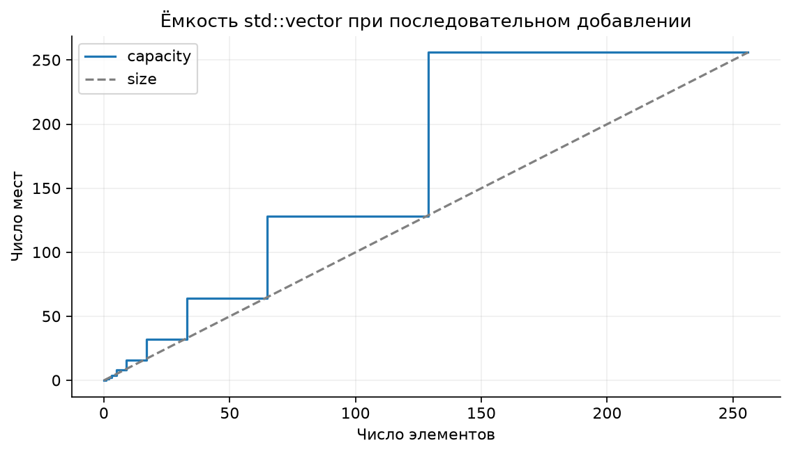
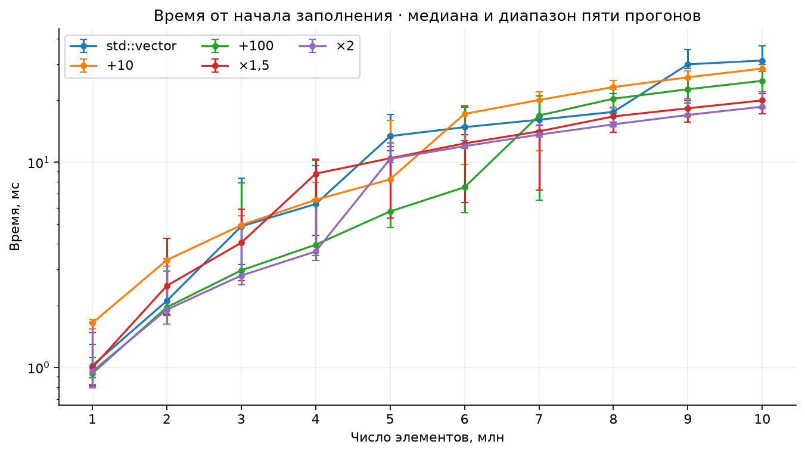
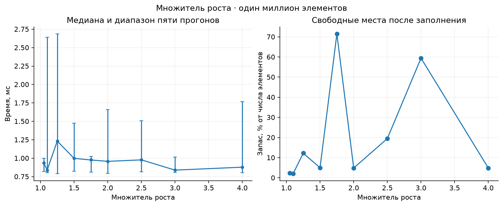
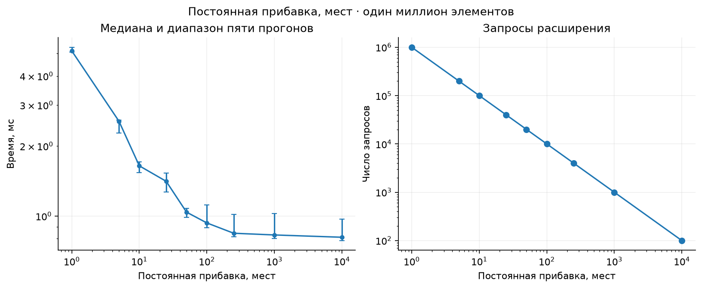

# Как растёт динамический массив

**Для последовательного заполнения неизвестного размера я бы выбрал удвоение.** Среди четырёх обязательных стратегий оно дало наименьшую медиану на 10 млн вставок, 18,62 мс. При множителе 1,5 время составило 19,98 мс, зато итоговый буфер занял на 4 818 560 мест меньше. Диапазоны времени этих двух стратегий пересекаются. Когда важнее уменьшить запас памяти, ×1,5 даёт разумный компромисс.

## 1. Что хранит контейнер

В заполненном префиксе `[0, size)` лежат записанные числа. Адрес начала массива хранится в `data_`, а `capacity_` сообщает, сколько чисел можно записать до следующего расширения. У нового объекта все три величины нулевые. Например, при `size = 3` и `capacity = 5` четвёртое и пятое числа записываются сразу. Шестое требует расширения.

| Вызов | Что происходит в версии Codex |
|---|---|
| `push_back(d)` | При заполненном буфере вычисляет новую ёмкость, затем помещает число в конец. Возвращает `false` при невозможности роста. |
| `pop_back()` | Уменьшает размер и возвращает последнее число. Пустой объект возвращает 0. |
| `resize(c)` | Устанавливает ёмкость и сохраняет первые `min(size, c)` значений. При отказе выделения сохраняет прежнее состояние. |
| `clear()` | Обнуляет размер. Буфер можно заполнить повторно. |
| `shrink_to_fit()` | Вызывает `resize(size)`. На пустом объекте освобождает буфер. При отказе аллокатора остаётся прежний запас. |

Класс владеет памятью единолично. Его можно перемещать, копирование запрещено. Для `int` подходит `std::realloc`, который может расширять блок на месте. Адрес, полученный через `data()`, нужно запрашивать заново после успешного изменения ёмкости. Вариант с прибавкой начинает с заданного шага, вариант с множителем — с одного места. Дробная ёмкость округляется вверх. Код и проверки доступны в [subvector.hpp](subvector.hpp) и [tests.cpp](tests.cpp).

## 2. Ёмкость и конструкторы std::vector

По горизонтали отложено число добавленных элементов. При добавлении 129-го элемента ёмкость выросла со 128 до 256. Вплоть до 256-го элемента оставалась та же ступень. Измеренная последовательность после первого выделения идёт с удвоением. На 10 млн элементов наблюдается ёмкость 16 777 216. Это наблюдение для последовательного `push_back` в данной версии libstdc++.

Конструкторы показывают разницу между длиной и значениями. `vector<int>(4)` создаёт четыре нуля, `vector<int>(4, 7)` — четыре семёрки, а `vector<int>{4, 7}` — два элемента со значениями 4 и 7. Конструктор по диапазону в опыте дал три семёрки. После копирования и после перемещения в новом объекте читались 4 и 7. [Полная таблица](data/std_constructors.csv)

## 3. Скорость заполнения

| Стратегия | 1 млн, медиана, мс | 10 млн, медиана, мс | Диапазон на 10 млн, мс | Свободно мест на 10 млн |
|---|---:|---:|---:|---:|
| +10 | 1,65 | 28,55 | 28,12–30,76 | 0 |
| +100 | 0,93 | 24,88 | 21,53–27,68 | 0 |
| ×1,5 | 1,00 | 19,98 | 17,21–21,60 | 1 958 656 |
| ×2 | 0,96 | 18,62 | 18,23–22,06 | 6 777 216 |
| std::vector | 1,02 | 31,25 | 29,91–36,90 | 6 777 216 |

Удвоение в обоих контейнерах привело к одной конечной ёмкости. При этом отличаются способ получения памяти, код вставки и цена расширения. Поэтому по совпадению ступеней ёмкости нельзя предсказать совпадение времени.

## 4. Как выбрать параметр

На миллионе вставок медианы ×1,5 и ×2 близки к одной миллисекунде. Свободных мест оказалось 49 868 и 48 576 соответственно. На 10 млн ситуация меняется в пользу ×1,5 по памяти. Причина в положении конечного размера относительно последней ступени. Сразу после расширения запас велик, а перед следующим расширением он почти исчерпан. Это объясняет немонотонную правую часть графика.

Если каждый рост требует скопировать все прежние элементы, то при удвоении число переносов до заполнения ёмкости 2ᵐ равно 1 + 2 + … + 2ᵐ⁻¹ = 2ᵐ − 1. Для любого фиксированного множителя больше единицы получается геометрическая сумма порядка N. Запись одного элемента стоит O(1) амортизированно, хотя отдельное расширение может стоить O(N).

При шаге 1 понадобился миллион запросов, при шаге 100 — 10 000, при шаге 10 000 — 100. Медианы составили 5,13, 0,93 и 0,81 мс. Для фиксированного шага c требуется m = ⌈N/c⌉ выделений или расширений. При обязательном копировании суммарно копируется c · m · (m − 1) / 2 элементов, то есть объём работы растёт квадратично по N. В опыте с `realloc` адрес при +10 изменился всего один раз за 100 000 запросов роста на миллионе вставок. Это объясняет, как постоянный шаг смог показать приемлемое время на этой машине. При другой истории выделений такой результат не гарантирован.

## Как получены числа

Ubuntu 26.04 LTS в WSL2, x86-64, Intel Core i7-13700H, GCC/libstdc++ 15.2, glibc 2.43, `-std=c++20 -O2`, без LTO. Таймер `steady_clock` охватывает добавление чисел от 0 до N − 1. Создание и уничтожение объекта, запись CSV и проверка контрольной суммы N(N − 1)/2 находятся за границами таймера.

Пять раундов с перемешиванием стратегий и фиксированным зерном. В основной серии каждая отметка в миллион — накопленное время с начала одного заполнения. Соседние точки одной кривой принадлежат одному прогону и зависимы. В развёртках параметров сравниваются отметки N = 1 млн. На графиках точки показывают медиану, отрезки — минимум и максимум пяти наблюдений. Счётчики получены отдельным проходом. Изменение численного адреса и длина префикса характеризуют наблюдаемое поведение буфера, физический трафик памяти не измерялся. [Стенд](benchmark.cpp) · [Все 320 замеров](data/times.csv) · [Счётчики](data/growth.csv)
