# Коротко о главном

**Что сделано.** Найдено и восстановлено задание лабораторной («недовектор» `subvector`). Написано третье, независимое решение (Claude, папка `Lab4/claude/`). Его интерфейс дословно повторяет задание: структура `mas / top / capacity` и функции `init`, `push_back`, `pop_back`, `resize`, `shrink_to_fit`, `clear`, `destructor`. Проведено 9 серий замеров и построено 12 графиков. Три чужих решения (Fable 5.2 в `Lab4/`, Codex в `Lab4/codex/`, DeepSeek в `Lab4/deepseek/`) и `std::vector` из двух стандартных библиотек перемерены на одном стенде. Просмотрены реализации из интернета: MSVC STL, libc++, folly `fbvector`, Rust `Vec`, Go `append`, Python `list`, Java `ArrayList`.

**Главные выводы.**

1. Прибавляющая стратегия `capacity += c` квадратична: $T(n)\approx a\,n^2/c$. Умножающая `capacity *= k` линейна, и цена одного `push_back` в среднем постоянна (амортизированное $O(1)$).
2. `std::vector` в libstdc++ и libc++ удваивает ёмкость, MSVC растит её в 1,5 раза. Стандарт множитель не фиксирует, он требует только амортизированного $O(1)$ для `push_back`.
3. **Почему в выводах Codex «криво».** Его `subvector` перевыделяет память через `realloc`. Для больших блоков glibc переносит не данные, а страницы памяти (`mremap`), и при +10 на миллион вставок адрес меняется всего 1 раз из 100 000. Квадратичная стоимость копирования в его замерах исчезла: +10 выглядит в 1,5 раза медленнее ×2, хотя при честном копировании разница в тысячи раз. Это замер аллокатора glibc, а не стратегии роста. Подробно в разделах 6.4 и 7.
4. Гипотеза Fable о скачке времени между 8 и 9 млн элементов подтверждена: это первое касание нового блока на 64 МБ. Регрессия по 1092 замерам раскладывает время так: **≈0,9 нс на сам `push_back`, ≈0,9 нс на перенос элемента и ≈1,5 мкс на page fault**. На больших $n$ page faults стоят больше, чем само копирование. От них не спасает даже `reserve(n)`.
5. Абсолютные числа зависят от состояния `malloc`. Одна и та же стратегия +10 на 500 тыс. занимает 8,1 с или 14,7 с в зависимости от порога `mmap` в glibc: 977 page faults против 7,6 млн. Поэтому числа Fable (17 с на миллион) и мои (33 с) различаются почти вдвое, хотя на одном стенде их код работает одинаково (рис. 10).
6. Лучший компромисс — множитель 1,5–2. При $k<\varphi\approx1{,}618$ освобождённые старые блоки в сумме могут вместить новый, поэтому MSVC и folly выбирают 1,5. При $k=2$ это невозможно никогда.

# 1. Задание

Текст задания в репозитории не сохранился, и в открытом интернете его найти не удалось. Ниже он восстановлен по стандартной формулировке курса («недовектор»), которую цитирует отчёт Fable: поле `top`, функция `get_time`, `resize` как изменение именно ёмкости.

```cpp
struct subvector {
    int *mas;               // указатель на массив в динамической памяти
    unsigned int top;       // сколько элементов лежит (размер)
    unsigned int capacity;  // сколько помещается без перевыделения
};
bool init(subvector *qv);          // пустой недовектор: mas = NULL, top = capacity = 0
bool push_back(subvector *qv, int d);   // добавить в конец, при нехватке места выделить ещё
int  pop_back(subvector *qv);      // удалить последний и вернуть его; пустой -> 0
bool resize(subvector *qv, unsigned int new_capacity);
     // изменить ёмкость; при уменьшении ниже top копируется только то, что влезает
void shrink_to_fit(subvector *qv); // переехать в блок ёмкости top
void clear(subvector *qv);         // top = 0, занимаемая память не меняется
void destructor(subvector *qv);    // освободить память, снова пустой
```

Исследовательская часть:

1. Изучить, как растёт `capacity` у `std::vector` при последовательных `push_back`, и что дают разные конструкторы и методы (`reserve`, `resize`, `shrink_to_fit`, `clear`).
2. Сравнить время заполнения при четырёх стратегиях роста: `+10`, `+100`, `×1.5`, `×2`, а также `std::vector`. Время измерять функцией `get_time()` на `std::chrono`.
3. Найти наилучшую стратегию и объяснить, почему она лучшая.

# 2. Теория

## 2.1 Динамический массив

Обычный массив `int a[N]` имеет размер, известный при компиляции. Динамический массив хранит **адрес** блока в куче и два числа:

* `top` (`size`) — сколько элементов действительно записано;
* `capacity` — сколько помещается в выделенный блок.

Всегда выполняется инвариант $0 \le \text{top} \le \text{capacity}$. Пока `top < capacity`, `push_back` — это одна запись в память и инкремент, несколько тактов. Когда `top == capacity`, места нет. Расширить блок «вправо» в общем случае нельзя: память за ним может быть занята. Поэтому выполняется **перевыделение**:

1. выделить новый блок ёмкости $c' > c$;
2. перенести $c$ старых элементов;
3. освободить старый блок, запомнить новый адрес.

Шаг 2 стоит $\Theta(c)$, поэтому отдельный `push_back` может быть очень дорогим. Весь вопрос лабораторной в том, **как выбирать $c'$**, чтобы суммарная цена $n$ вставок была малой и при этом не тратилось слишком много лишней памяти.

## 2.2 Прибавляющая стратегия: $c' = c + s$

Перевыделения происходят на размерах $s, 2s, 3s, \dots$. Их число $m = \lceil n/s \rceil$, и на $j$-м переносится $j\cdot s$ элементов:

$$
\text{copies}(n) = \sum_{j=1}^{m-1} j s = s\,\frac{m(m-1)}{2} \approx \frac{n^2}{2s}.
$$

Время **квадратично** по $n$ при любом постоянном $s$. Увеличение $s$ уменьшает время лишь в постоянное число раз. Если $s$ вдесятеро больше, то и время вдесятеро меньше: $T\cdot s \approx \text{const}$. Средняя цена одного `push_back` равна $\Theta(n/s)$ и растёт вместе с $n$. Плюс у такой стратегии один: запас памяти не превосходит $s$ элементов.

## 2.3 Умножающая стратегия: $c' = \lceil k c\rceil$, $k>1$

Ёмкости образуют геометрическую прогрессию $1, k, k^2, \dots$. Пусть последнее перевыделение было на ёмкости $C$, где $C/k < n \le C$. Перенесено

$$
\text{copies}(n) = \frac{C}{k} + \frac{C}{k^2} + \dots < \frac{C}{k}\cdot\frac{1}{1-1/k} = \frac{C}{k-1}.
$$

Так как $n \le C < k n$, получаем $\dfrac{n}{k-1} \lesssim \text{copies}(n) < \dfrac{k\,n}{k-1}$. На один элемент приходится **постоянное** число переносов: для $k=2$ от 1 до 2, для $k=1.5$ от 2 до 3, для $k=1.1$ от 10 до 11. Это и есть **амортизированное $O(1)$**: $n$ вставок стоят $\Theta(n)$, хотя отдельная вставка может стоить $\Theta(n)$.

**Метод потенциалов.** Возьмём $\Phi = \frac{k}{k-1}\,(\text{top} - \text{capacity}/k)$ (для $k=2$ это $2\,\text{top} - \text{capacity}$). Обычная вставка стоит 1 и увеличивает $\Phi$ на $\frac{k}{k-1}$. Перевыделение стоит $\text{top}$ переносов, а $\Phi$ падает примерно на столько же. Значит, амортизированная цена любой вставки не больше $1 + \frac{k}{k-1}$, то есть константа.

**Память.** Сразу после перевыделения заполнена только $1/k$ часть блока. Худший запас равен $(k-1)$ (100 % при $k=2$, 50 % при $k=1.5$). Если $n$ «случайно» по логарифмической шкале, средняя доля $\text{capacity}/n$ равна $\frac{k-1}{\ln k}$: для $k=2$ около 1,44 (запас 44 %), для $k=1.5$ около 1,23.

**Компромисс.** Чем больше $k$, тем меньше переносов, $\approx \frac{1}{k-1}\dots\frac{k}{k-1}$, но тем больше лишней памяти, $\approx k-1$. Время почти перестаёт падать уже после $k\approx1.5$–$2$, а запас памяти растёт линейно. Отсюда и практический выбор $k\in[1.5, 2]$.

## 2.4 Почему именно 1.5: повторное использование памяти и число $\varphi$

Пока элементы переносятся в новый блок ёмкости $k^m$, старый блок $k^{m-1}$ ещё занят. Освобождены лишь блоки $1, k, \dots, k^{m-2}$. Если они лежали подряд, их суммарный размер

$$
\sum_{i=0}^{m-2} k^i = \frac{k^{m-1}-1}{k-1}.
$$

Аллокатор может выдать новый блок на этом месте, если $\frac{k^{m-1}-1}{k-1} \ge k^m$. При большом $m$ это условие $\frac{1}{k(k-1)} \ge 1$, то есть $k^2 - k - 1 \le 0$, или $k \le \varphi = \frac{1+\sqrt5}{2} \approx 1.618$. При $k = 2$ новый блок **всегда** больше суммы всех предыдущих: $2^m > 2^m - 1$. Удваивающий вектор никогда не помещается в собственные «объедки» и всё время уходит дальше по адресному пространству. Это аргумент Эндрю Кёнига и документации folly `fbvector`, и по нему MSVC и folly используют 1.5. Аргумент модельный: реальный аллокатор держит блоки в разных пулах, а большие блоки (≥ 128 КБ в glibc) вообще берёт через `mmap` и сразу возвращает системе.

## 2.5 Из чего на самом деле складывается время

Асимптотика считает переносы, а реальное время зависит ещё от трёх вещей.

* **Копирование.** Оно идёт со скоростью памяти: несколько ГБ/с, порядка 0,1–0,6 нс на `int`, в зависимости от того, превратил ли компилятор цикл в `memcpy`/SIMD.
* **Аллокатор.** Блоки больше порога `M_MMAP_THRESHOLD` (128 КБ с динамическим подъёмом до 32 МБ) glibc выделяет системным вызовом `mmap` и освобождает через `munmap`, то есть каждый раз получает от ОС **новые** страницы.
* **Page faults.** Новые страницы ОС отображает лениво. Первое касание каждой страницы в 4 КБ (1024 `int`) вызывает page fault. Ядро обнуляет страницу, это около 0,1–0,5 мкс на страницу. Платит за это любая стратегия, даже `reserve(n)`: она избавляет от переносов, но не от первого касания.
* **`realloc`.** Для блоков из `mmap` glibc делает `mremap`: ядро переставляет записи в таблице страниц, и данные **вообще не копируются**. Для маленьких блоков `realloc` часто расширяет блок на месте, если сосед свободен. Поэтому `realloc` маскирует цену стратегии роста. Для `int` это законная оптимизация, но к вопросу лабораторной («сколько стоит перенос при данной стратегии») она отношения не имеет.

# 3. Как устроен `std::vector` и почему он именно такой

## 3.1 Представление

В libstdc++ `std::vector<T>` — это **три указателя** (`_M_start`, `_M_finish`, `_M_end_of_storage`) плюс аллокатор, обычно пустой и не занимающий места благодаря EBO. Значит, `sizeof(vector<int>) == 24` на 64-битной платформе. Размер `size() = finish − start`, ёмкость `capacity() = end_of_storage − start`. Указатели вместо целых чисел выбраны потому, что так дешевле самые частые операции: `push_back` сравнивает `finish != end_of_storage` и пишет по `finish`, а итераторы — это просто указатели.

## 3.2 Рост

При переполнении libstdc++ вызывает `_M_realloc_insert` → `_M_check_len(1)`, новая длина равна `size + max(size, n)`. Для одного элемента это удвоение, для пустого 1. При `insert` многих элементов берётся максимум: `vector(5)` после вставки 20 элементов получает ёмкость 25, а не 10. Это подтверждено замером (табл. 1). libc++ (Clang) использует `max(2·capacity, нужное)`, MSVC — `capacity + capacity/2`, но не меньше нужного.

**Почему стандарт не фиксирует множитель, но требует геометрического роста.** Стандарт C++ требует, чтобы `push_back` выполнялся за **амортизированное постоянное время**. Из раздела 2.2 следует, что никакая прибавляющая стратегия этому не удовлетворяет, а любая умножающая — удовлетворяет. Конкретное $k$ — инженерный выбор библиотеки.

## 3.3 Почему не `realloc`

* `std::vector<T>` должен работать с любым `T`: со строками, объектами, владеющими ресурсами, объектами, хранящими указатели на себя. Побайтовое перемещение такого объекта (`realloc`) в общем случае ломает его. Элементы надо **переместить конструктором** (`T(T&&)`) и уничтожить старые.
* Интерфейс аллокатора (`std::allocator_traits`) содержит только `allocate` / `deallocate`, без «расширь на месте».
* Для тривиально копируемых типов (`int`) libstdc++ всё же переносит элементы одним `memmove` (`__relocate_a`), а вот `mremap` недоступен.

## 3.4 Гарантии исключений и `noexcept`

`push_back` даёт **строгую гарантию**: если при перевыделении брошено исключение, вектор остаётся прежним. Поэтому при переносе старых элементов используется `std::move_if_noexcept`. Если конструктор перемещения `T` не помечен `noexcept`, а копирование возможно, вектор **копирует** элементы. Иначе исключение на середине переноса оставило бы часть элементов «вынутыми» из старого блока. Это измерено на рис. 9: без `noexcept` заполнение вектора строк заметно медленнее.

## 3.5 Инвалидация

Любое перевыделение делает недействительными **все** указатели, ссылки и итераторы на элементы. Это прямое следствие переезда в новый блок. `reserve(n)` заранее выделяет блок и даёт гарантию: пока `size() ≤ n`, адреса не меняются.

## 3.6 Методы, которые не возвращают память

`pop_back`, `clear`, `erase`, `resize(меньше)` ёмкость не уменьшают. Иначе чередование `push_back`/`pop_back` на границе ёмкости стоило бы $\Theta(n)$ каждый раз. `shrink_to_fit` — **необязательный** запрос, libstdc++ его исполняет копированием в новый блок. Копия вектора получает ёмкость ровно `size()`, а перемещение забирает блок целиком.

## 3.7 Стратегии роста в других библиотеках и языках

| Реализация | Правило роста | Комментарий |
|---|---|---|
| libstdc++ (GCC) | $\times 2$ (`size + max(size, n)`) | проверено здесь |
| libc++ (Clang) | $\times 2$ (`max(2·cap, need)`) | проверено здесь |
| MSVC STL | $\times 1.5$ (`cap + cap/2`) | по исходнику `<vector>` |
| folly `fbvector` | $\times 1.5$, учитывает размерные классы jemalloc, использует `realloc` для «relocatable» типов | аргумент повторного использования памяти |
| Rust `Vec` | $\times 2$, минимум 4 (8 для байтов) | `RawVec::grow_amortized` |
| Go `append` | $\times 2$ до 256 элементов, далее плавно к $\times 1.25$ | с округлением до размерных классов |
| Python `list` | $\approx\times 1.125$ + константа | `list_resize`; новые объекты дешёвые (указатели) |
| Java `ArrayList` | $\times 1.5$ | `newCapacity = old + (old >> 1)` |
| C# `List<T>` | $\times 2$, старт с 4 | |

Общий вывод: все используют **умножение**, $k$ от 1.125 до 2. Меньшие $k$ выбирают там, где важнее память или переиспользование блоков, большие — где важнее скорость.

# 4. Решение Claude

Файлы лежат в `Lab4/claude/`: `subvector.h`, `subvector.cpp`, `tests.cpp`, `bench.cpp`, `compare.cpp`, `capseq.cpp`, `compare.py`, `plot.py`, `make_pdf.py`, `run.sh`.

## 4.1 Решения в коде

* **Интерфейс как в задании**: структура и свободные функции, а не класс. Из-за этого оба предыдущих решения отличаются от задания: у Fable класс с методами и полем `size`, у Codex класс с `realloc`. Сверху добавлено только то, без чего нельзя провести опыт: поле `growth` (умножать на $k$ или прибавлять $c$) и поле `how` (способ перевыделения).
* **Три способа перевыделения** в одной функции `resize`: `new[]` + цикл копирования (как в задании и у Fable), `new[]` + `memcpy`, `realloc` (как у Codex). Так влияние способа переноса отделяется от влияния стратегии, и становится видно, откуда разница между отчётами Fable и Codex.
* **Безопасный рост.** `next_capacity` считает в `double`, округляет вверх, ограничивает `UINT_MAX` и гарантирует рост хотя бы на 1. Без этого $1\cdot1.5=1$ и $0\cdot2=0$ зациклили бы рост. Недопустимые $k\le1$ и $c=0$ заменяются значениями по умолчанию.
* **Строгая гарантия.** При неудаче выделения (`new (std::nothrow)` или `realloc` вернули `nullptr`) структура не меняется, функция возвращает `false`.
* **Быстрый путь `push_back` встраивается** (inline в заголовке), а редкий путь `grow_slow` вынесен в отдельную функцию. Это та же схема, что у `std::vector` (`_M_realloc_insert` помечен как холодный).
* **`destructor`** освобождает память и снова делает объект пустым. Повторный вызов безопасен.

```cpp
inline bool push_back(subvector* qv, int d) {
    if (qv->top == qv->capacity && !grow_slow(qv)) return false;
    qv->mas[qv->top++] = d;
    return true;
}
unsigned int next_capacity(const Growth& g, unsigned int cap) {
    double want = g.multiply ? (cap == 0 ? 1.0 : std::ceil(cap * g.factor)) : double(cap) + g.step;
    if (want > double(UINT_MAX)) want = UINT_MAX;
    unsigned int next = static_cast<unsigned int>(want);
    return next > cap ? next : cap + 1;
}
```

## 4.2 Проверки

`tests.cpp` собирается с AddressSanitizer и UndefinedBehaviorSanitizer. Для каждого из трёх способов перевыделения проверяются граничные случаи (пустой объект, `pop_back` пустого, `resize(0)`, обрезка, повторный `destructor`). Затем 4 стратегии × 30 000 случайных операций сравниваются со `std::vector` **по всему содержимому после каждой операции**. Отдельно проверены последовательности ёмкостей и переполнение. Итог: **3065 проверок, 0 ошибок**, санитайзеры молчат.

## 4.3 Методика замеров

| | |
|---|---|
| Машина | Intel Xeon @ 2.10 ГГц (KVM, 4 vCPU), Ubuntu 24.04, ядро 6.18 |
| Компиляторы | g++ 13.3 (libstdc++), clang++ 18.1 (libc++), `-O2` |
| Таймер | `std::chrono::steady_clock` вокруг цикла из $n$ вызовов `push_back` |
| Повторы | 7 для быстрых стратегий, 3 для +10/+100; порядок стратегий перемешан в каждом раунде |
| Что вне таймера | создание и уничтожение объекта, запись CSV, контрольная сумма |
| Счётчики | page faults (`getrusage`, `ru_minflt`) вокруг того же цикла; число переносов — точная формула и отдельный проход |

На графиках точка — медиана, отрезок — минимум и максимум повторов. Каждое заполнение строит **новый объект с нуля**, в отличие от стенда Codex, где точки 1…10 млн — отметки одного и того же заполнения.

# 5. Исследование std::vector

## 5.1 Последовательность ёмкостей

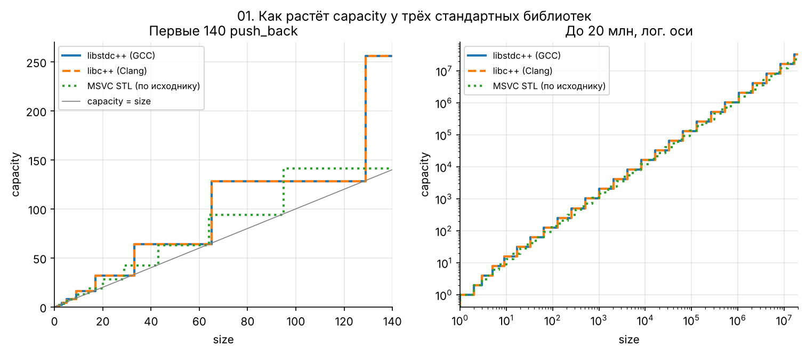

libstdc++ (g++ 13) и libc++ (clang 18) дали **одинаковую** последовательность: $0, 1, 2, 4, 8, \dots, 2^{24}=16\,777\,216, 2^{25}$. Это 26 перевыделений на 20 млн вставок. Перевыделение случается при вставке элемента номер $2^m+1$: 129-й элемент переводит ёмкость со 128 на 256. Правило MSVC (`cap + cap/2`) даёт $1, 2, 3, 4, 6, 9, 13, 19, 28, 42, 63, 94, 141, \dots$ и 43 перевыделения на те же 20 млн. Ступени в 1,5 раза чаще, но каждая ниже.

## 5.2 Конструкторы и методы (libstdc++)

| Действие | size | capacity | Что из этого следует |
|---|---|---|---|
| `vector<int> a;` | 0 | 0 | пустой вектор памяти не выделяет |
| `vector<int> b(10);` / `c(10, 7)` | 10 | 10 | конструктор выделяет ровно нужное |
| `vector<int> d{1, 2, 3};` | 3 | 3 | то же для списка |
| `b.push_back(1)` при 10/10 | 11 | 20 | запас появляется только при переполнении: ×2 |
| `vector<int> e(b);` копия | 11 | 11 | копия не наследует запас |
| `vector<int> m(std::move(e));` | 11 | 11 | перемещение забирает блок, `e` становится 0/0 |
| `a.reserve(100);` | 0 | 100 | ёмкость без элементов |
| `a.resize(5);` | 5 | 100 | `resize` вектора меняет **размер**, а не ёмкость (в отличие от `resize` в задании) |
| `a.reserve(10);` при capacity 100 | 5 | 100 | `reserve` никогда не уменьшает |
| `b.pop_back();` | 10 | 20 | удаление память не возвращает |
| `b.clear();` | 0 | 20 | тоже |
| `b.shrink_to_fit();` | 0 | 0 | только явный запрос возвращает память |
| `vector<int>(5).resize(6)` | 6 | 10 | рост при `resize` тоже удвоением |
| `vector<int>(5)` + `insert` 20 эл. | 25 | 25 | `size + max(size, n)`: при большой вставке берётся нужное |

# 6. Результаты замеров

## 6.1 Сравнение четырёх стратегий и std::vector

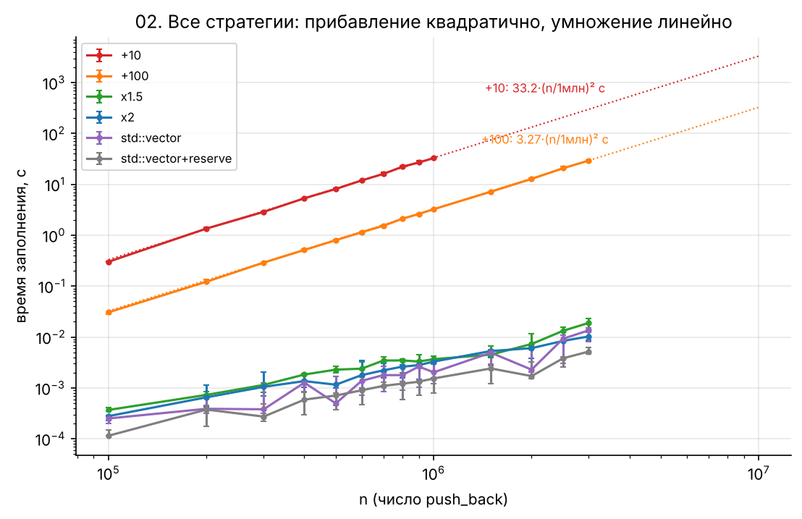

Медианы, мс (7 повторов для быстрых стратегий, 3 для +10/+100):

| n | +10 | +100 | ×1.5 | ×2 | std::vector | std::vector + reserve |
|---|---|---|---|---|---|---|
| 100 000 | 302 | 30,7 | 0,37 | 0,28 | 0,25 | 0,12 |
| 500 000 | 8 129 | 800 | 2,29 | 1,16 | 0,50 | 0,71 |
| 1 000 000 | 32 772 | 3 246 | 3,68 | 3,29 | 2,03 | 1,54 |
| 3 000 000 | — | 29 359 | 19,0 | 10,3 | 13,6 | 5,2 |
| 5 000 000 | — | — | 20,9 | 21,1 | 16,4 | 5,1 |
| 10 000 000 | — | — | 42,8 | 47,3 | 43,7 | 11,2 |
| 20 000 000 | — | — | 140,2 | 119,4 | 101,4 | 42,3 |

**Наблюдения.**

* На логарифмических осях +10 и +100 — прямые с наклоном 2: $T = 33{,}2\cdot(n/10^6)^2$ с и $T = 3{,}27\cdot(n/10^6)^2$ с. Отношение 10,2 совпадает с отношением шагов, как и предсказывает $n^2/(2c)$.
* По этой формуле +10 до 10 млн занял бы около **55 минут**, а +100 около **5,5 минуты** на одно заполнение. Поэтому эти точки не измерялись, а экстраполированы. Все измеренные точки ложатся на параболу с отклонением в несколько процентов. У Fable та же проверка (прогноз на 2 и 3 млн по точкам до 1 млн) тоже сошлась.
* На миллионе +10 медленнее ×2 примерно в **10 000 раз**, +100 — примерно в 1000 раз.
* Умножающие стратегии и `std::vector` растут линейно. Разница между ×1,5, ×2 и `std::vector` в пределах «пилы» (рис. 3) и не постоянна по знаку.

## 6.2 «Пила» и откуда она берётся

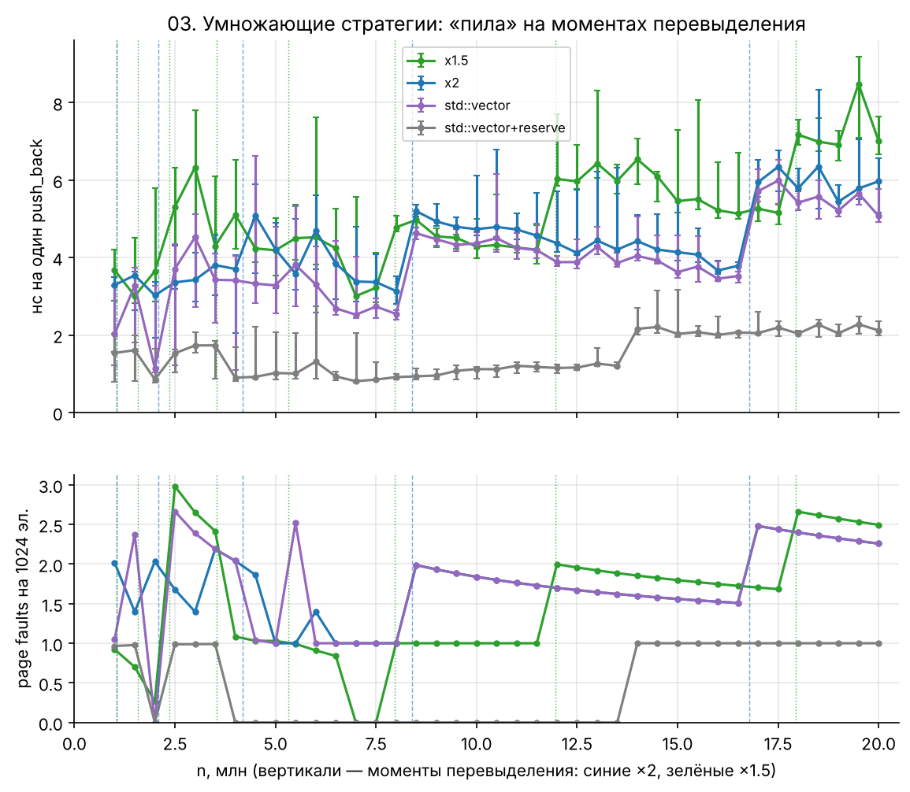

У ×2 и `std::vector` время на элемент скачком растёт при $n$ чуть больше $2^{23}=8\,388\,608$: с 3,1 до 5,2 нс. Так же оно растёт при $n > 2^{24}$. Ровно в этих точках удваивается число page faults: с 1,0 до 2,0 на 1024 элемента (нижняя панель). Перевыделение на блок $2^{24}$ `int` = 64 МБ означает, что надо отобразить 16 384 новые страницы, и первая половина из них трогается уже при копировании старых 8,4 млн элементов. У ×1,5 скачки стоят в своих точках: 7,97 млн, 11,96 млн, 17,9 млн. Поэтому при одном $n$ «лучше» ×1,5, при другом ×2. **Сравнивать множители по одному $n$ нельзя.** Именно поэтому в разделе 6.5 время усредняется по 37 значениям $n$.

Серая кривая `reserve(n)` — нижняя граница: переносов нет вовсе. Но и она в 2 раза дороже при $n \ge 14$ млн, где появляются page faults (1 на 1024 элемента, то есть по одному на каждую новую страницу). При меньших $n$ память берётся из уже отображённого ранее кучевого пространства и faults не нужны.

## 6.3 Из чего состоит время

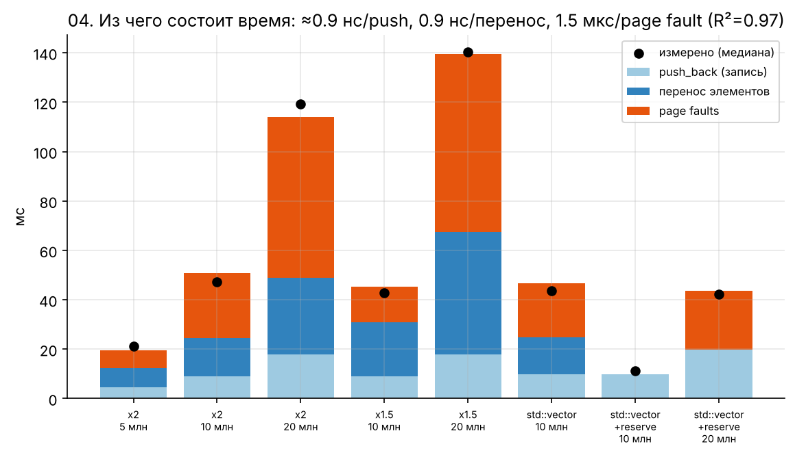

Линейная регрессия по всем замерам с $n \ge 1$ млн:

| | на один push_back | на один перенос | на один page fault | $R^2$ |
|---|---|---|---|---|
| subvector (×1.5, ×2), new + цикл | 0,89 нс | 0,92 нс | 1,48 мкс | 0,97 |
| std::vector (с reserve и без) | 0,99 нс | 0,88 нс | 1,22 мкс | 0,98 |

Один page fault на 1024 элемента — это около 1,4 нс на элемент, **больше, чем запись и перенос вместе**. Для ×2 на 10 млн элементов это 8,9 мс записи, 15,5 мс переноса ($2^{24}-1$ элементов) и 26,5 мс page faults. Модель даёт 51 мс, измерено 47 мс. Отсюда практический вывод: `reserve`, когда размер известен заранее, выигрывает в 4 раза не из-за копирования, а потому что сокращает и переносы, и число новых страниц.

## 6.4 Способ переноса: new+цикл, new+memcpy, realloc

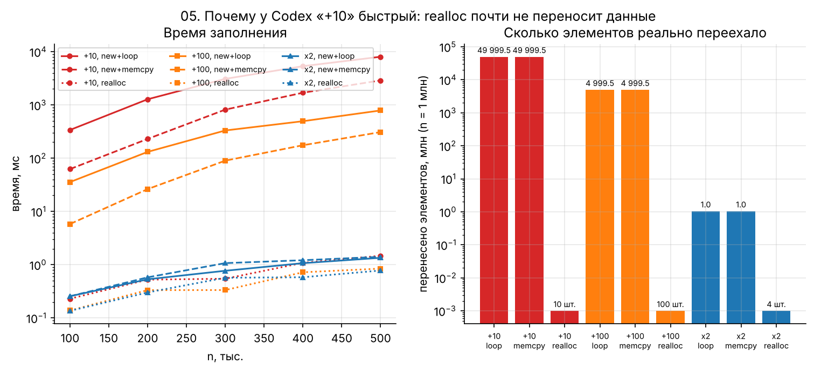

| n = 500 000 | new[] + цикл | new[] + memcpy | realloc | смен адреса (n = 1 млн): цикл / realloc |
|---|---|---|---|---|
| +10 | 8 055 мс | 2 896 мс | **1,47 мс** | 99 999 / **1** |
| +100 | 789 мс | 310 мс | **0,85 мс** | 9 999 / **1** |
| ×2 | 1,35 мс | 1,41 мс | 0,78 мс | 20 / 1 |

* `memcpy` быстрее простого цикла в 2,8 раза. При `-O2` g++ 13 не векторизует цикл с неизвестным числом итераций и копирует по одному `int`, а `memcpy` из glibc использует AVX.
* `realloc` быстрее цикла в **5 500 раз**. При +10 на миллион вставок блок сменил адрес **один раз**, на размере 10 элементов. Остальные 99 999 «перевыделений» расширили блок на месте: маленький блок лежит на вершине кучи, и `realloc` просто сдвигает её границу. Когда блок перерастает порог `mmap`, glibc переносит его через `mremap`, переставляя страницы без копирования данных. На 10 млн адрес меняется 5 раз, но данные при этом не копируются.
* Значит, **стенд Codex измерял не стратегию роста, а `realloc` из glibc.** Для `int` это законная и полезная оптимизация, её же использует folly для «перемещаемых» типов. Но вопрос лабораторной — сколько стоит перенос элементов при выбранной стратегии — она обходит. Ответ «+10 всего в 1,5 раза медленнее ×2» верен только для glibc, для `int` и для программы, которая больше ничего не выделяет. Достаточно, чтобы между двумя `push_back` кто-то выделил память, и блок перестанет расти на месте.

## 6.5 Время от множителя k

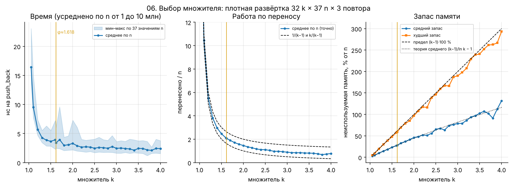

| k | нс на push_back (среднее по n) | переносов на элемент | средний запас памяти | худший запас |
|---|---|---|---|---|
| 1,05 | 16,4 | 20,5 | 2,5 % | 5 % |
| 1,1 | 9,5 | 10,5 | 4,5 % | 9 % |
| 1,2 | 5,7 | 5,5 | 9,7 % | 20 % |
| 1,3 | 4,3 | 3,8 | 14 % | 30 % |
| **1,5** | **3,65** | **2,46** | **23 %** | **48 %** |
| 1,618 (φ) | 3,40 | 2,07 | 28 % | 59 % |
| **2** | **3,30** | **1,46** | **46 %** | **97 %** |
| 2,5 | 2,47 | 1,10 | 65 % | 147 % |
| 3 | 2,46 | 0,89 | 79 % | 190 % |
| 4 | 2,41 | 0,77 | 132 % | 293 % |

* Число переносов лежит точно между теоретическими границами $\frac{1}{k-1}$ и $\frac{k}{k-1}$ (средняя панель). Средний запас совпадает с теорией $\frac{k-1}{\ln k} - 1$ (правая панель).
* Время падает гиперболой до $k \approx 1{,}5$, дальше почти не меняется: от 1,5 до 4 выигрыш 1,2 нс на элемент. Средний запас памяти при этом растёт с 23 % до 132 %.
* Переход от 1,5 к 2 даёт −10 % времени за +23 п. п. запаса. Обе точки — разумный компромисс, и выбор между ними — это выбор между памятью (MSVC, Java, folly) и скоростью (GCC, Clang, Rust, C#).

## 6.6 Время от слагаемого c

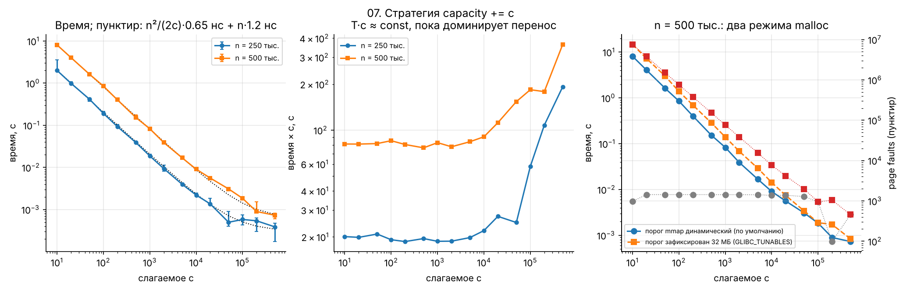

* Пока перенос доминирует ($c \le 5000$), произведение $T\cdot c$ постоянно: ≈ 20 с при $n=250$ тыс. и ≈ 80 с при $n=500$ тыс. Вдвое большее $n$ даёт вчетверо большую константу, то есть квадратичность.
* При $c \ge 10^5$ время упирается в «пол» ≈ 0,7 мс: $n$ записей плюс первое касание страниц.
* **Правая панель — главная находка этого раздела.** Тот же замер с зафиксированным порогом `mmap` (`GLIBC_TUNABLES=glibc.malloc.mmap_threshold=33554432`) медленнее в 1,7–1,8 раза: +10 занимает 14,7 с против 8,1 с, а page faults 7,6 млн против 977. В обычном режиме glibc после первого освобождения большого блока поднимает порог `mmap` и одновременно порог возврата памяти системе (trim). Освобождённая куча остаётся отображённой, и новые блоки встают на уже тронутые страницы. При зафиксированном пороге каждое освобождение на вершине кучи возвращает страницы ядру, и следующий блок снова платит page faults. У Fable часть `capacity` с `std::vector` до 10 млн шла первой и подняла порог до 32 МБ. Поэтому его +10 на миллион шёл 17 с, а в моём прогоне 33 с. Алгоритм при этом один: на общем стенде (рис. 10) Fable и Claude укладываются в один и тот же разброс.

## 6.7 Цена отдельного push_back

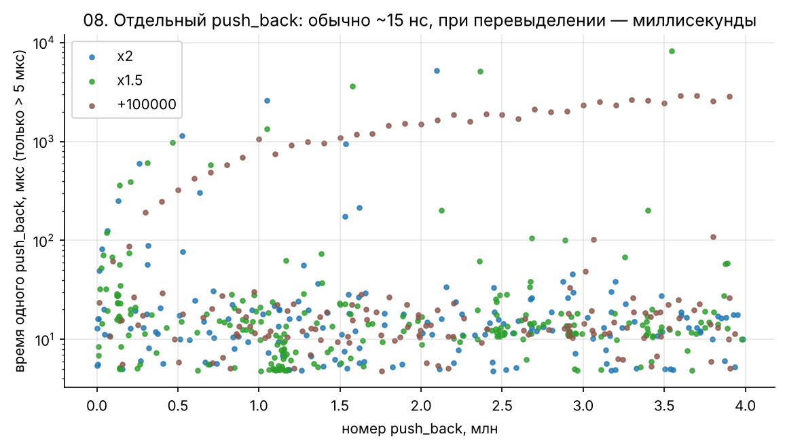

Медиана — 32 такта (≈ 15 нс, вместе с накладными `rdtsc`), 99-й процентиль — 44 такта. Но максимум для ×2 — 10,9 млн тактов (**5,2 мс**), для ×1,5 — 8,3 мс. Это перевыделения. Амортизированное $O(1)$ — это обещание о **сумме**, а не о каждой операции. Для систем реального времени (звук, игры, управление роботом) такой всплеск недопустим, и там используют `reserve`, пулы или контейнеры с другой структурой (`std::deque`, кольцевые буферы).

## 6.8 noexcept и перенос объектов

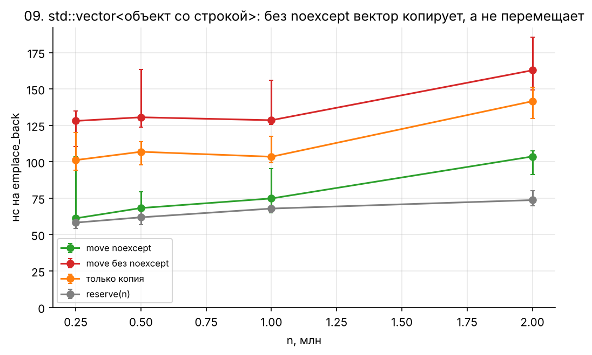

| n = 1 млн | время | относительно noexcept move |
|---|---|---|
| move-конструктор `noexcept` | 74,8 мс | 1,00 |
| move-конструктор без `noexcept` | 128,5 мс | 1,72 |
| только копирование | 103,5 мс | 1,38 |
| `reserve(n)` (переносов нет) | 67,9 мс | 0,91 |

Без `noexcept` libstdc++ не рискует перемещать (раздел 3.4) и **копирует** каждую строку при каждом перевыделении: новое выделение памяти и копирование символов. Одно слово `noexcept` в классе ускоряет заполнение вектора в 1,7 раза.

# 7. Сравнение решений

## 7.1 Все реализации на одном стенде

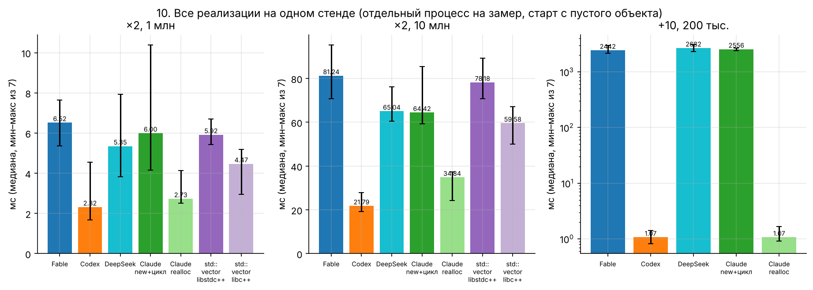

| мс, медиана [мин–макс] | ×2, 1 млн | ×2, 10 млн | +10, 200 тыс. |
|---|---|---|---|
| Fable (new[] + цикл) | 6,52 [5,37–7,65] | 81,2 [70,8–95,2] | 2 442 [2 144–2 995] |
| Codex (realloc) | 2,32 [1,67–4,56] | 21,8 [19,3–27,8] | 1,07 [0,82–1,42] |
| DeepSeek (new[] + цикл) | 5,35 [3,84–7,92] | 65,0 [60,5–76,1] | 2 682 [2 315–3 079] |
| Claude, new[] + цикл | 6,00 [4,15–10,37] | 64,4 [59,3–85,4] | 2 556 [2 421–2 704] |
| Claude, realloc | 2,73 [2,51–4,13] | 34,8 [24,3–37,3] | 1,07 [0,91–1,66] |
| std::vector, libstdc++ | 5,92 [5,43–6,71] | 78,2 [70,7–89,2] | — |
| std::vector, libc++ | 4,47 [2,96–5,20] | 59,6 [50,0–67,2] | — |

Стенд перезапущен 18.11 в новом контейнере (тот же тип машины, Xeon 2,1 ГГц), когда добавилось решение DeepSeek. Все семь реализаций измерены в одной сессии. Машина в этот день была примерно в 1,3 раза медленнее, чем 17.11, поэтому абсолютные числа выше, чем в разделе 6, а соотношения те же.

* **Fable, DeepSeek и Claude с `new[]` на +10 совпадают** в пределах разброса (2442, 2682 и 2556 мс, диапазоны перекрываются): алгоритм и машинный цикл копирования одни и те же. Расхождение их отчётов (17 с против 33 с на миллион) объясняется состоянием `malloc`, а не кодом (раздел 6.6).
* **Codex и Claude с `realloc` тоже совпадают**: 1,07 и 1,07 мс, то есть в 2300 раз быстрее копирующих вариантов. Моя реализация с `realloc` воспроизводит результат Codex, значит, дело именно в способе перевыделения.
* На ×2 разница между реализациями в пределах 2–4 раз, и её почти целиком определяет способ получения памяти. `realloc`/`mremap` не копирует и не трогает заново старые страницы, поэтому быстрее всех. Три копирующих subvector (Fable, DeepSeek, Claude) и `std::vector` из libstdc++ идут вровень. libc++ быстрее libstdc++ примерно на четверть, причину я не исследовал.

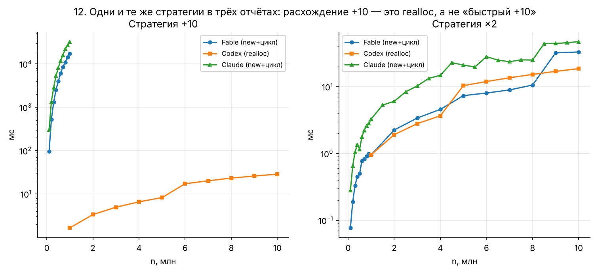

## 7.2 Решение Fable 5.2 (`Lab4/`)

**Сильные стороны.** Честный перенос через `new[]` и цикл, как в задании. Подробные таблицы. Отдельный подсчёт переносов. Проверка прогноза $n^2$ на 2 и 3 млн. Развёртки по $k$ и $c$. 26 тестов, включая сверку со `std::vector` на 200 000 случайных операций. Выводы по существу верные: аддитивная стратегия квадратична, лучше всего $k \in [1{,}5; 2]$.

**Недочёты.**

1. Интерфейс отошёл от задания: класс с полем `size` вместо структуры с `top` и функций `init`/`destructor`. Fable это оговорил.
2. Абсолютные времена зависят от порядка частей в программе через состояние `malloc` (раздел 6.6), а в отчёте этого нет. Ничего не исказилось, кроме абсолютных секунд.
3. Развёртка по $k$ сделана при трёх значениях $n$. Пила (рис. 3) делает выводы вида «k = 2.4 лучше k = 2» случайными, и Fable сам об этом предупреждает. Плотная развёртка (рис. 6) снимает вопрос.
4. Скачок 8 → 9 млн и «почему стоит 20 мс» оставлены гипотезой. Здесь она подтверждена счётчиком page faults и регрессией.
5. Утверждение «`std::vector` медленнее subvector ×2 на 4–30 %» не устойчиво: в моих замерах `std::vector` то быстрее, то медленнее (табл. 6.1, рис. 10).
6. Две строки `std_constructors.csv` содержат запятые без кавычек и не читаются CSV-парсером. Это заметил Codex.
7. Нет `noexcept`-эксперимента, нет сравнения библиотек.

## 7.3 Решение Codex (`Lab4/codex/`) — что именно «криво»

**Сильные стороны.** Аккуратный код: отдельный `Growth`, проверка параметров, перемещение, `noexcept`. Тесты с санитайзерами и сверкой всего содержимого после каждой операции. Контрольная сумма всего массива. Пять повторов на каждой точке.

**Что криво.**

1. **Главное.** Перевыделение через `realloc`, а задание требует выделить новый блок и скопировать. В результате график 02 и таблица отчёта показывают +10 = 28,6 мс и ×2 = 18,6 мс на 10 млн, будто разница полуторакратная. На самом деле при копировании она около $10^4$ раз. Codex упоминает в одном предложении, что «адрес при +10 изменился всего один раз», но вывод и графики оставлены как есть. Читатель получает неверный ответ на центральный вопрос лабораторной.
2. Объяснение асимптотики ($c\cdot m(m-1)/2$) в отчёте есть, но графики ему противоречат, и это противоречие не разрешено.
3. Точки 1, 2, …, 10 млн — это отметки **одного и того же** заполнения с накопленным временем, а не независимые заполнения. Соседние точки коррелированы, и медиана по 5 повторам относится к целому прогону.
4. Разница `std::vector` 31 мс против ×2 18,6 мс не объяснена. Это `mremap` против копирования и новых страниц (рис. 4, 5).
5. Рис. 01 обрезан на 256 элементах, развёртки по $k$ и $c$ — только при $n = 1$ млн, без учёта пилы.
6. Трёхстороннее сравнение в `REVIEW.md` опирается на `Sem8.zip` (Journal), которого в репозитории нет, поэтому его нельзя повторить. Все реализации стартуют с ёмкости 1, а не 0.
7. Тяжёлый язык отчёта: много оговорок и мало прямых ответов. Например, «свободно мест на 10 млн: +10 — 0» подано как преимущество, хотя оно ничего не стоило только благодаря `realloc`.

## 7.4 Решение DeepSeek (`Lab4/deepseek/`)

Решение прислано 18.11 одним классом, без `main`, замеров и отчёта. Сохранено без изменений в `deepseek/subvector.hpp`. Тесты к нему (`deepseek/tests.cpp`) и демонстрацию переполнения (`deepseek/ub_factor.cpp`) написал Claude.

**Что хорошо.**

* Честный перенос: `new (std::nothrow) int[]` и цикл копирования, как в задании и у Fable. Поэтому на общем стенде DeepSeek идёт вровень с Fable и Claude (рис. 10): +10 на 200 тыс. занимает 2,7 с, ×2 на 10 млн — 65 мс.
* Рост рассчитан так же, как у Claude и Codex: `ceil(cap·k)` и рост хотя бы на 1. Для ×1,5 получается последовательность 1, 2, 3, 5, 8, 12, 18, 27, 41, … Пустой старт без выделения памяти.
* При неудаче выделения `resize` и `push_back` возвращают `false`, объект не меняется. Копирование запрещено, деструктор освобождает память.
* Код короткий и читаемый, четыре стратегии задания собраны в `enum class Strategy`.
* **Проверки: 1022 из 1022 проходят** под ASan/UBSan. Это пустой объект, `resize`/`shrink_to_fit`/`clear`, последовательности ёмкостей, 4 стратегии × 30 000 случайных операций против `std::vector`.

**Недочёты.**

1. **Нет доступа к элементам.** У класса нет ни `get(i)`, ни `operator[]`, ни `data()`. Прочитать содержимое можно только `pop_back`, разрушая его. Для лабораторной этого хватает, но проверить, что после перевыделений элементы не испортились, можно только опустошив объект. Так и сделано в тестах и в контрольной сумме общего стенда.
2. **`subvector v(10);` не компилируется**: «call of overloaded `subvector(int)` is ambiguous». Литерал `int` одинаково хорошо преобразуется и в `double` (конструктор множителя), и в `unsigned int` (конструктор шага). Писать приходится `subvector v(10u)` или через `Strategy`. Кроме того, смысл конструктора зависит от типа аргумента: `subvector(2)` не собирается, `subvector(2.0)` — умножение на 2, `subvector(2u)` — прибавление 2. Это ловушка интерфейса.
3. **Нет проверки параметров.** `subvector(1e300)` даёт неопределённое поведение: `static_cast<unsigned>(ceil(cap·f))` вне диапазона, UBSan с `float-cast-overflow` это ловит. Множитель `NaN` — тоже UB. Множители $k \le 1$ и шаг 0 «спасает» правило «рост хотя бы на 1», но тогда стратегия незаметно превращается в +1, то есть квадратичную.
4. `next_add` переполняет `unsigned` у самой границы $2^{32}$: ёмкость «прирастает» до маленького числа, и `resize` обрезает данные. Для реальных размеров лабораторной это недостижимо.
5. Интерфейс не по заданию, как у Fable и Codex: класс с `size_` вместо структуры с `top` и функциями `init`/`destructor`.
6. Подключены `<chrono>`, `<fstream>`, `<iostream>`, `<string>`, `<vector>`, которые в классе не используются. Видимо, это остаток от вырезанного `main` с замерами.
7. Нет исследовательской части: ни замеров, ни графиков, ни выводов, поэтому оценить, «криво» ли у DeepSeek что-то в выводах, нельзя. Как реализация контейнера решение корректно и по скорости не отличается от Fable и Claude.

## 7.5 Реализации из интернета

| Реализация | Что берёт из теории | Чем отличается от учебной |
|---|---|---|
| **libstdc++** `std::vector` | ×2, рост `size + max(size, n)` | перенос `memmove` для тривиальных типов, `move_if_noexcept` для остальных; холодный путь `_M_realloc_insert` |
| **libc++** `std::vector` | ×2 (`max(2·cap, need)`) | на этом стенде примерно на четверть быстрее libstdc++ |
| **MSVC STL** | ×1.5 | меньше запас памяти, в 1,6 раза больше перевыделений |
| **folly `fbvector`** | ×1.5 | `realloc` для «relocatable» типов, подгонка под размерные классы jemalloc; именно то, что сделал Codex, но осознанно и только для подходящих типов |
| **Rust `Vec`** | ×2, минимум 4 | перемещение всегда побитовое (в Rust нет move-конструкторов), поэтому `realloc` допустим для любого типа |
| **Go `append`** | ×2 до 256, затем к ×1.25 | округление до размерных классов аллокатора |
| **Python `list`** | ≈×1.125 + 6 | хранит указатели, копирование дешёвое; экономия памяти важнее |
| **Java `ArrayList`** | ×1.5 | |

Эффективные решения — геометрический рост с $k \in [1{,}5; 2]$ плюс быстрый способ переноса (`memmove`/`realloc` там, где тип это позволяет). Неэффективные — любой постоянный шаг, а также $k < 1{,}3$: вдвое и более медленнее при выигрыше в памяти на 10–20 %.

## 7.6 Какие решения эффективные, какие нет — итоговая таблица

| Решение | Корректность | Соответствие заданию | Методика | Верность выводов |
|---|---|---|---|---|
| Fable | 26 тестов, OK | класс вместо структуры | хорошая, но зависит от состояния malloc | верные, часть объяснений — гипотезы |
| Codex | тесты + ASan/UBSan, OK | класс, `realloc` вместо копирования | одиночные заполнения с накоплением | **центральный вывод о +10 неверен для задачи** |
| DeepSeek | 1022 проверки Claude + ASan/UBSan, OK; UB при огромном/NaN множителе | класс, `new[]` + цикл (как в задании) | замеров нет | выводов нет; по скорости вровень с Fable и Claude |
| Claude | 3065 проверок + ASan/UBSan, OK | **структура и функции дословно** | отдельное заполнение на точку, page faults, регрессия, 3 способа переноса, общий стенд | объяснены оба расхождения |

# 8. Затраты работы ИИ

| Исполнитель | Время | Токены / лимит | Источник цифр |
|---|---|---|---|
| Fable 5.2 (основное решение `Lab4/`) | 28 мин 42 с | **40 % пятичасового лимита**; токены не сообщались | со слов пользователя, приведено в `codex/REVIEW.md`; коммиты Lab4 — 10.11 00:13–00:26 |
| Codex (`Lab4/codex/`) | 14 мин 50 с | **не известно** (телеметрия квоты и токенов недоступна) | `codex/REVIEW.md`, коммиты 15.11 16:58–17:09 |
| DeepSeek (`Lab4/deepseek/`) | **не известно** | **не известно** | прислан только код класса, без метаданных сессии |
| Claude (`Lab4/claude/` и этот отчёт) | ≈ 40 мин (14:27–15:05 МСК), из них ≈ 20 мин — работа стенда замеров | точный счётчик недоступен; контекст к концу ≈ 130 тыс. токенов; суммарно по всем шагам — порядка нескольких миллионов токенов ввода, почти всё из кеша, и ≈ 60–80 тыс. токенов вывода (код + отчёт) | оценка по содержимому сессии |

Сравнивать эти цифры как «кто эффективнее» нельзя: объём работ разный. Fable делал лабораторную с нуля, Codex — реализацию плюс рецензию, DeepSeek — только класс (в присланном виде), Claude — реализацию, 9 серий замеров, сравнение всех решений и PDF. Добавление DeepSeek 18.11 (проверка, тесты, повторный общий стенд, правка отчёта) заняло у Claude ещё около 15 минут. Ни у одного исполнителя нет точного счётчика токенов, поэтому в таблице приведены только известные величины и оценки.

# 9. Выводы

1. **Динамический массив** — это адрес, размер и ёмкость. Любое расширение означает новый блок, перенос и освобождение старого блока. Вся стоимость роста сидит в переносе и в первом касании новой памяти.
2. **Прибавление константы квадратично**: $T \approx 33\cdot(n/10^6)^2$ с для +10 и $3{,}3\cdot(n/10^6)^2$ с для +100. На миллионе элементов это в $10^3$–$10^4$ раз медленнее удвоения. Увеличение шага помогает только в постоянное число раз.
3. **Умножение линейно** — амортизированное $O(1)$: в среднем $\frac{1}{k-1}\dots\frac{k}{k-1}$ переносов на элемент. Это требование стандарта к `push_back`, поэтому все реализации `std::vector` растут геометрически.
4. **libstdc++ и libc++ удваивают**, MSVC умножает на 1,5. Удвоение быстрее на ~10 %, но в среднем оставляет 46 % неиспользуемой памяти против 23 % у ×1,5. При $k < \varphi$ аллокатор может переиспользовать освобождённые блоки, при $k = 2$ — никогда.
5. **Лучшая стратегия — умножение с $k \in [1{,}5; 2]$**. Меньшие $k$ резко дороже ($k = 1{,}1$ медленнее в 2,6 раза), большие почти не ускоряют и тратят память. Если размер известен, надо вызывать `reserve`: так быстрее ещё в 2–4 раза.
6. **Реальное время** — это ≈ 0,9 нс на запись, ≈ 0,9 нс на перенос и ≈ 1,5 мкс на page fault. На десятках мегабайт page faults дороже копирования. Отсюда скачки на графиках и чувствительность к состоянию `malloc`.
7. **`realloc` для `int` убирает копирование** почти полностью: в 5500 раз на +10. Поэтому решение Codex показало «быстрый +10». Это свойство glibc, а не стратегии роста, и `std::vector` им пользоваться не может из-за произвольных типов, интерфейса аллокатора и гарантий исключений.
8. **`noexcept` у move-конструктора** — не формальность: без него `vector` копирует элементы при каждом росте, у нас в 1,7 раза медленнее.

# Приложение. Как повторить

```bash
cd Lab4/claude
./run.sh                 # тесты -> замеры (~15 мин) -> сравнение реализаций -> графики -> PDF
# по частям:
g++ -std=c++17 -O1 -g -fsanitize=address,undefined tests.cpp subvector.cpp -o build/tests && ./build/tests
g++ -std=c++17 -O2 bench.cpp subvector.cpp -o build/bench
./build/bench strategies data      # capacity latency realloc step factor types strategies
STEP_CSV=step_fixed_threshold.csv GLIBC_TUNABLES=glibc.malloc.mmap_threshold=33554432 ./build/bench step data
python3 compare.py && python3 plot.py && python3 make_pdf.py
```

Нужны g++ (C++17/20), clang++ с libc++ (для одного столбца сравнения), Python 3 с matplotlib и numpy, pandoc и Node.js с Playwright (для PDF). Все исходные замеры лежат в `data/*.csv`, итоговые числа — в `data/summary.json`.

**Источники:** исходники libstdc++ (`bits/vector.tcc`, `_M_check_len`), libc++ (`__recommend`), MSVC STL (`_Calculate_growth`); документация folly `FBVector.md`; N. Nethercote, «Please grow your buffers exponentially» (blog.mozilla.org, 2014); обсуждение множителя в списке рассылки libstdc++ (gcc.gnu.org, 2013); обсуждение роста `list` на discuss.python.org; Rust `RawVec`; исходник Go `runtime/slice.go`; man-страницы `malloc(3)`, `mallopt(3)` (`M_MMAP_THRESHOLD`, `M_TRIM_THRESHOLD`), `mremap(2)`.
