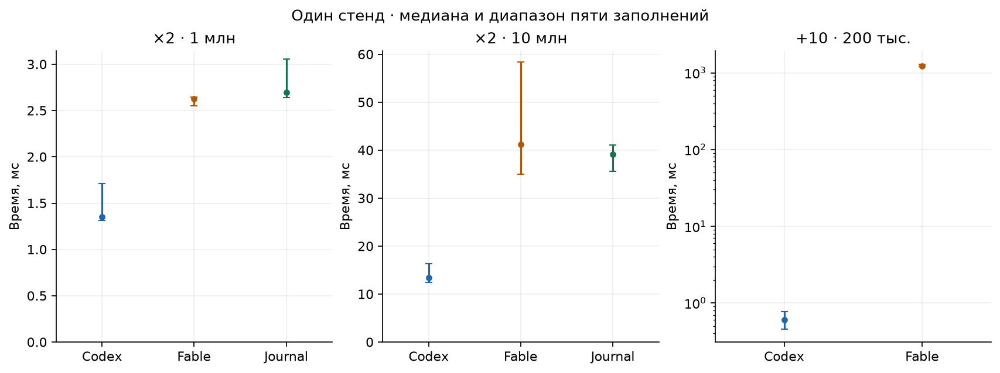

# Journal, Fable 5.2 и Codex · рецензия

**Для изучения механики копирования удобнее решение Fable. Для изучения роли аллокатора полезна пара Fable и Codex.** Обе версии соблюдают основной интерфейс лабораторной. Fable явно переносит заполненную часть массива, поэтому число копирований можно точно вывести из последовательности ёмкостей. Codex делегирует изменение блока `realloc`, и на той же последовательности ёмкостей получаются другие времена. Семинарский Journal даёт короткую исходную реализацию, на которой удобно проследить одно расширение вручную.

## Что именно сравнивалось

1. Прочитано задание «4 Лаба по subvector». Собственный контейнер, тесты и основной стенд зафиксированы до чтения чужих исходников. [Независимый коммит](https://github.com/Zawerdq/DmitrievDenis504-1/commit/955b338ae823313392bc251279f25c7d2eb5231d)
2. Затем разобраны `container.h`, `container.cpp` и `main.cpp` из `Sem8.zip`, а также версии Journal из материалов семинаров 8 и 9. В общий замер включён исходный C++ из архива. Его пример собран и запущен: напечатаны числа 0…9, конечная ёмкость 16. SHA-256 архива: `614cec7fb2a440bd92bc515f131608bbc0013d45874cdddbe3b252208a1e86bb`.
3. После семинарской версии прочитаны код, тесты, CSV, скрипт построения графиков и отчёт Fable в исходной Lab4. Затем добавлен общий стенд, расширены тесты Codex на недопустимые параметры и точную последовательность ×1,5. [Зафиксированная версия Fable](https://github.com/Zawerdq/DmitrievDenis504-1/tree/984eb4b461ab160d75e6f14db5ab7e8d48270252/Lab4)

## От учебного Journal к двум решениям

| Свойство | Journal из архива | Fable 5.2 | Codex |
|---|---|---|---|
| Что видно в коде | Одна ветка роста прямо в `add`, затем запись измерения | `push_back → grow → resize`. Можно пройти весь путь до цикла копирования | `push_back → Growth::next → resize`. Политика роста отделена от выделения |
| Что происходит с буфером | Новый `int[]`, цикл копирования, `delete[]` | Новый `int[]`, копирование живого префикса, `delete[]` | `realloc` для `int`, возможен рост по прежнему адресу, освобождение через `free` |
| Владение | Поля открыты. Глубокая копия из неконстантного объекта, присваивание запрещено | Закрытые поля, копирование запрещено, перемещение не реализовано | Закрытые поля, копирование запрещено, владение можно перемещать |
| Старт и рост | Требует начальную ёмкость, удваивает её | Пустой старт, шаг или множитель меняются сеттерами. Для ×1,5 округление вниз с минимумом +1 | Пустой старт, стратегия задаётся конструктору. Для ×1,5 округление вверх |
| При нехватке памяти | Обычный `new[]` может бросить исключение; поле ёмкости меняется до выделения | `new (std::nothrow)`, при отказе `resize` возвращает `false` | `realloc` через временный указатель, при отказе `false`, прежнее состояние сохраняется |

**Journal.** Семинар 8 в PDF вводит фиксированный журнал, закрытые поля и безопасный `get`. Семинар 9 добавляет рост с нулевой ёмкости, счётчики и обновление полей после успешного выделения. Архивный пример представляет ещё один вариант. При начальной ёмкости 0 его удвоение оставляет 0. В `get` условие допускает индекс, равный размеру, а при большем индексе отсутствует возвращаемое значение. В работе использовался корректный диапазон и начальная ёмкость 1. Эти замечания относятся к архиву.

**Fable.** Сильная сторона — связь между полем `capacity`, явным циклом копирования, счётчиками в отдельном прогоне и выводом в отчёте. Видно, откуда возникает квадратичная стоимость постоянного шага. В тестах проверяются конкретные последовательности ёмкостей и 200 000 случайных операций. При повторном запуске все 26 проверок прошли. В трёх местах решение требует оговорок:

- В `grow` нет проверки представимости результата умножения до приведения к `unsigned`. Сеттер принимает и недопустимые множители. Это замечание к диапазону входов, опубликованные замеры используют обычные конечные параметры.
- В основной функции замера игнорируется возвращаемое значение `push_back`, после чего контрольные элементы читаются по ожидаемому размеру. В корректном стенде при отказе точку следует прервать.
- Две метки в `data/std_constructors.csv` содержат запятые без кавычек. При чтении стандартным CSV-парсером эти строки дают четыре и пять полей при трёх столбцах заголовка. Числа из отчёта понятны человеку, автоматическое чтение этих двух строк нарушено.

Fable явно ограничил медленные аддитивные стратегии одним миллионом, быстрые довёл до десяти миллионов. Для дорогих точек оставлял один замер. Это позволило провести опыт с явным копированием, но точки с одним наблюдением не показывают разброс. В обзоре сохранено различие между исходными измерениями Fable на Xeon и повтором на общем стенде. [Исходный отчёт и графики](../REPORT.md)

**Codex.** Отдельный объект `Growth` проверяет параметры до запуска. Для четырёх стратегий тесты выполняют в сумме 40 000 случайных операций, сверяя с эталоном весь заполненный префикс после каждого шага. Пройдены также обычная сборка и сборка с AddressSanitizer/UndefinedBehaviorSanitizer. Методика даёт пять повторов для каждой обязательной стратегии на всём диапазоне 1–10 млн и контрольную сумму всего массива. Цена выбранного решения — более сложный код управления владением и меньшая наглядность переносов. Замена `int` на произвольный тип с конструктором и деструктором потребовала бы иной реализации. Число физических копирований внутри аллокатора этот стенд установить не может.

## Общий эксперимент

Одинаковые значения 0…N−1, тип `int`, начальная ёмкость 1, одинаковые границы таймера, GCC 15.2 с `-O2` без LTO, одна машина. Для каждой реализации собирается исходный класс с одним и тем же драйвером. Каждое заполнение запускается отдельным процессом, а время запуска процесса, контрольная сумма и сообщения деструктора исключены. Порядок перемешан в каждом из пяти раундов. Время включает особенности компоновки: у архивного Journal метод `add` вынесен в другую единицу трансляции. Основной лабораторный стенд начинает с ёмкости 0 и использует несколько стратегий в одном процессе, поэтому его числа рассматриваются отдельно.

| Режим | Codex, мс | Fable, мс | Journal, мс |
|---|---:|---:|---:|
| ×2, 1 млн | 1,35 [1,32–1,71] | 2,63 [2,55–2,64] | 2,70 [2,64–3,06] |
| ×2, 10 млн | 13,47 [12,42–16,42] | 41,19 [34,97–58,42] | 39,20 [35,64–41,06] |
| +10, 200 тыс. | 0,60 [0,46–0,77] | 1 224,39 [1 207,70–1 296,59] | Шаг +10 отсутствует |

В ячейке указана медиана, в скобках — крайние наблюдения. Удвоение на 10 млн дало пересекающиеся диапазоны у Journal и Fable. Самая заметная разница проявилась на +10. При начальной ёмкости 1 Fable переносит префиксы длины 1, 11, 21, …, 199 991 — чуть меньше двух миллиардов элементов за одно заполнение. Столько же запросов роста у Codex не обязывают аллокатор каждый раз перемещать буфер. Прямое сравнение показывает цену двух способов управления памятью для этого типа и нагрузки. По одному заданию нельзя оценить общую скорость или качество двух моделей. [Все 40 замеров и контрольные суммы](data/comparison.csv) · [Общий драйвер](compare.cpp)

## Затраты работы ИИ

| Исполнитель | Прошедшее время | Расход лимита | Что известно о границах |
|---|---:|---|---|
| Fable 5.2 | 28 мин 42 с | 40% пятичасового лимита | Время и долю сообщил пользователь. Отдельной разбивки этапов нет. |
| Codex | 14 мин 50 с | Телеметрия квоты и токенов недоступна | От первой отметки до проверки материалов перед итоговой публикацией, включая сборки, измерения и рецензию. |

Отсчёт Codex начался 15 ноября 2026 года в 16:54:25 МСК. Первый коммит самостоятельной реализации сделан в 16:58:03 МСК, через 3 мин 38 с. Итоговая отметка — 17:09:15 МСК. Это календарное время с ожиданиями инструментов. У Codex в объём работы входил отдельный сравнительный эксперимент; разность длительностей двух сессий не даёт оценки производительности моделей для одинаковой задачи.
